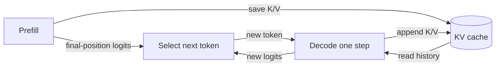

# Decoder-only: autoregressive generation

[中文](decoder-only.md) · **English**

> Reading time: ~15 min · Level: core · Last reviewed: 2026-10

When generating “It is raining,” the model needs the prefix before choosing what follows it. During training, the complete sentence is available, so predictions at several positions can be computed together. During generation, future tokens do not exist yet. This distinction explains the decoder-only structure, causal mask, and KV cache.

## Everything goes into one sequence {#everything-goes-into-one-sequence}

Put the instruction, the context, and the answer into one token sequence, block the future with a causal mask, and then have every position do exactly one thing: guess the next token. This is what I find most appealing about decoder-only: the structure ends up more uniform than encoder–decoder.

## A sequence is its own training data {#a-sequence-is-its-own-training-data}

Given a token sequence $x_1,\ldots,x_T$ (in the example below, $x_1$ is BOS):

$$
\mathcal{L}_{\text{LM}}=-\sum_{t=1}^{T-1}\log p_\theta(x_{t+1}\mid x_{\le t})
$$

Inputs and labels are the same sequence, offset by one position:

```text
input:   [BOS,   today, the,     weather, is]
target:  [today, the,   weather, is,      nice]
```

Every position supplies one unit of supervision, so large-scale unlabeled text naturally turns into training examples.

## Why the encoder can be dropped {#why-the-encoder-can-be-dropped}

Just chain the “input” and the “output” into the same sequence:

```text
[system] ... [user] question [assistant] answer
```

Answer tokens can see the prompt to their left through self-attention; prompt tokens have no need to see the future answer. The conditioning that encoder–decoder expressed with two modules is now expressed by the causal sequence itself. One difference remains: the prompt is also read causally, so an earlier prompt token cannot see a later one, whereas an encoder reads its whole input bidirectionally.

This does not mean encoders have no value. Bidirectional representations, classification, and some retrieval tasks still commonly use an encoder. The advantage of decoder-only is that **one objective unifies pre-training, conditional generation, and dialogue**.

## From messages to single-turn or multi-turn generation {#from-messages-to-single-turn-or-multi-turn-generation}

### 1. Inference: the final assistant marker is the generation boundary {#1-inference-the-final-assistant-marker-is-the-generation-boundary}

After the user submits structured messages, the application uses a
[chat template and tokenizer](tokenization.en.md) to create token IDs with role boundaries.
A typical prompt ends at the assistant-start marker:

```text
<system> You are helpful <end>
<user> How are you? <end>
<assistant>
```

The model then repeats one loop: predict the next token, append it to the context, and
predict again. Generation stops on an end-of-message or EOS token, another configured
stop condition, or a maximum-length limit.

```text
<assistant> → I → am fine → . → <end>
```

Role structure does not change the decoder equation. It makes “whose turn is next” part
of the token context while the model continues ordinary causal next-token prediction.

### 2. Multi-turn dialogue is a longer left context {#2-multi-turn-dialogue-is-a-longer-left-context}

For the second response, the sequence usually contains the system message, first user
turn, first assistant turn, second user turn, and a new assistant-start marker. Standard full causal attention can read earlier tokens that remain in context and are not masked; sliding-window variants have narrower visibility. This lets the response use earlier dialogue.

This is not permanent memory independent of context. History must remain in the logical prefix: either supply its tokens again or reuse a matching KV cache and pass only uncached new tokens. History absent from both cannot be read. When the sequence exceeds the context window, the application must truncate, summarize, or retrieve important facts. [Caching API, Transformers v5.20.0](https://huggingface.co/docs/transformers/v5.20.0/cache_explanation)

KV cache stores already-computed K/V for the **current inference sequence** to avoid
recomputation. It does not turn one session into a cross-session knowledge base or decide
which history deserves long-term retention.

## The modern decoder block: what actually changed {#the-modern-decoder-block-what-actually-changed}

### 1. The modern block at a glance {#1-the-modern-block-at-a-glance}

A typical pre-norm decoder block can be written as

$$
\begin{gathered}
U=\operatorname{RMSNorm}(X),\\
H=X+\operatorname{Attention}(U).
\end{gathered}
$$

$$
\begin{gathered}
G=\operatorname{RMSNorm}(H),\\
Y=H+\operatorname{SwiGLU}(G).
\end{gathered}
$$

The full path is RMSNorm → Q/K/V projections → RoPE on Q and K → causal attention
→ output projection → residual addition → RMSNorm → SwiGLU → a second residual
addition. A final norm usually follows the entire stack before the vocabulary logits.

This is a common design, not a universal law. Relative to the 2017 encoder–decoder,
modern LLMs are often decoder-only, use pre-norm instead of post-norm, RMSNorm instead
of LayerNorm, RoPE instead of additive sinusoidal positions, SwiGLU instead of a ReLU
FFN, and sometimes GQA or MQA instead of standard MHA.

As of October 2026, open models show three more common changes: Qwen3 and Gemma 3 add
[QK-norm](normalization.en.md#qk-norm) on q and k; DeepSeek-V3 caches a 512-dimensional KV latent plus a separate 64-dimensional positional key with
[MLA](../deep-dives/latent-and-sparse-attention.en.md); and in [Qwen3.5-397B-A17B](https://huggingface.co/Qwen/Qwen3.5-397B-A17B) (February 2026), 45 of 60 layers are
[Gated DeltaNet](../deep-dives/gated-deltanet.en.md) layers with a fixed-size recurrent state and only 15 are
[Gated Attention](../deep-dives/gated-attention.en.md) layers, in a 3:1 pattern.

<span id="2-rope-relative-phase-in-q-and-k"></span><span id="3-pre-norm-and-rmsnorm-protecting-the-residual-stream"></span><span id="4-swiglu-content-and-a-learned-gate"></span><span id="5-mha-mqa-and-gqa-reducing-kv-width"></span><span id="6-kv-cache-trading-memory-for-historical-recomputation"></span><span id="7-flashattention-the-same-formula-with-less-memory-traffic"></span><span id="8-long-context-position-extrapolation-and-quadratic-cost-are-different-problems"></span><span id="9-moe-scaling-ffn-capacity-not-attention-heads"></span>

### 2. The other eight parts, and what each one changes {#2-the-other-eight-parts-and-what-each-one-changes}

The changes listed in the previous card sit in different parts of the block. Each row records only what the part changes and the point most often stated wrong; the derivations live in the linked notes.

| Part | What it changes | The point most often stated wrong | Where it is explained |
| --- | --- | --- | --- |
| RoPE | Rotates Q/K by position in every layer; V is not rotated | Position enters the dot product only as $n-m$, while the score still depends on content; far beyond the training length you still need RoPE scaling | [The Transformer architecture](../transformer.en.md#positional-encoding-from-sinusoids-to-rope), [RoPE and long context](../deep-dives/position-and-context.en.md) |
| Pre-norm + RMSNorm | Moves the norm into the branch; divides by the root mean square without centering or bias | The trunk keeps an identity path and the stack still ends with a final norm; using RMSNorm does not by itself make a model better | [Normalization](normalization.en.md#four-concepts-answer-first-then-go-deeper) |
| SwiGLU | Adds a gating projection to the FFN | The gate is SiLU, not a probability, and can be negative; with three matrices the hidden width is often about $\tfrac83d$ to keep the parameter budget | [FFN and gates](ffn-and-gates.en.md) |
| GQA / MQA | Several query heads share one K/V head | Heads that share K/V still attend differently because their Q differs; the saving is in the KV cache, not total parameters | [KV cache and inference cost](../deep-dives/kv-cache-and-inference.en.md) |
| KV cache | Stores past K/V; a new step computes only $q_t,k_t,v_t$ | It equals recomputing the prefix only with the same weights, prefix, positions, and visibility, and dropout off; it grows linearly with layers, length, and KV heads | [KV cache and inference cost](../deep-dives/kv-cache-and-inference.en.md) |
| FlashAttention | Tiles Q/K/V, computes block by block in on-chip GPU memory, and keeps the normalization right with online softmax | It computes the same attention, not a sparse approximation; FLOPs stay about $O(L^2)$, and the saving is memory traffic | [Attention kernels](../deep-dives/attention-kernels.en.md), [GPU memory hierarchy](../../12-infra/gpu-architecture.en.md), [CUDA tiling](../../12-infra/cuda.en.md#tiling) |
| Long context | RoPE scaling, sliding windows, sparse connectivity, or mixed local / global layers | Position extrapolation and quadratic cost are separate problems; identify the bottleneck first (below the table) | [RoPE and long context](../deep-dives/position-and-context.en.md), [MLA and sparse attention](../deep-dives/latent-and-sparse-attention.en.md) |
| MoE | Replaces the FFN with several experts; a router picks a few per token | Total parameters can far exceed those active per token; the cost is load balancing, expert capacity, and cross-device all-to-all communication; experts need not learn a nameable division of labor | [MoE](../moe/README.en.md) |

For long context, first ask which bottleneck you face:

- position distributions beyond the training length → RoPE scaling / frequency adjustment;
- quadratic computation and intermediate state of full attention → windowed / sparse connectivity or an efficient kernel;
- distant evidence cannot reach the query → global pathways, retrieval, or layer mixing.

The FFN row is where dimensions most often go wrong. This chapter writes a token as a row vector: the original FFN is $\operatorname{ReLU}(xW_1)W_2$ (bias omitted), and SwiGLU is

$$
\begin{gathered}
g=\operatorname{SiLU}(xW_{\text{gate}}),\\
u=xW_{\text{up}},\\
\operatorname{SwiGLU}(x)=(g\odot u)W_{\text{down}},
\end{gathered}
$$

with $W_{\text{gate}},W_{\text{up}}\in\mathbb R^{d\times h}$, $W_{\text{down}}\in\mathbb R^{h\times d}$, and $\operatorname{SiLU}(z)=z\sigma(z)$. The next card keeps this notation and walks through the whole block.

### 3. Walking through one modern block end to end {#10-walking-through-one-modern-block-end-to-end}

For layer-$l$ input $X_l$, first normalize and form Q, K, and V:

$$
U=\operatorname{RMSNorm}(X_l),
$$

$$
\begin{gathered}
Q=UW_Q\\
K=UW_K\\
V=UW_V.
\end{gathered}
$$

K and V may use GQA. The following attention equation is for one query head and its
associated KV head; concatenate head outputs before the output projection.
Next rotate only Q and K, then apply causal attention:

$$
\begin{gathered}
Q'=\operatorname{RoPE}(Q)\\
K'=\operatorname{RoPE}(K),
\end{gathered}
$$

$$
\begin{gathered}
S=Q'K'^\top/\sqrt{d_k},\\
A=\operatorname{softmax}(S+M_{\text{causal}}),\\
O=AV.
\end{gathered}
$$

FlashAttention can implement this step efficiently without changing the formula.
Concatenate the outputs of all $h_q$ query heads, then apply the output projection and first residual connection:

$$
\begin{gathered}
O_{\text{multi}}=\operatorname{Concat}(O_1,\ldots,O_{h_q}),\\
H=X_l+O_{\text{multi}}W_O.
\end{gathered}
$$

Then follow the second pre-norm branch:

$$
G=\operatorname{RMSNorm}(H),
$$

$$
\begin{gathered}
U_g=\operatorname{SiLU}(GW_{\text{gate}}),\\
U_u=GW_{\text{up}},\\
F=(U_g\odot U_u)W_{\text{down}}.
\end{gathered}
$$

$$
X_{l+1}=H+F.
$$

Some models replace this SwiGLU FFN with MoE. Take the embedding output as $X_0$, so layer $l=0,\ldots,N-1$ maps $X_l$ to $X_{l+1}$. After all $N$ layers:

$$
\begin{gathered}
H_{\text{final}}=\operatorname{RMSNorm}(X_N)\\
\text{logits}=H_{\text{final}}W_{\text{vocab}}.
\end{gathered}
$$

These terms therefore operate at different levels: RoPE changes positional relations
in Q/K; GQA changes KV heads; KV cache stores historical state; FlashAttention
optimizes the attention kernel; and MoE replaces the FFN.

## Prefill and decode: process the prefix, then generate step by step {#prefill-is-fast-decode-is-long}

### Prefill {#prefill}

The whole prompt is known, so all positions can be computed in parallel and each layer's K/V are saved. The first generated token is selected from the logits at the last valid prompt position in this pass.

### Decode {#decode}

Each step takes only the new token as input, queries the historical KV cache, and produces the next token. The compute per step is small, but the steps must run serially, and the phase is often limited by memory bandwidth and cache size; how the bottleneck moves as the batch grows is in [inference performance](../../12-infra/performance.en.md#decode-batching).



## Why batched generation often uses left padding {#left-padding}

Prompts of different lengths need padding to fit a rectangular tensor. Suppose one has 3 tokens and another has 5. Here `·` means padding, and the letters stand for tokens:

<figure class="worked-update worked-update--pairs" aria-label="Final-position comparison for left and right padding">
<figcaption><strong>Which position supplies the next-token logits?</strong> A common generation loop reads the final position of every row.</figcaption>
<ol>
<li><strong>Right padding</strong><br><code>A B C · ·</code><br><code>D E F G H</code><br>The shorter row ends in padding; the longer row ends in H.</li>
<li><strong>Left padding</strong><br><code>· · A B C</code><br><code>D E F G H</code><br>The rows end in C and H: the actual ends of both prefixes.</li>
</ol>
</figure>

A common decoder-only generation loop takes its next-token scores from `logits[:, -1, :]`. Left padding makes that index work for both prompts. With right padding, the shorter row instead supplies the output at a padding position, not the prediction following C.

**An attention mask does not fix the readout index.** It controls which positions attention can read; it does not change `-1` to the index of the last valid token. Hiding padding in the decoded text cannot repair a prediction already taken from the wrong position.

### Masks, positions, and readout do different jobs {#padding-controls}

| Setting | For the shorter row `· · A B C` | What it controls |
| --- | --- | --- |
| Attention mask | `[0, 0, 1, 1, 1]` | Valid tokens do not read padded K/V; causal masking is still needed |
| Position IDs | Ignore padding; number A/B/C as 0/1/2 | Give tokens the positions the model expects |
| Logits index | Last position, C | Predict after the actual prefix |
| Loss mask | Score only target positions | Exclude padding from training or evaluation loss |

A common position-ID construction is `attention_mask.cumsum(-1) - 1`, with a legal placeholder assigned to padded positions. Valid tokens then start at zero. **This is not a universal model interface:** multimodal positions, cached prefixes, and specialized serving engines may require different handling.

<details markdown="1">
<summary>Check “last position” against “last valid token” in code</summary>

This example only selects logits after a full prefill, assuming their first two dimensions match the input mask. It downloads no model and measures no generation quality. The three numbers at each position are made-up scores that are easy to inspect.

```python
import torch


def last_valid_logits(logits, attention_mask):
    if logits.ndim != 3 or attention_mask.ndim != 2:
        raise ValueError("Expected [batch, length, vocab] and [batch, length]")
    if logits.shape[:2] != attention_mask.shape or logits.shape[1] == 0:
        raise ValueError("Logits and mask must align with a nonempty sequence")
    if logits.device != attention_mask.device:
        raise ValueError("Logits and mask must be on the same device")
    if not torch.all((attention_mask == 0) | (attention_mask == 1)):
        raise ValueError("Attention mask must contain only zero and one")
    valid = attention_mask.bool()
    if not valid.any(dim=-1).all():
        raise ValueError("Every row needs a valid token")
    positions = torch.arange(logits.shape[1], device=logits.device)
    last_positions = positions.expand_as(valid).masked_fill(~valid, -1).amax(-1)
    rows = torch.arange(logits.shape[0], device=logits.device)
    return logits[rows, last_positions]


scores = torch.arange(30).reshape(2, 5, 3)
right_mask = torch.tensor([[1, 1, 1, 0, 0], [1, 1, 1, 1, 1]])
left_mask = torch.tensor([[0, 0, 1, 1, 1], [1, 1, 1, 1, 1]])
assert last_valid_logits(scores, right_mask).tolist() == [[6, 7, 8], [27, 28, 29]]
assert torch.equal(last_valid_logits(scores, left_mask), scores[:, -1, :])
```

`mask.sum(-1) - 1` works only when valid tokens are contiguous and start at position zero. A left-padded row with three valid tokens ends at index 4, not 2. This helper finds the last nonzero position instead of assuming a padding direction.

It fixes one readout, not an entire generation loop. Right-padded generation also needs correct positions, growing masks, and KV-cache handling at later steps. An API that already returns only the final step's logits does not fit this helper's contract.

</details>

Left padding is therefore **a convenient choice for a common batched generation interface**, not a requirement of every decoder-only model. Padding does not inherently break meaning. Training can often use right padding or packing without padding; causal visibility, sample boundaries, and loss masks still need to be correct. With left-padded training, check that label shifting does not accidentally train a padding position to predict the first real token.

Some models without a dedicated pad token allow EOS as padding. Supply an explicit mask: the token ID alone cannot distinguish padding from an actual EOS. Default stopping usually checks a newly generated end token rather than EOS already in the prompt; custom stopping rules need their own check.

See the [Transformers generation guide](https://huggingface.co/docs/transformers/llm_tutorial#padding-side). The [pinned implementation `536ecc0`](https://github.com/huggingface/transformers/blob/536ecc007387a50e77603bb5d92100e9b07514cc/src/transformers/generation/utils.py#L3226) reads the last position in its ordinary generation path and prepares positions from the mask. A serving engine with variable-length sequences can use a different layout and indexing scheme.

## The model gives scores; sampling decides how to choose {#the-model-gives-scores-sampling-decides-how-to-choose}

The last layer's hidden state passes through a linear layer to give a logit for every token in the vocabulary:

$$
\begin{gathered}
z_t=h_tW_{\text{vocab}}\\
p_t=\text{softmax}(z_t / \tau)
\end{gathered}
$$

- temperature $\tau>0$ adjusts how sharp the distribution is; if an API uses 0 for greedy decoding, take argmax directly rather than dividing by zero;
- top-$k$ keeps only the $k$ most probable candidates;
- top-$p$ keeps the smallest candidate set whose cumulative probability reaches the threshold;
- greedy takes the maximum at every step, which is not the same as maximizing the probability of the whole sequence.

Sampling decides how a token is chosen from the probability distribution the model provides; it does not change the model's own logits. A higher temperature does not mean the model has suddenly become more creative, only that low-probability tokens are more likely to be picked.

## How post-training acts on the same architecture {#how-post-training-acts-on-the-same-architecture}

| Stage | What the data tells the model | Common objective |
| --- | --- | --- |
| pre-training | language, knowledge, and patterns | next-token cross-entropy |
| SFT | which response should go with which input | cross-entropy on the target response tokens |
| preference learning | which of two responses is better | pairwise / policy objective |
| RL | which behavior earns higher return | trajectory-level objective (for multi-step tool use, see [training agents with RL](../../11-frontier/agentic-rl/README.en.md)) |

These stages usually leave the decoder-only backbone unchanged. What changes is the data distribution, the loss, and which positions contribute directly to that loss. Masked prompt positions can still receive gradients through attention from scored response positions.

<details markdown="1">
<summary><b>deeper</b>: why SFT often masks out the prompt tokens</summary>

A training example contains both the prompt and the response, but the goal is usually to learn “how to respond given this prompt,” not to relearn how to repeat the user's input. The loss mask therefore often keeps only the assistant response. If every assistant turn in a multi-turn conversation is trained on, the role template and the boundary tokens have to be handled precisely.

</details>

## Experiment: verify the training and generation paths {#experiment-verify-the-training-and-generation-paths}

[`../code/model.py`](../code/model.py) is a hand-written modern decoder-only model; [`../code/test_model.py`](../code/test_model.py) verifies the causal mask, RoPE, GQA, and the KV cache; [`../code/train.py`](../code/train.py) has the model learn a task that requires copying across positions.

## Self-check {#self-check}

<div class="taste-check">
  <strong>If you really understand this, you should be able to explain:</strong>
  <ol>
    <li>Why do inputs and labels only need to be offset by one token?</li>
    <li>Prefill and decode use the same model, so why are their performance characteristics completely different?</li>
    <li>Do temperature, top-k, and top-p change the model, or the way the model's distribution is read?</li>
  </ol>
</div>

## Where to read next {#where-to-read-next}

Continue with [language-model objectives and generation](../deep-dives/language-model-objective.en.md), then move on to [Post-Training](../../05-post-training/README.en.md).

## Quick learning: the complete generation path of a modern LLM {#quick-learning-the-complete-generation-path-of-a-modern-llm}

<details class="interview" markdown="1">
<summary>From messages to logits, then to KV-cached decode</summary>

**Quick memory**: a chat template lays every role out in one sequence; a causal Transformer predicts the next token at every position; prefill processes the prompt in parallel, and decode adds one token per step while reusing the KV cache.

**Interview answer**

> A decoder-only model serializes system, user, assistant, and tool messages into one context and uses causal self-attention so that every position can see itself and permitted earlier positions, but not the future. Training does next-token prediction at all positions in parallel; inference first prefills the prompt and then decodes token by token, caching each layer's historical K/V so that each step does not recompute the whole prefix.

<details markdown="1">
<summary><b>Deep dive</b>: what does the KV cache store, and why not Q?</summary>

The K/V of historical tokens are read again by every future query, so caching them means each token's K/V is computed only once, at the step where that token is added. A query is used only by the current token to issue its read; the next step produces a new query, so there is nothing to reuse across steps. The cache optimizes computation without changing attention semantics, and the incremental result must be equivalent to a full causal forward pass.

</details>
</details>
