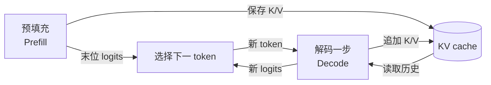

# Decoder-only：自回归生成

**中文** · [English](decoder-only.en.md)

> 阅读时间：约 15 分钟 · 难度：必修 · 最近审阅：2026-10

模型生成“今天下雨”时，要先有“今天”，才能根据这个前缀决定接下来写什么。训练时完整句子已经给定，所以多个位置的预测可以一起算；生成时后面的字还不存在，只能逐步继续。Decoder-only 的结构、causal mask 和 KV cache，都可以沿着这个区别来理解。

## 所有东西都排进同一条序列 {#_1}

把 instruction、context 和 answer 全都排进同一条 token 序列，用 causal mask 挡住未来，然后每个位置只做一件事：猜下一个 token。这就是 decoder-only 最迷人的地方——结构反而比 encoder–decoder 更统一。

## 一条序列自己就能当训练数据 {#_2}

给定 token 序列 $x_1,\ldots,x_T$（下面的例子里 $x_1$ 是 BOS）：

$$
\mathcal{L}_{\text{LM}}=-\sum_{t=1}^{T-1}\log p_\theta(x_{t+1}\mid x_{\le t})
$$

输入与标签只是错开一位：

```text
input:   [BOS, 今, 天, 天, 气]
target:  [今,  天, 天, 气, 好]
```

每个位置都提供一次监督，因此大规模无标注文本天然能构造训练样本。

## 为什么可以去掉 Encoder {#encoder}

把“输入”和“输出”串在同一条序列里即可：

```text
[system] ... [user] 问题 [assistant] 回答
```

回答 token 能通过 self-attention 看见左侧 prompt；prompt token 不需要看见未来回答。原来 encoder–decoder 用两个模块表达的条件关系，现在由这条 causal 序列自己表达。不过 prompt 内部也按 causal 方式读取：前面的 prompt token 看不到后面的 prompt token，不像 encoder 那样双向读完整段输入。

这不代表 encoder 没价值。双向表征、分类和部分检索任务仍常使用 encoder；decoder-only 的优势是**一个目标统一预训练、条件生成与对话**。

## 从 Messages 到一轮或多轮生成 {#messages}

<div class="bilingual-note bilingual-intro">
  <span>逐概念双语 · CONCEPT-BY-CONCEPT</span>
  <p>下面两张卡默认中文；点 <strong>English ↻</strong> 可在当前位置查看等价英文。</p>
</div>

<section class="concept-card" data-concept-card markdown="1">
<div class="concept-face concept-zh" data-concept-zh markdown="1">

### 1. 推理：最后一个 Assistant 标记是生成起点 {#1-assistant}

用户提交结构化 messages 后，应用先用 [chat template 与 tokenizer](tokenization.md)
生成带角色边界的 token IDs。典型 prompt 结束在 assistant 起始标记：

```text
<system> You are helpful <end>
<user> 你好吗？ <end>
<assistant>
```

然后模型重复同一循环：预测下一个 token，把它追加回上下文，再预测下一个；直到产生
end-of-message / EOS、命中其他 stop condition，或达到长度上限。

```text
<assistant> → 我 → 很好 → 。 → <end>
```

角色结构没有改变 decoder 的公式。它只是让“现在该由谁继续说”也成为 token context
的一部分；模型仍然执行 causal next-token prediction。

</div>
<div class="concept-face concept-en" data-concept-en markdown="1">

<div class="concept-title-en" role="heading" aria-level="3">1. Inference: the final assistant marker is the generation boundary</div>

After the user submits structured messages, the application uses a
[chat template and tokenizer](tokenization.md) to create token IDs with role boundaries.
A typical prompt ends at the assistant-start marker:

```text
<system> You are helpful <end>
<user> How are you? <end>
<assistant>
```

The model then repeats one loop: predict the next token, append it to the context, and
predict again. Generation stops on an end-of-message or EOS token, another configured
stop condition, or a maximum-length limit.

```text
<assistant> → I → am fine → . → <end>
```

Role structure does not change the decoder equation. It makes “whose turn is next” part
of the token context while the model continues ordinary causal next-token prediction.

</div>
</section>

<section class="concept-card" data-concept-card markdown="1">
<div class="concept-face concept-zh" data-concept-zh markdown="1">

### 2. 多轮对话只是更长的左侧上下文 {#2}

第二轮生成时，序列通常包含 system、第一轮 user、第一轮 assistant、第二轮 user，
最后再加新的 assistant 起始标记。标准 full causal attention 可以读取左侧所有未被截断、未被 mask 排除的 token；滑动窗口等变体的可见范围更小。新回答由此利用此前对话。

这不等于模型拥有脱离上下文的永久记忆。历史必须保留在当前逻辑前缀中：可以重新输入对应 token，也可以复用与该前缀匹配的 KV cache，只输入未缓存的新 token；两者都没有，模型才无法读取那段历史。如果总长度超过 context window，应用还必须截断、总结，或通过 retrieval / external memory 选回重要信息。[缓存接口说明（Transformers v5.20.0）](https://huggingface.co/docs/transformers/v5.20.0/cache_explanation)

KV cache 只缓存**本次推理序列**里已计算的 K/V，减少重复计算；它不会自动把一次会话
变成跨会话知识库，也不会替你决定哪些历史值得长期保留。

</div>
<div class="concept-face concept-en" data-concept-en markdown="1">

<div class="concept-title-en" role="heading" aria-level="3">2. Multi-turn dialogue is a longer left context</div>

For the second response, the sequence usually contains the system message, first user
turn, first assistant turn, second user turn, and a new assistant-start marker. Standard full causal attention can read earlier tokens that remain in context and are not masked; sliding-window variants have narrower visibility. This lets the response use earlier dialogue.

This is not permanent memory independent of context. History must remain in the logical prefix: either supply its tokens again or reuse a matching KV cache and pass only uncached new tokens. History absent from both cannot be read. When the sequence exceeds the context window, the application must truncate, summarize, or retrieve important facts. [Caching API, Transformers v5.20.0](https://huggingface.co/docs/transformers/v5.20.0/cache_explanation)

KV cache stores already-computed K/V for the **current inference sequence** to avoid
recomputation. It does not turn one session into a cross-session knowledge base or decide
which history deserves long-term retention.

</div>
</section>

## 现代 Decoder Block：哪些东西真的变了 {#decoder-block}

<div class="bilingual-note bilingual-intro">
  <span>逐概念双语 · CONCEPT-BY-CONCEPT</span>
  <p>下面三张卡默认中文；点 <strong>English ↻</strong> 可在当前位置查看等价英文。</p>
</div>

<section class="concept-card" data-concept-card markdown="1">
<div class="concept-face concept-zh" data-concept-zh markdown="1">

### 1. 现代 Block 的整体结构 {#1-block}

典型的 pre-norm decoder block 可以写成：

$$
\begin{gathered}
U=\operatorname{RMSNorm}(X),\\
H=X+\operatorname{Attention}(U).
\end{gathered}
$$

$$
\begin{gathered}
G=\operatorname{RMSNorm}(H),\\
Y=H+\operatorname{SwiGLU}(G).
\end{gathered}
$$

实际路径是：RMSNorm → Q/K/V projection → 对 Q/K 应用 RoPE → causal
attention → output projection → residual addition → RMSNorm → SwiGLU → 第二次
residual addition。堆完所有 block 后通常还有一次 final norm，再投影到词表 logits。

这不是所有模型的硬性标准，而是一组常见设计。与 2017 原版相比，主体从
encoder–decoder 变为 decoder-only，post-norm 常被 pre-norm 替代，LayerNorm 常被
RMSNorm 替代，正弦位置编码常被 RoPE 替代，FFN 常使用 SwiGLU，注意力头也可能从
MHA 变为 GQA 或 MQA。

截至 2026-10，开源模型里还有三类常见变化：Qwen3、Gemma 3 在 q/k 上再做一次
[QK-norm](normalization.md#qk-norm)；DeepSeek-V3 用 [MLA](../deep-dives/latent-and-sparse-attention.md)
只缓存低维 latent；[Qwen3.5-397B-A17B](https://huggingface.co/Qwen/Qwen3.5-397B-A17B)（2026-02）的 60 层里，45 层是
[Gated DeltaNet](../deep-dives/gated-deltanet.md) 这种固定大小的循环状态，只有 15 层是
[Gated Attention](../deep-dives/gated-attention.md)，按 3:1 交替。

</div>
<div class="concept-face concept-en" data-concept-en markdown="1">

<div class="concept-title-en" role="heading" aria-level="3">1. The modern block at a glance</div>

A typical pre-norm decoder block can be written as

$$
\begin{gathered}
U=\operatorname{RMSNorm}(X),\\
H=X+\operatorname{Attention}(U).
\end{gathered}
$$

$$
\begin{gathered}
G=\operatorname{RMSNorm}(H),\\
Y=H+\operatorname{SwiGLU}(G).
\end{gathered}
$$

The full path is RMSNorm → Q/K/V projections → RoPE on Q and K → causal attention
→ output projection → residual addition → RMSNorm → SwiGLU → a second residual
addition. A final norm usually follows the entire stack before the vocabulary logits.

This is a common design, not a universal law. Relative to the 2017 encoder–decoder,
modern LLMs are often decoder-only, use pre-norm instead of post-norm, RMSNorm instead
of LayerNorm, RoPE instead of additive sinusoidal positions, SwiGLU instead of a ReLU
FFN, and sometimes GQA or MQA instead of standard MHA.

As of October 2026, open models show three more common changes: Qwen3 and Gemma 3 add
[QK-norm](normalization.md#qk-norm) on q and k; DeepSeek-V3 caches only a low-dimensional latent with
[MLA](../deep-dives/latent-and-sparse-attention.md); and in [Qwen3.5-397B-A17B](https://huggingface.co/Qwen/Qwen3.5-397B-A17B) (February 2026), 45 of 60 layers are
[Gated DeltaNet](../deep-dives/gated-deltanet.md) layers with a fixed-size recurrent state and only 15 are
[Gated Attention](../deep-dives/gated-attention.md) layers, in a 3:1 pattern.

</div>
</section>

<span id="2-rope-qk"></span><span id="3-pre-norm-rmsnorm"></span><span id="4-swiglu-ffn"></span><span id="5-mhamqa-gqa-kv"></span><span id="6-kv-cache"></span><span id="7-flashattention"></span><span id="8"></span><span id="9-moe-ffn"></span>

<section class="concept-card" data-concept-card markdown="1">
<div class="concept-face concept-zh" data-concept-zh markdown="1">

### 2. 其余八个零件，各改了哪一处 {#2-parts}

上一张卡列出的变化分散在 block 的不同位置。下面每行只记它改了哪里、最容易说错的一点；推导去对应的笔记看。

| 零件 | 改了哪里 | 最容易说错的一点 | 详细讲解 |
| --- | --- | --- | --- |
| RoPE | 每层把 Q/K 按位置旋转，V 不转 | 位置只以 $n-m$ 进入点积，分数仍取决于内容；远超训练长度仍要 RoPE scaling | [Transformer 架构](../transformer.md#rope)、[RoPE 与长上下文](../deep-dives/position-and-context.md) |
| Pre-norm + RMSNorm | norm 移进分支；只除以均方根，不减均值、没有 bias | 主干留下 identity path，堆完所有 block 还要 final norm；“用了 RMSNorm”不等于模型更好 | [归一化](normalization.md#_3) |
| SwiGLU | FFN 多一个门控投影 | 门是 SiLU，不是概率，可以为负；三个矩阵时隐藏宽度常取约 $\tfrac83d$，保持参数预算 | [FFN 与门控](ffn-and-gates.md) |
| GQA / MQA | 多个 query head 共享一组 K/V head | 共享 K/V 的头仍因 Q 不同而有不同的注意力分布；省的是 KV cache，不是总参数 | [KV cache 与推理成本](../deep-dives/kv-cache-and-inference.md) |
| KV cache | 保存历史 K/V，新一步只算 $q_t,k_t,v_t$ | 权重、前缀、位置和可见范围相同且关闭 dropout 时，才与重算前缀等价；随层数、长度和 KV head 数线性增长 | [KV cache 与推理成本](../deep-dives/kv-cache-and-inference.md) |
| FlashAttention | Q/K/V 分块，在 GPU 片上存储里逐块计算，用 online softmax 维护归一化 | 算的是同一个 attention，不是稀疏近似；FLOP 仍约 $O(L^2)$，省的是显存读写 | [Attention kernel](../deep-dives/attention-kernels.md)、[GPU 内存层级](../../12-infra/gpu-architecture.md)、[CUDA tiling](../../12-infra/cuda.md#tiling) |
| 长上下文 | RoPE scaling、滑动窗口、稀疏连接或局部 / 全局混合层 | 位置外推和平方成本是两件事，先判断瓶颈（见表下） | [RoPE 与长上下文](../deep-dives/position-and-context.md)、[MLA 与稀疏注意力](../deep-dives/latent-and-sparse-attention.md) |
| MoE | 用多个专家替换 FFN，router 给每个 token 选少数几个 | 总参数可以远大于每个 token 激活的参数；代价是负载均衡、专家容量和跨设备 all-to-all 通信；专家也不一定学出能叫得出名字的分工 | [MoE](../moe/README.md) |

长上下文要先问瓶颈是哪一种：

- 训练长度外的位置分布失配 → RoPE scaling / frequency adjustment；
- 完整 attention 的平方计算与中间状态 → windowed / sparse connectivity 或高效 kernel；
- 长距离证据无法到达 → 设计全局通路、检索或层间混合。

FFN 一行最容易把维度写错。本章把 token 写成行向量：原版 FFN 是 $\operatorname{ReLU}(xW_1)W_2$（省略 bias），SwiGLU 是

$$
\begin{gathered}
g=\operatorname{SiLU}(xW_{\text{gate}}),\\
u=xW_{\text{up}},\\
\operatorname{SwiGLU}(x)=(g\odot u)W_{\text{down}},
\end{gathered}
$$

其中 $W_{\text{gate}},W_{\text{up}}\in\mathbb R^{d\times h}$，$W_{\text{down}}\in\mathbb R^{h\times d}$，$\operatorname{SiLU}(z)=z\sigma(z)$。下一张卡沿用这套写法，把整个 block 走一遍。

</div>
<div class="concept-face concept-en" data-concept-en markdown="1">

<div class="concept-title-en" role="heading" aria-level="3">2. The other eight parts, and what each one changes</div>

The changes listed in the previous card sit in different parts of the block. Each row records only what the part changes and the point most often stated wrong; the derivations live in the linked notes.

| Part | What it changes | The point most often stated wrong | Where it is explained |
| --- | --- | --- | --- |
| RoPE | Rotates Q/K by position in every layer; V is not rotated | Position enters the dot product only as $n-m$, while the score still depends on content; far beyond the training length you still need RoPE scaling | [The Transformer architecture](../transformer.md#rope), [RoPE and long context](../deep-dives/position-and-context.md) |
| Pre-norm + RMSNorm | Moves the norm into the branch; divides by the root mean square without centering or bias | The trunk keeps an identity path and the stack still ends with a final norm; using RMSNorm does not by itself make a model better | [Normalization](normalization.md#_3) |
| SwiGLU | Adds a gating projection to the FFN | The gate is SiLU, not a probability, and can be negative; with three matrices the hidden width is often about $\tfrac83d$ to keep the parameter budget | [FFN and gates](ffn-and-gates.md) |
| GQA / MQA | Several query heads share one K/V head | Heads that share K/V still attend differently because their Q differs; the saving is in the KV cache, not total parameters | [KV cache and inference cost](../deep-dives/kv-cache-and-inference.md) |
| KV cache | Stores past K/V; a new step computes only $q_t,k_t,v_t$ | It equals recomputing the prefix only with the same weights, prefix, positions, and visibility, and dropout off; it grows linearly with layers, length, and KV heads | [KV cache and inference cost](../deep-dives/kv-cache-and-inference.md) |
| FlashAttention | Tiles Q/K/V, computes block by block in on-chip GPU memory, and keeps the normalization right with online softmax | It computes the same attention, not a sparse approximation; FLOPs stay about $O(L^2)$, and the saving is memory traffic | [Attention kernels](../deep-dives/attention-kernels.md), [GPU memory hierarchy](../../12-infra/gpu-architecture.md), [CUDA tiling](../../12-infra/cuda.md#tiling) |
| Long context | RoPE scaling, sliding windows, sparse connectivity, or mixed local / global layers | Position extrapolation and quadratic cost are separate problems; identify the bottleneck first (below the table) | [RoPE and long context](../deep-dives/position-and-context.md), [MLA and sparse attention](../deep-dives/latent-and-sparse-attention.md) |
| MoE | Replaces the FFN with several experts; a router picks a few per token | Total parameters can far exceed those active per token; the cost is load balancing, expert capacity, and cross-device all-to-all communication; experts need not learn a nameable division of labor | [MoE](../moe/README.md) |

For long context, first ask which bottleneck you face:

- position distributions beyond the training length → RoPE scaling / frequency adjustment;
- quadratic computation and intermediate state of full attention → windowed / sparse connectivity or an efficient kernel;
- distant evidence cannot reach the query → global pathways, retrieval, or layer mixing.

The FFN row is where dimensions most often go wrong. This chapter writes a token as a row vector: the original FFN is $\operatorname{ReLU}(xW_1)W_2$ (bias omitted), and SwiGLU is

$$
\begin{gathered}
g=\operatorname{SiLU}(xW_{\text{gate}}),\\
u=xW_{\text{up}},\\
\operatorname{SwiGLU}(x)=(g\odot u)W_{\text{down}},
\end{gathered}
$$

with $W_{\text{gate}},W_{\text{up}}\in\mathbb R^{d\times h}$, $W_{\text{down}}\in\mathbb R^{h\times d}$, and $\operatorname{SiLU}(z)=z\sigma(z)$. The next card keeps this notation and walks through the whole block.

</div>
</section>

<section class="concept-card" data-concept-card markdown="1">
<div class="concept-face concept-zh" data-concept-zh markdown="1">

### 3. 把一个现代 Block 从头走一遍 {#10-block}

对于第 $l$ 层输入 $X_l$，先归一化并产生 Q、K、V：

$$
U=\operatorname{RMSNorm}(X_l),
$$

$$
\begin{gathered}
Q=UW_Q\\
K=UW_K\\
V=UW_V.
\end{gathered}
$$

K/V 可能使用 GQA。下面按一个 query head 及其对应的 KV head 写公式；多头结果拼接后再做输出投影。接着只旋转 Q/K，并做 causal attention：

$$
\begin{gathered}
Q'=\operatorname{RoPE}(Q)\\
K'=\operatorname{RoPE}(K),
\end{gathered}
$$

$$
\begin{gathered}
S=Q'K'^\top/\sqrt{d_k},\\
A=\operatorname{softmax}(S+M_{\text{causal}}),\\
O=AV.
\end{gathered}
$$

这一步底层可以由 FlashAttention 高效实现，但公式不变。把 $h_q$ 个 query head 的输出拼接，再做输出投影和第一次残差：

$$
\begin{gathered}
O_{\text{multi}}=\operatorname{Concat}(O_1,\ldots,O_{h_q}),\\
H=X_l+O_{\text{multi}}W_O.
\end{gathered}
$$

然后走第二条 pre-norm 分支：

$$
G=\operatorname{RMSNorm}(H),
$$

$$
\begin{gathered}
U_g=\operatorname{SiLU}(GW_{\text{gate}}),\\
U_u=GW_{\text{up}},\\
F=(U_g\odot U_u)W_{\text{down}}.
\end{gathered}
$$

$$
X_{l+1}=H+F.
$$

有些模型会把这里的 SwiGLU FFN 换成 MoE。把 embedding 输出记作 $X_0$，第 $l$ 层（$l=0,\ldots,N-1$）把 $X_l$ 变成 $X_{l+1}$；重复 $N$ 层后：

$$
\begin{gathered}
H_{\text{final}}=\operatorname{RMSNorm}(X_N)\\
\text{logits}=H_{\text{final}}W_{\text{vocab}}.
\end{gathered}
$$

因此这些名词并不在同一层面：RoPE 改 Q/K 的位置关系；GQA 改 KV heads；KV cache
保存历史状态；FlashAttention 优化 attention kernel；MoE 则替换 FFN。

</div>
<div class="concept-face concept-en" data-concept-en markdown="1">

<div class="concept-title-en" role="heading" aria-level="3">3. Walking through one modern block end to end</div>

For layer-$l$ input $X_l$, first normalize and form Q, K, and V:

$$
U=\operatorname{RMSNorm}(X_l),
$$

$$
\begin{gathered}
Q=UW_Q\\
K=UW_K\\
V=UW_V.
\end{gathered}
$$

K and V may use GQA. The following attention equation is for one query head and its
associated KV head; concatenate head outputs before the output projection.
Next rotate only Q and K, then apply causal attention:

$$
\begin{gathered}
Q'=\operatorname{RoPE}(Q)\\
K'=\operatorname{RoPE}(K),
\end{gathered}
$$

$$
\begin{gathered}
S=Q'K'^\top/\sqrt{d_k},\\
A=\operatorname{softmax}(S+M_{\text{causal}}),\\
O=AV.
\end{gathered}
$$

FlashAttention can implement this step efficiently without changing the formula.
Concatenate the outputs of all $h_q$ query heads, then apply the output projection and first residual connection:

$$
\begin{gathered}
O_{\text{multi}}=\operatorname{Concat}(O_1,\ldots,O_{h_q}),\\
H=X_l+O_{\text{multi}}W_O.
\end{gathered}
$$

Then follow the second pre-norm branch:

$$
G=\operatorname{RMSNorm}(H),
$$

$$
\begin{gathered}
U_g=\operatorname{SiLU}(GW_{\text{gate}}),\\
U_u=GW_{\text{up}},\\
F=(U_g\odot U_u)W_{\text{down}}.
\end{gathered}
$$

$$
X_{l+1}=H+F.
$$

Some models replace this SwiGLU FFN with MoE. Take the embedding output as $X_0$, so layer $l=0,\ldots,N-1$ maps $X_l$ to $X_{l+1}$. After all $N$ layers:

$$
\begin{gathered}
H_{\text{final}}=\operatorname{RMSNorm}(X_N)\\
\text{logits}=H_{\text{final}}W_{\text{vocab}}.
\end{gathered}
$$

These terms therefore operate at different levels: RoPE changes positional relations
in Q/K; GQA changes KV heads; KV cache stores historical state; FlashAttention
optimizes the attention kernel; and MoE replaces the FFN.

</div>
</section>

## Prefill 与 Decode：并行处理前缀，再逐步生成 {#prefill-decode}

### Prefill {#prefill}

整段 prompt 已知，可以并行计算所有位置，并把每层的 K/V 保存起来。生成的第一个 token，就是从这一步最后一个有效位置的 logits 中选出的。

### Decode {#decode}

每次只输入新 token，查询历史 KV cache，再产生下一个 token。每步计算量小，但各步必须串行，常受内存带宽和 cache 大小限制；batch 变大后瓶颈怎样移动，见[推理性能](../../12-infra/performance.md#decode-batching)。



## 批量生成时，为什么常用左填充？ {#left-padding}

两条 prompt 长度不同，要放进同一个矩形 tensor，就得把短的补齐。假设它们分别有 3 个和 5 个 token，`·` 表示 padding，字母只是 token 的占位符：

<figure class="worked-update worked-update--pairs" aria-label="左填充与右填充的最后位置对照">
<figcaption><strong>下一步读哪一格的 logits？</strong> 常见生成循环统一取每一行的最后一格。</figcaption>
<ol>
<li><strong>右填充（right padding）</strong><br><code>A B C · ·</code><br><code>D E F G H</code><br>短句最后一格是 padding；长句最后一格是 H。</li>
<li><strong>左填充（left padding）</strong><br><code>· · A B C</code><br><code>D E F G H</code><br>最后一格分别是 C 和 H，都是实际前缀的末尾。</li>
</ol>
</figure>

在常见的 decoder-only 生成循环里，下一 token 的分数取自 `logits[:, -1, :]`。左填充让不同长度的 prompt 都能使用这个索引。右填充时，短句会取到 padding 位置的输出，而不是 C 后面该接什么的分数。

**传了 attention mask，也不等于取对了 logits。** Mask 控制哪些位置能被 attention 读取，不负责把 `-1` 改成最后一个有效 token 的下标。把解码结果中的 padding 隐藏掉，也修不好已经取错位置的预测。

### Mask、位置编号和输出位置，各管一件事 {#padding-controls}

| 设置 | 在短句 `· · A B C` 上 | 解决什么问题 |
| --- | --- | --- |
| Attention mask | `[0, 0, 1, 1, 1]` | 有效 token 不读取 padding 的 K/V；仍需 causal mask |
| Position IDs | padding 忽略，A/B/C 编为 0/1/2 | 让 token 使用模型预期的位置编号 |
| Logits 索引 | 最后一格，即 C | 从实际前缀末尾预测下一 token |
| Loss mask | 只统计目标位置 | 训练或评估时，不把 padding 算进 loss |

一种常见的位置编号方式是 `attention_mask.cumsum(-1) - 1`，再给 padding 位置填一个合法占位值。它让有效 token 从 0 开始编号，**但不要把这行公式当作所有模型的接口约定**：多模态位置、已缓存前缀和专用推理引擎可能有各自的处理方式。

<details markdown="1">
<summary>用几行代码，检查“最后一格”和“最后一个有效 token”的区别</summary>

下面只演示一次完整 prefill 后的索引，假设 logits 的前两维和输入 mask 对齐。不下载模型，也不比较真实生成质量；每个位置的 3 个数只是便于核对的假分数。

```python
import torch


def last_valid_logits(logits, attention_mask):
    if logits.ndim != 3 or attention_mask.ndim != 2:
        raise ValueError("Expected [batch, length, vocab] and [batch, length]")
    if logits.shape[:2] != attention_mask.shape or logits.shape[1] == 0:
        raise ValueError("Logits and mask must align with a nonempty sequence")
    if logits.device != attention_mask.device:
        raise ValueError("Logits and mask must be on the same device")
    if not torch.all((attention_mask == 0) | (attention_mask == 1)):
        raise ValueError("Attention mask must contain only zero and one")
    valid = attention_mask.bool()
    if not valid.any(dim=-1).all():
        raise ValueError("Every row needs a valid token")
    positions = torch.arange(logits.shape[1], device=logits.device)
    last_positions = positions.expand_as(valid).masked_fill(~valid, -1).amax(-1)
    rows = torch.arange(logits.shape[0], device=logits.device)
    return logits[rows, last_positions]


scores = torch.arange(30).reshape(2, 5, 3)
right_mask = torch.tensor([[1, 1, 1, 0, 0], [1, 1, 1, 1, 1]])
left_mask = torch.tensor([[0, 0, 1, 1, 1], [1, 1, 1, 1, 1]])
assert last_valid_logits(scores, right_mask).tolist() == [[6, 7, 8], [27, 28, 29]]
assert torch.equal(last_valid_logits(scores, left_mask), scores[:, -1, :])
```

注意，`mask.sum(-1) - 1` 只适合有效 token 从第 0 格开始、连续排放的情况。左填充短句有 3 个有效 token，但最后一个在下标 4，不在下标 2。这里直接找最后一个非零位置，不依赖填充方向。

这个 helper 只修正一次读出。要让右填充下的完整生成也正确，还要一起处理后续 token 的位置、mask 扩展和 KV cache；已经只返回最后一步 logits 的接口，也不能套用这个函数。

</details>

所以不是“decoder-only 只能左填充”，也不是“padding 一出现，语义就被打断”。**左填充是在常见批量生成接口下，方便又不容易取错位置的选择。** 训练通常能用右填充，甚至通过 packing 去掉 padding；此时关键是 causal / sample boundary 与 loss mask 是否正确。若用左填充训练，还要检查 shift 后的首个有效标签是否意外由 padding 位置预测。

没有独立 pad token 时，有些模型允许用 EOS 充当 padding；这时尤其要显式传入 mask，因为仅看 token ID 无法分清填充值和真实 EOS。默认停止条件通常看新生成的结束 token，不是看到 prompt 左侧已有 EOS 就停；自定义停止逻辑仍需另查。

可对照 [Transformers 生成指南](https://huggingface.co/docs/transformers/llm_tutorial#padding-side)。本次核对的[固定实现 `536ecc0`](https://github.com/huggingface/transformers/blob/536ecc007387a50e77603bb5d92100e9b07514cc/src/transformers/generation/utils.py#L3226)在普通生成路径取最后一格，并按 mask 准备位置编号。专用 serving 引擎可以用变长序列和自己的索引，不必照搬这一布局。

## 模型给分数，Sampling 决定怎么选 {#sampling}

最后一层 hidden state 经过线性层得到词表上每个 token 的 logits：

$$
\begin{gathered}
z_t=h_tW_{\text{vocab}}\\
p_t=\text{softmax}(z_t / \tau)
\end{gathered}
$$

- temperature $\tau>0$ 调整分布尖锐程度；若接口用 0 表示 greedy，应直接取 argmax，不能在公式里除以 0；
- top-$k$ 只保留概率最高的 $k$ 个候选；
- top-$p$ 保留累计概率达到阈值的最小候选集合；
- greedy 每步取最大值，不等于全序列概率最大。

Sampling 决定怎样从模型给出的概率分布中选择 token，但不会改变模型本身的 logits。temperature 较高不代表模型突然获得了更强的创造力，只是低概率 token 更容易被选中。

## Post-Training 如何作用于同一架构 {#post-training}

| 阶段 | 数据告诉模型什么 | 常见目标 |
| --- | --- | --- |
| pre-training | 语言、知识与模式 | next-token cross-entropy |
| SFT | 什么输入应该对应什么回答 | 对目标回答 token 做 cross-entropy |
| preference learning | 两个回答哪个更好 | pairwise / policy objective |
| RL | 行为怎样产生更高回报 | trajectory-level objective（多步工具调用的情形见[用强化学习训练 agent](../../11-frontier/agentic-rl/README.md)） |

这些阶段通常不改变 decoder-only 的主体结构，改变的是数据分布、loss 和哪些位置直接计入 loss。Prompt 位置即使不计入 loss，也仍可能通过后续回答的 attention 路径收到梯度。

<details markdown="1">
<summary><b>进阶</b>：为什么 SFT 常把 prompt token mask 掉</summary>

训练样本包含 prompt 和 response，但目标通常是学习“在给定 prompt 下怎样回答”，而不是重新学习复述用户输入。因此 loss mask 常只保留 assistant response。若多轮对话里所有 assistant turns 都训练，需要精确处理角色模板和边界 token。

</details>

## 实验：验证训练与生成路径 {#_3}

[`../code/model.py`](../code/model.py) 是手写的现代 decoder-only；[`../code/test_model.py`](../code/test_model.py) 验证 causal mask、RoPE、GQA 和 KV cache；[`../code/train.py`](../code/train.py) 让它学习一个需要跨位置复制的任务。

## 自检 {#_4}

<div class="taste-check">
  <strong>如果真的理解了，你应该能解释：</strong>
  <ol>
    <li>为什么输入和标签只需要错开一个 token？</li>
    <li>Prefill 与 decode 使用同一模型，性能特征为什么完全不同？</li>
    <li>temperature、top-k 和 top-p 改的是模型，还是读取模型分布的方法？</li>
  </ol>
</div>

## 继续阅读 {#_5}

继续读 [语言模型目标与生成](../deep-dives/language-model-objective.md)，再接到 [Post-Training](../../05-post-training/)。

## 快速学习：现代 LLM 的完整生成路径 {#llm}

<details class="interview" markdown="1">
<summary>从 messages 到 logits，再到 KV-cached decode</summary>

**快速记忆**：Chat Template 把不同角色的消息按格式拼成一条序列，模型根据前文预测下一个 token。推理时，prefill 先并行处理 prompt，随后逐个 token 生成；历史 K/V 存进 cache，留给后续步骤复用。

**面试回答**

> Decoder-only 模型把 system、user、assistant 与工具消息序列化到同一上下文中，用 causal self-attention 保证每个位置可以看自己和允许读取的左侧位置，不能看未来。训练对所有位置并行做 next-token prediction；推理先 prefill prompt，再逐 token decode，缓存每层历史 K/V，避免每一步都把整个前缀重新算一遍。

<details markdown="1">
<summary><b>深挖</b>：KV Cache 缓存什么，为什么不缓存 Q？</summary>

历史 token 的 K/V 会被未来每个 query 重复读取，因此缓存后只需为新 token 计算一次。Query 只用于当前 token 发起读取，下一步会产生新的 query，没有跨步复用价值。KV cache 省的是重复计算，不应该改变 attention 的结果：逐步生成得到的结果，要和完整序列的 causal forward 一致。

</details>
</details>
