# Normalization: BatchNorm, LayerNorm, and RMSNorm

[中文](normalization.md) · **English**

> Reading time: ~17 min · Level: core · Last reviewed: 2026-10

Take `[1, 3]`, temporarily ignoring epsilon and learned parameters. LayerNorm subtracts the mean, 2, and divides by the standard deviation, 1, giving `[-1, 1]`. RMSNorm instead divides by the root mean square, √5, without centering. Both change scale, but they are different operations. Next we place them inside a batch of sequences and identify the reduction axes.

## The core difference: normalization axes {#the-core-difference-normalization-axes}

**BatchNorm takes its statistics across a batch of examples. LayerNorm takes them across one example's own features.**

Start with the axes, then check running statistics and train / eval modes. Together they determine behavior with variable lengths, batch size 1, and autoregressive decoding. The axis alone is not the entire implementation contract.



Each row in the figure is one feature vector. For a sequence shaped `[B,T,d]`, token-wise normalization means `LayerNorm(d)` / `RMSNorm(d)`. Passing `(T,d)` includes time as well. **Check `normalized_shape`, not just the layer's name.** Both [LayerNorm](https://docs.pytorch.org/docs/2.14/generated/torch.nn.LayerNorm.html) and [RMSNorm](https://docs.pytorch.org/docs/2.14/generated/torch.nn.RMSNorm.html) allow normalization over multiple trailing dimensions.

## Three formulas {#three-formulas}

**BatchNorm** (for each feature $j$, statistics over the batch dimension):

$$\mu_j = \frac{1}{N}\sum_{i=1}^{N} x_{ij}, \qquad \sigma_j^2 = \frac{1}{N}\sum_{i=1}^{N}(x_{ij}-\mu_j)^2$$

$$\hat{x}_{ij} = \frac{x_{ij}-\mu_j}{\sqrt{\sigma_j^2+\epsilon}}, \qquad y_{ij} = \gamma_j \hat x_{ij} + \beta_j$$

**LayerNorm** (for each example $i$, statistics over the feature dimension):

$$\mu_i = \frac{1}{d}\sum_{j=1}^{d} x_{ij}, \qquad \sigma_i^2 = \frac{1}{d}\sum_{j=1}^{d}(x_{ij}-\mu_i)^2, \qquad y_{ij} = \gamma_j\,\frac{x_{ij}-\mu_i}{\sqrt{\sigma_i^2+\epsilon}} + \beta_j$$

**RMSNorm** (root-mean-square scaling, commonly with learned gain $\gamma$ only):

$$y_{ij} = \gamma_j\,\frac{x_{ij}}{\sqrt{\frac{1}{d}\sum_{k} x_{ik}^2+\epsilon}}$$

The learned $\gamma$, and $\beta$ where present, run **per feature**, with length $d$. BatchNorm and LayerNorm differ in their reduction axes. LayerNorm and RMSNorm use the same feature axis but different statistics: variance versus the raw second moment. RMSNorm is not LayerNorm assuming that the mean is already zero.

Add 10 to the opening example: `[1, 3]` becomes `[11, 13]`. Ignoring epsilon, LayerNorm still returns `[-1, 1]`; the RMSNorm denominator changes from $\sqrt{5}$ to $\sqrt{145}$, so its output changes too. It does not remove the shift. **Pre-Norm versus Post-Norm is a separate choice** about placement, not the normalization formula. The [RMSNorm paper](https://arxiv.org/abs/1910.07467) investigates scale normalization without re-centering.

## Why can train and eval differ on the same batch? {#train-eval-statistics}

The BatchNorm formula above uses a two-dimensional input. On `[N,C,L]`, `BatchNorm1d` reduces over `N,L` per channel. By default, training uses current-input statistics and eval uses accumulated running statistics. With `track_running_stats=False`, eval uses the current input too. These are statistical state, not optimizer-trained parameters such as gamma / beta. See [PyTorch 2.14](https://docs.pytorch.org/docs/2.14/generated/torch.nn.BatchNorm1d.html) (checked October 2026).

A distribution shift is not the only possible explanation. **Even the same batch `[1,3]` can produce different outputs.** Set `eps=0`, disable affine parameters, and use `momentum=1` so the running statistics come directly from this batch:

<figure class="worked-update worked-update--pairs" id="normalization-train-eval" lang="en">
<figcaption>Same input [1, 3], different denominator</figcaption>
<ol>
<li><span>Training forward</span><strong>[-1, 1]</strong><p>The mean is 2. Squared deviations sum to 2; dividing by 2 samples gives variance 1.</p></li>
<li><span>Then switch to eval</span><strong>About [-0.707, 0.707]</strong><p>The stored variance divides by the sample count minus one, giving 2. This forward divides by √2.</p></li>
</ol>
</figure>

There are two denominators: training uses $v_b=\sum(x-\mu)^2/m$, while the running-variance update uses $v_u=\sum(x-\mu)^2/(m-1)$. Here $m$ counts the values reduced per channel. With `momentum=a`, the update is $v_{\rm run}\leftarrow(1-a)v_{\rm run}+av_u$; the mean uses the same weighting rule. This is not optimizer momentum. The [original BN paper, §3.1](https://proceedings.mlr.press/v37/ioffe15.pdf), distinguishes training statistics from inference estimates too.

<details markdown="1">
<summary>Reproduce the numbers (PyTorch 2.8 / CPU)</summary>

```python
import torch

def batchnorm_train_eval_example():
    inputs = torch.tensor([[1.0], [3.0]])
    norm = torch.nn.BatchNorm1d(1, eps=0, momentum=1, affine=False)
    training = norm(inputs)
    stored_variance = norm.running_var.clone()
    norm.eval()
    evaluation = norm(inputs)
    return training, evaluation, stored_variance

training, evaluation, stored_variance = batchnorm_train_eval_example()
print(training.flatten().tolist())
print(evaluation.flatten().tolist(), stored_variance.item())
```

Default `momentum=0.1` would mix in previous statistics, changing these numbers. Setting it to 1 isolates the difference between the variance estimators. The code was run on PyTorch 2.8 / CPU; checked against the 2.14 documentation in October 2026, these BatchNorm behaviors are unchanged.

</details>

### Gradient accumulation does not enlarge BN's batch {#batchnorm-accumulation}

A forward over `[0,2,10,12]` has mean 6. Two forwards over `[0,2]` and `[10,12]` instead use means 1 and 11. You can accumulate gradients before updating weights, but **that does not combine two completed normalizations into one**. Running statistics also update on each forward, not at `optimizer.step()`.

Starting with running mean 0 and variance 1, with `momentum=0.1`:

| Input grouping | Final running mean | Final running variance |
| --- | ---: | ---: |
| All 4 values in one forward | 0.6 | 4.3667 |
| Two forwards of 2 values each | 1.19 | 1.19 |

The first row uses sample variance $104/3$. Each microbatch in the second row has sample variance 2, but updates the state twice. Normalized activations, subsequent losses, and gradients may differ too. Matching the effective batch size therefore does not establish equivalent training with BN.

One more distinction: `torch.no_grad()` disables gradient recording; it does not switch BN modes. A training-mode module still updates running statistics. Validation commonly uses both `.eval()` and `no_grad()` because they control different behaviors. [Autograd documentation](https://docs.pytorch.org/docs/2.14/notes/autograd.html#evaluation-mode-nn-module-eval)

## Four concepts: answer first, then go deeper {#four-concepts-answer-first-then-go-deeper}

For input-feature min–max and Z-score scaling, see [preprocessing versus network normalization](../deep-dives/generalization.en.md).

<details class="interview" markdown="1">
<summary>1. Why do deep networks need normalization?</summary>

**Quick learning**

A residual network repeatedly applies

$$
x_{\ell+1}=x_\ell+f_\ell(x_\ell).
$$

If branch outputs have uncontrolled scale, residual additions let activation scale drift with depth. During backpropagation, curvature and gradient scale may also differ sharply across layers and directions. This does not mean values must monotonically explode; it means **one learning rate has trouble serving every layer and direction**.

Normalization gives each sublayer more predictably scaled inputs, reducing sensitivity to initialization and parameter scale. It often improves effective conditioning, which makes it easier to use larger learning rates and train deeper networks.

**Interview answer**

> The residual stream accumulates updates from every layer. If sublayer input scales drift, activations and gradients become harder to control and the optimization problem becomes ill-conditioned. LayerNorm or RMSNorm brings each token's sublayer input back to a predictable scale, improving gradient propagation and making deep Transformers easier to train.

<details markdown="1">
<summary><b>Deep dive</b>: residual scale, conditioning, and what “stable” means</summary>

If residual updates are temporarily treated as approximately uncorrelated,

$$
\operatorname{Var}(x_L)
\approx
\operatorname{Var}(x_0)+
\sum_{\ell=0}^{L-1}\operatorname{Var}\big(f_\ell(x_\ell)\big).
$$

This explains why residual-stream scale may grow with depth. Real networks contain correlations and adaptive weights, so it is not a theorem that variance must grow linearly. The more precise statement is: **depth creates scale drift, while normalization gives each branch a controlled input scale.**

From an optimization view, a Hessian with widely separated eigenvalues makes one learning rate unstable in high-curvature directions and slow in low-curvature ones. Normalization does not guarantee a well-conditioned global Hessian, but it reduces scale disparities between layers and usually makes gradients smoother under parameter perturbations and the effective conditioning better.

Also note that Pre-LN does not keep the residual stream $x_\ell$ itself at unit variance; it only feeds $\operatorname{Norm}(x_\ell)$ into Attn / FFN. That is why a final LN is still needed at the end to bring back the scale handed to the output head.

</details>

</details>

<details class="interview" markdown="1">
<summary>2. Why do Transformers usually avoid BatchNorm?</summary>

**Quick learning**

1. **Variable length and padding**: ordinary `BatchNorm1d` takes no padding mask, so padding enters the statistics. A custom valid-token pool for lengths `[3,1]` would contain 4 tokens. Only a separate estimate at each position has just one valid sample at the later positions.
2. **Batch-composition dependence**: during training, changing neighboring examples changes this token's output, and small batches produce noisy statistics.
3. **Train/inference mismatch**: training uses current-batch statistics, while inference normally uses running statistics. Autoregressive decoding often runs with tiny batches or batch size one, so it cannot rely on statistics computed from the batch at hand.
4. **Possible causality violation**: statistics computed across time from the current sequence let future tokens affect past outputs, bypassing the causal attention mask. Frozen running statistics do not create this path.

The usual Transformer configuration, `LayerNorm(d)`, reduces only over a token's hidden features, independently of the batch, other positions, and train/eval mode. `LayerNorm((T,d))` does not: changing the last token can change the first token's output.

**Interview answer**

> Transformers typically use LN over each token's hidden dimension, with the same normalization in training and inference. BN requires handling batch composition, padding, and running statistics; computing statistics across the current sequence also reads future positions. The axes and mode matter, not just the layer's name.

<details markdown="1">
<summary><b>Deep dive</b>: when does BatchNorm really leak the future?</summary>

The answer depends on tensor layout and reduction axes; “BatchNorm always leaks” is too broad.

- For $X\in\mathbb R^{B\times T\times d}$, a separate normalization at every position $t$ that reduces only over $B$ does not directly read future tokens from the same sequence. It still depends on other batch members, and each position may have a different valid sample count.
- A common sequence training forward of <code>BatchNorm1d</code> computes current-input statistics over both $B$ and $T$ per channel. Then $\mu_j$ and $\sigma_j$ include tokens with $t'>t$. The normalized result at position $t$ already contains future information; causal attention masking cannot block this separate path.
- Flattening $B\times T$ before computing current-input BN statistics has the same problem.

The precise conclusion is:

> **Computing statistics across the current sequence makes earlier positions depend on future ones. Eval with fixed running statistics does not. BN still requires care with train/eval differences, batch composition, and padding.**

Batch size one does not mean BatchNorm must fail at inference: eval mode can use running statistics. The deeper issue is that those statistics came from the training distribution rather than the current token, and training and inference execute different functions.

</details>

</details>

<details class="interview" markdown="1">
<summary>3. Where do Pre-LN and Post-LN go, and why is Pre-LN more stable?</summary>

**Write the structure first**

<pre><code>Post-LN (2017 original)          Pre-LN (common today)
x = LN(x + Attn(x))             x = x + Attn(LN(x))
x = LN(x + FFN(x))              x = x + FFN(LN(x))
                                 ...
                                 x = LN(x)   ← final LN</code></pre>

**Interview answer**

> Post-LN places LayerNorm after residual addition, so the main-path gradient crosses an LN in every block. Pre-LN moves the LN into the branch and leaves a direct identity path in the residual stream. Every block Jacobian therefore contains an explicit identity term, making deep gradient propagation more stable. The trade-off is that the residual stream is not normalized after every addition, so standard Pre-LN uses a final LN after all blocks.

<details markdown="1">
<summary><b>Deep dive</b>: the identity path in the Jacobian</summary>

Ignoring the multi-branch details, Post-LN is

$$
x_{\ell+1}=\operatorname{LN}\big(x_\ell+f_\ell(x_\ell)\big),
$$

with Jacobian

$$
\frac{\partial x_{\ell+1}}{\partial x_\ell}
=
J_{\operatorname{LN}}\big(I+J_{f_\ell}\big).
$$

Across many layers, the gradient repeatedly multiplies by $J_{\operatorname{LN}}$. This does not imply that every layer necessarily shrinks the gradient, but it interrupts a pure identity highway and makes training more sensitive to initialization, residual scaling, and learning-rate warmup.

Pre-LN is

$$
x_{\ell+1}=x_\ell+f_\ell\big(\operatorname{LN}(x_\ell)\big),
$$

so

$$
\frac{\partial x_{\ell+1}}{\partial x_\ell}
=
I+J_{f_\ell}J_{\operatorname{LN}}.
$$

Even when the branch contribution is small, $I$ remains a direct gradient path. The more careful claim is that Pre-LN **significantly reduces** the dependence of deep training on warmup; it does not guarantee that every configuration needs no warmup at all. [Xiong et al. (2020)](https://arxiv.org/abs/2002.04745) used mean-field analysis to show that, at initialization, Post-LN has large expected gradients for parameters near the output layer, which warmup keeps from causing overly large early updates; Pre-LN gradients are well behaved at initialization, and their experiments trained it without warmup. That holds in the paper's setting; it is not a theorem that every configuration must, or need not, use warmup.

Pre-LN has its own trade-off. Residual-stream scale can grow, and later-layer updates may become small relative to the main stream, reducing effective depth. Final LN repairs the output scale, not every expressivity issue.

</details>

</details>

<details class="interview" markdown="1">
<summary>4. Why can RMSNorm work with re-scaling alone?</summary>

**Quick learning**

LayerNorm performs both

$$
x\longmapsto x-\mu
\quad\text{(re-centering)},
\qquad
x\longmapsto \frac{x}{\sqrt{\operatorname{Var}(x)+\epsilon}}
\quad\text{(re-scaling)}.
$$

RMSNorm removes mean subtraction, usually omits $\beta$, and keeps

$$
x\longmapsto
\frac{x}{\sqrt{\frac{1}{d}\sum_jx_j^2+\epsilon}}\odot\gamma.
$$

Its success in modern LLMs suggests that controlling vector magnitude and sublayer input scale often matters more than forcing every token's feature mean to zero.

**Interview answer**

> RMSNorm keeps LayerNorm's scale control and learned gain, but removes mean subtraction and bias. It eliminates a mean reduction, simplifying computation and communication. In practice it often retains similar quality, suggesting that re-scaling is usually more important than re-centering.

<details markdown="1">
<summary><b>Deep dive</b>: does RMSNorm prove that the mean never matters?</summary>

No. Its success is strong empirical evidence, not a mathematical proof. LayerNorm divides by the standard deviation,

$$
\sqrt{\frac{1}{d}\sum_j(x_j-\mu)^2+\epsilon},
$$

while RMSNorm divides by the square root of the second moment plus epsilon,

$$
\sqrt{\frac{1}{d}\sum_jx_j^2+\epsilon}.
$$

“Small mean” must be relative to the vector's scale. Since $\mathbb E[x^2]=\operatorname{Var}(x)+\mu^2$, the denominators are close only when $\mu^2\ll\operatorname{Var}(x)+\epsilon$. The outputs also differ by the centering step.

For example, `[0.000001,0.000003]` has a small absolute mean. Ignoring epsilon, LN still gives `[-1,1]`, whereas RMSNorm gives about `[0.447,1.342]`. Scaling the whole input down does not remove the difference. The formulas coincide at exactly zero mean with matching epsilon and affine settings. How a model adapts to a nonzero mean remains a training and architecture question; these equations alone do not establish model quality.

RMSNorm's engineering gain is one fewer mean reduction and less associated synchronization and memory traffic. Implementations normally accumulate sums of squares in fp32 to avoid bf16 or fp16 numerical error.

</details>

</details>

## Where modern LLMs add more norms: QK-norm and pre + post norm {#qk-norm}

Pre-LN controls the $x$ that enters each sublayer, but attention has another quantity that can grow on its own: the logit $q\cdot k/\sqrt{d_k}$. The input $x$ is normalized, yet the lengths of $q=xW_Q$ and $k=xW_K$ still follow the projection weights.

Take a small example. Only score gaps matter here, so leave out the constant $\sqrt{d_k}$. With $q=[2,1]$ and keys $[1,0]$ and $[0,1]$, the scores are 2 and 1 and the softmax is about `[0.731, 0.269]`. If training scales $W_Q$ and $W_K$ each by 3, then $q=[6,3]$, the keys become $[3,0]$ and $[0,3]$, and the scores are 18 and 9. The gap grows from 1 to 9 and the softmax is about `[0.99988, 0.00012]`: nearly one-hot, so the gradient back through the softmax to the scores becomes small (derivation in [multi-head attention](multi-head-attention.en.md#why-divide-by-sqrtd_k)). [ViT-22B](https://arxiv.org/abs/2302.05442) reported exactly this: attention logits became extremely large, attention entropy fell to near zero, and the loss diverged after a few thousand steps.

**QK-norm** applies RMSNorm to each head's $q$ and $k$ before the dot product, each with its own learnable gain:

$$
\hat q=\operatorname{RMSNorm}(q),\qquad
\hat k=\operatorname{RMSNorm}(k),\qquad
s=\frac{\hat q\cdot\hat k}{\sqrt{d_k}}.
$$

As shown above, RMSNorm ignores an overall scale when epsilon is ignored: $[6,3]$ and $[2,1]$ normalize to the same vector, so scaling the weights by 3 no longer changes the score. With unit gain, $\|\hat q\|=\|\hat k\|=\sqrt{d_k}$, so $|s|\le\sqrt{d_k}$; for $d_k=128$ the bound is about 11.3. Normalization removes growth caused by uniformly scaling the projection norms. The directions of q and k can still become more aligned and raise a score with fixed gains; learned gains can change the bound as well. Neither effect is guaranteed to happen slowly. RoPE is a rotation and preserves length, so the bound does not depend on whether the norm comes before or after RoPE; [Gemma 3's Transformers implementation](https://github.com/huggingface/transformers/blob/main/src/transformers/models/gemma3/modeling_gemma3.py) applies it before.

The [Qwen3 technical report](https://arxiv.org/abs/2505.09388) says it removed Qwen2's QKV bias and introduced QK-Norm for stable training; the [Gemma 3 technical report](https://arxiv.org/abs/2503.19786) §2 replaced Gemma 2's soft-capping with QK-norm. Soft-capping squeezes a score into $(-c,c)$ with $c\tanh(s/c)$ after the fact; QK-norm limits the lengths of $q$ and $k$ at the source.

**Norm before and after.** Gemma 3 puts an RMSNorm both before and after each sublayer:

$$
h=x+\operatorname{Norm}_{\text{post}}\big(\operatorname{Attn}(\operatorname{Norm}_{\text{pre}}(x))\big),
$$

and the FFN does the same. This post-norm acts only on the **branch output**; nothing normalizes the sum after it is added back, so the trunk keeps the Pre-LN identity path above. It shares a name with the 2017 Post-LN, which normalizes the whole residual sum, but sits in a different place. One way to read it is as a limit on how large an update each sublayer writes into the residual stream.

## How to choose a normalization method {#how-to-choose-a-normalization-method}

| Situation | Use | Why |
| --- | --- | --- |
| CNN classification, sufficient statistical samples | **BatchNorm** is a common baseline | Per-channel samples include spatial positions, not just batch members |
| Autoregressive Transformers | Commonly **LayerNorm / RMSNorm** | Token-wise feature statistics do not mix future positions or other samples |
| RNN / LSTM | Compare **LayerNorm** | Normalize within a timestep; placement relative to gates still matters |
| Small-batch detection or segmentation | Compare **GroupNorm / LayerNorm** | No batch statistics, but groups and axes must fit the architecture |
| RL and online learning | **LayerNorm** can be a baseline | No running batch mean; distribution shift does not rule out BatchNorm in every RL method |
| Objectives that disallow cross-sample coupling | Use within-sample statistics | Choose LN, GN, or another method from the objective's constraints, not the task name alone |

One rule: **whenever "the same input must produce the same output in different batches" is a hard requirement, do not let normalization use batch statistics.**

Modern LLMs often use RMSNorm. Removing mean centering can simplify computation, but actual speed and synchronization depend on kernel fusion and tensor partitioning, not just the number of sums in the formula.

<details markdown="1">
<summary><b>Supplement</b>: why internal covariate shift is not the full explanation</summary>

The original paper argued it reduces internal covariate shift. [How Does Batch Normalization Help Optimization?](https://arxiv.org/abs/1805.11604) later undercut that: injecting distribution noise *after* BN leaves training just as fast and stable.

The safer account is that normalization reduces sensitivity to parameter scale and often makes the loss landscape and gradients smoother. This is not an unconditional guarantee on the global condition number of every network.

A useful property needs its conditions: ignoring epsilon, with nonzero statistics recomputed from the current input and $\alpha>0$, $\text{Norm}(\alpha Wx)=\text{Norm}(Wx)$. This is invariance to positive uniform input scaling, not arbitrary weight changes. BatchNorm evaluation with fixed running statistics does not meet that condition. Epsilon generally makes it approximate. Whether the normalization gain $\gamma$ receives weight decay is a separate optimization decision, not a consequence of this identity.

</details>

## Verify it {#verify-it}

[`../code/norm_compare.py`](../code/norm_compare.py) compares reduction axes and three distinct cases: BatchNorm training on `[1,C]` raises an error; evaluation with running statistics works; training on `[1,C,L]` also works when `L>1`, but its statistics span time. These are not all the same “small-batch problem.”

The figure is generated by [`../code/make_norm_figures.py`](../code/make_norm_figures.py).

## Self-check {#self-check}

<div class="taste-check">
  <strong>You understand this if you can explain:</strong>
  <ol>
    <li>For activations shaped $B\times T\times d$, which axis does LayerNorm reduce over?</li>
    <li>Why is “BatchNorm always leaks the future” too broad? Which implementation really leaks?</li>
    <li>Write Pre-LN and Post-LN and locate the final LN.</li>
    <li>Why does the Pre-LN Jacobian contain an identity path?</li>
    <li>What does RMSNorm remove, and does its success prove re-centering never matters?</li>
  </ol>
</div>

## Next {#next}

Normalization keeps each layer's input scale under control; trainable depth also needs [residual connections](residual-connections.en.md). Once you have read both, continue to [FFN and SwiGLU](ffn-and-gates.en.md), then assemble the pieces in the [vanilla Transformer](vanilla-transformer.en.md).

## The 30-second mental model {#the-30-second-mental-model}

| Concept | One-line memory | Interview keywords |
| --- | --- | --- |
| Why normalize? | Give each sublayer predictably scaled inputs and reduce sensitivity to parameter scale | stable activations · conditioning · larger learning rate |
| Why not BatchNorm? | One token should not depend on other batch members or future positions | variable length · padding · train/eval mismatch · causality |
| Pre-LN vs Post-LN | Pre-LN moves Norm off the residual highway, preserving an identity gradient path | $I+J_fJ_{\mathrm{LN}}$ · final LN |
| RMSNorm | Keep re-scaling and drop re-centering | RMS only · no mean subtraction · cheaper reduction |

> **Normalization is not about keeping every representation permanently at mean zero and variance one. It is about controlling the numerical scale fed into each sublayer and making a deep network easier to optimize.**
