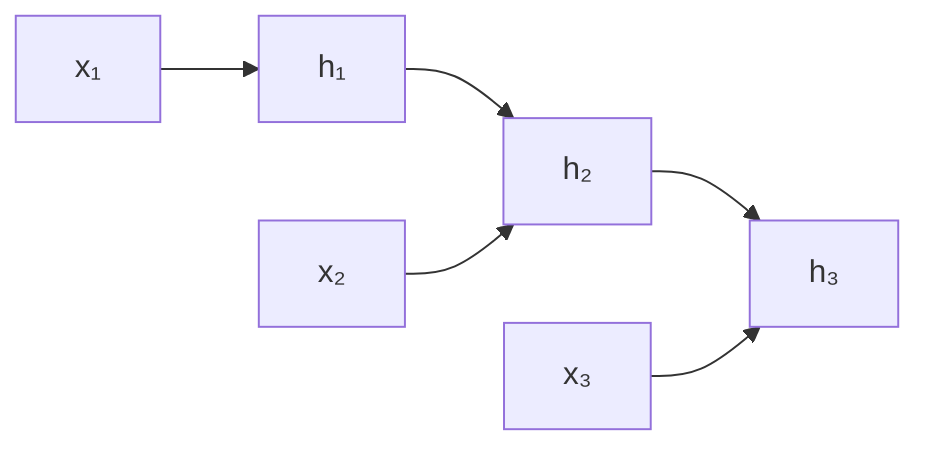

# RNN and LSTM

[中文](recurrent-models.md) · **English**

> Reading time: ~10 min · Last reviewed: 2026-10

In “It is raining; remember your umbrella,” the final word depends on earlier information. An RNN updates a hidden state as it reads each position. An LSTM adds controls for keeping, writing, and reading its state. First we follow the information forward, then examine why learning long dependencies is difficult. **An RNN squeezes all history into one fixed-size state and updates it step by step; LSTM gates make that state easier to keep, but the computation is still serial and the capacity still fixed.**

## How the hidden state carries information {#how-the-hidden-state-carries-information}

An RNN updates a fixed-size hidden state rather than storing every token it has read. An LSTM maintains two vectors: a cell state for memory and a hidden state used for the current output and the next step's gates. Keeping these states separate makes the gate equations easier to follow.

## The state update of a vanilla RNN {#the-state-update-of-a-vanilla-rnn}

$$h_t = \tanh(W_x x_t + W_h h_{t-1} + b), \qquad y_t = W_y h_t$$

Each step receives only the current token vector $x_t$ and the previous state $h_{t-1}$. The parameters are shared across all time steps, which is why it can handle sequences of different lengths.



“Recurrent” does not mean the graph really contains an infinite loop; it means the same cell is unrolled $T$ times along time.

## Why early information gradually disappears {#why-early-information-gradually-disappears}

During training, gradients to earlier states pass through a sequence of Jacobians: the derivative matrices $\partial h_t/\partial h_{t-1}$ of each state with respect to the previous one. The weights are shared, but each Jacobian also depends on the current inputs, hidden state, and tanh derivative. Repeated contraction along a direction can shrink the gradient toward zero; repeated expansion can make it explode. Gating changes this propagation path rather than merely adding parameters.

Start with a one-dimensional RNN to see the scale: $h_t=\tanh(w\,h_{t-1}+u\,x_t)$ with $w=0.9$, and assume the state stays near $h_t\approx0.5$. Each step's derivative is $w\,(1-h_t^2)=0.9\times0.75=0.675$. Ten steps apart, the product is about $0.675^{10}\approx0.020$; fifty steps apart, only about $2.9\times10^{-9}$. Each step shrinks the signal by only a third, yet after 50 steps almost nothing gets back. Treating every step as the same number is only for seeing the scale of the product; in a real network each step's Jacobian differs and is a matrix. The derivation is in [BPTT and gates](../deep-dives/recurrent-dynamics.en.md).

So this is not just a matter of “a few more parameters would fix it.” The real trouble is that **both information and gradients have to cross the same narrow state path over and over**; the farther apart two positions are, the more easily something is lost on the way.

## LSTM manages information with gates {#lstm-manages-information-with-gates}

An LSTM splits the state into a short-term output $h_t$ and a more direct memory path $c_t$:

$$f_t = \sigma(W_f[x_t;h_{t-1}] + b_f), \qquad i_t = \sigma(W_i[x_t;h_{t-1}] + b_i)$$

$$\tilde c_t = \tanh(W_c[x_t;h_{t-1}] + b_c), \qquad c_t = f_t \odot c_{t-1} + i_t \odot \tilde c_t$$

$$o_t = \sigma(W_o[x_t;h_{t-1}] + b_o), \qquad h_t = o_t \odot \tanh(c_t)$$

- forget gate $f_t$: how much of the old memory is kept;
- input gate $i_t$: how much of the new candidate is written;
- output gate $o_t$: how much of the current memory is exposed.

The important part is the additive path inside $c_t$. A forget gate near 1 causes less attenuation along this direct path. New writes can still change the state, and other gradient paths remain, so this does not guarantee successful long-range learning.

Continue the numbers from the previous section. With the gates held fixed, each step along this direct cell-state path multiplies by the forget gate (derived in the deep dive at the end). The table counts only this one path, with hand-set gate values:

| Factor per step | 10 steps apart | 50 steps apart |
| --- | ---: | ---: |
| Vanilla RNN, about 0.675 | 0.020 | $2.9\times10^{-9}$ |
| LSTM, forget = 0.9 | 0.35 | 0.0052 |
| LSTM, forget = 0.99 | 0.90 | 0.61 |

A forget gate of 0.9 still leaves only half a percent after 50 steps; for gradients to travel far, the forget gate has to learn values very close to 1. Having gates is not the same as remembering; it depends on what training makes of them.

### Trace the three gates with one number {#gate-example}

Take one component of the cell state, initially 0.8. These gate values are chosen for arithmetic, not measured in a trained model.

<figure class="worked-update" id="gate-trace" lang="en">
<figcaption>Keeping, writing, and reading are separate operations</figcaption>
<ol>
<li><b>Keep the old value</b><span>forget = 0.9 retains 0.9 × 0.8 = 0.72.</span></li>
<li><b>Write the candidate</b><span>input = 0.2 and candidate = −0.5 add −0.1, giving cell = 0.62.</span></li>
<li><b>Read the output</b><span>output = 0.5 gives hidden = 0.5 × tanh(0.62) ≈ 0.276.</span></li>
</ol>
</figure>

A small output gate does not erase the cell state. A forget gate near 1 does not stop new writes. Substituting numbers helps distinguish what each gate actually controls.

## What limits does an LSTM still have? {#what-limits-does-an-lstm-still-have}

1. **No parallelism over time**: $h_t$ depends on $h_{t-1}$.
2. **Single-state bottleneck**: the information in a long sequence keeps being squeezed into a fixed-size vector.
3. **Paths are too long**: for the first token to influence the last one takes $T$ updates.

An LSTM mitigates forgetting, but it does not eliminate the sequential computation and the fixed-state bottleneck that come with recurrence.

<details markdown="1">
<summary><b>Deeper</b>: when an RNN / LSTM is still worth using</summary>

For streaming sensors, very small edge models, and tasks whose state space is small and which must be updated online one step at a time, a recurrent state can still be cheaper than keeping the full context. The choice of architecture depends on the workload; it is not a simple ranking of new over old.

Fixed-size recurrent state has also returned to large models: as of October 2026, 45 of the 60 layers in [Qwen3.5-397B-A17B](https://huggingface.co/Qwen/Qwen3.5-397B-A17B) are [Gated DeltaNet](../deep-dives/gated-deltanet.en.md) layers, which update a matrix state in a form that trains in parallel; the RSSM in the world model [Dreamer](../../11-frontier/world-models/dreamer.en.md) is a recurrent network as well. They change how the state is written and forgotten; they are not a return to LSTMs trained serially token by token.

</details>

## Experiment: verify long-range dependencies {#experiment-verify-long-range-dependencies}

[`../code/sequence_numpy.py`](../code/sequence_numpy.py) unrolls the RNN and LSTM forward computation in NumPy; [`../code/sequence_torch.py`](../code/sequence_torch.py) has both learn a delayed-copy task and compares their error under long dependencies.

For input `[3, 8, 2, 5, 1]` and delay = 2, predictions from the third position onward target `[3, 8, 2]`: each target is two positions back, not the current input. From the repository root, run:

```bash
python 00-foundations/code/sequence_torch.py --task delay --model rnn --delay 8 --length 96
python 00-foundations/code/sequence_torch.py --task delay --model lstm --delay 8 --length 96
```

Then change delay to 64 while keeping length = 96; require `0 < delay < length`. The script prints training-batch metrics, not validation results. Equal hidden widths also give these cells different parameter counts. Treat this as a way to inspect training behavior, not an architecture ranking from one run. A generalization comparison needs fixed evaluation data, parameter and training-budget accounting, and multiple seeds.

## Self-check {#self-check}

<div class="taste-check">
  <strong>If you really understand this, you should be able to explain:</strong>
  <ol>
    <li>Why does adding parameters or stacking more RNN layers not automatically solve long-term memory?</li>
    <li>Why does the LSTM cell state pass gradients more easily than a plain hidden state?</li>
    <li>An LSTM mitigates forgetting, so why is it still unsuited to large-scale parallel training?</li>
  </ol>
</div>

## Next {#next}

An RNN can read a sequence, but how do we turn an input sequence into an output sequence of a different length? Continue to [Seq2Seq](seq2seq.en.md).

## Quick learning: what do RNNs and LSTMs actually solve? {#quick-learning-what-do-rnns-and-lstms-actually-solve}

<details class="interview" markdown="1">
<summary>Remember the state recurrence first, then see why gradients vanish</summary>

**Quick memory**: an RNN compresses history into one hidden state, updated by the same rule at every step. An LSTM uses an additive cell-state path and sigmoid gates to control what is kept, written, and read.

**Interview answer**

> A vanilla RNN propagates gradients through a sequence of state-dependent Jacobians: weights are shared, but activations change. Their product can attenuate or amplify long-range signals. An LSTM adds a gated, additive memory path that makes gradient propagation along the cell state easier.

<details markdown="1">
<summary><b>Deep dive</b>: why are the gates themselves not the whole answer?</summary>

Sigmoids saturate too. What really matters in an LSTM is

$$
c_t=f_t\odot c_{t-1}+i_t\odot\tilde c_t,
\qquad
\left.\frac{\partial c_t}{\partial c_{t-1}}\right|_{\text{fixed gates}}=\operatorname{diag}(f_t).
$$

This is the direct cell-state path with gates held fixed, not the total network derivative. A forget gate near one helps preserve gradients along this path; the gates still depend on history, and long-range learning is not guaranteed. For GRU gate conventions and implementation differences, continue to [BPTT and gates](../deep-dives/recurrent-dynamics.en.md).

</details>
</details>
