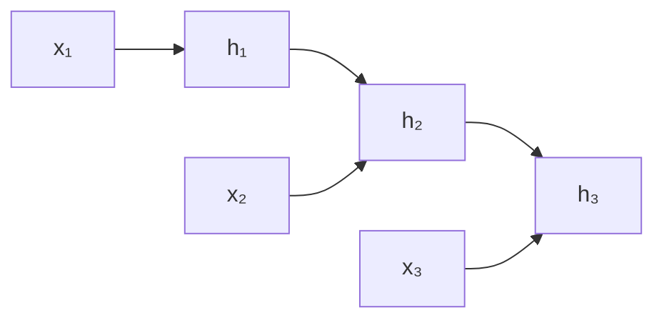

# RNN 与 LSTM

**中文** · [English](recurrent-models.en.md)

> 阅读时间：约 10 分钟 · 难度：必修 · 最近审阅：2026-10

读“今天下雨，出门记得带伞”时，读到“带伞”需要用到前面的“下雨”。RNN 每读一个位置，就把新输入和旧状态合起来更新；LSTM 再给这份状态增加保留、写入和读出的控制。先看信息怎么往后传，再看为什么传得太远会难学。**RNN 把全部历史压进一个固定大小的状态，一步步更新；LSTM 的门让这份状态更容易保留，但计算仍是串行的，容量也仍然有限。**

## 隐藏状态怎样传递信息 {#_1}

RNN 不会把读过的 token 全部存下来，而是不断更新一个固定长度的隐藏状态。LSTM 则维护两个向量：cell state 保存记忆，hidden state 参与当前输出和下一步的门控。先分清这两个状态，再看门值怎样影响它们。

## 普通 RNN 的状态更新 {#rnn}

$$h_t = \tanh(W_x x_t + W_h h_{t-1} + b), \qquad y_t = W_y h_t$$

每一步只接收当前 token 向量 $x_t$ 和上一步状态 $h_{t-1}$。参数在所有时间步共享，所以它能处理不同长度的序列。



“循环”说的是同一个 cell 沿时间展开了 $T$ 次，图里并没有一条真的无限环。

## 为什么早期信息会逐渐消失 {#_2}

训练时，早期状态收到的梯度要经过一串 Jacobian，也就是每一步状态对上一步状态的导数矩阵 $\partial h_t/\partial h_{t-1}$。共享的是权重，不是每步的 Jacobian：输入与隐藏状态不同，tanh 的导数也会变。若沿某个方向持续缩小，连乘后梯度可能接近 0；持续放大则可能爆炸。下一节的门控是在改善这条传播路径，不是简单增加参数。

先用一维 RNN 看量级：$h_t=\tanh(w\,h_{t-1}+u\,x_t)$，取 $w=0.9$，并假设状态一直停在 $h_t\approx0.5$ 附近。每一步的导数是 $w\,(1-h_t^2)=0.9\times0.75=0.675$。隔 10 步，连乘约 $0.675^{10}\approx0.020$；隔 50 步只剩约 $2.9\times10^{-9}$。每步只缩小三分之一，50 步后几乎什么也传不回去。这里把每一步当成同一个数，只为看清连乘的量级；真实网络里每步的 Jacobian 都不同，而且是矩阵，推导见 [BPTT 与门控](../deep-dives/recurrent-dynamics.md)。

所以这不只是“参数再多一点就好了”。真正麻烦的是，**信息和梯度都得反复穿过同一条很窄的状态通路**；离得越远，越容易在路上丢掉。

## LSTM 用门控管理信息 {#lstm}

LSTM 把状态拆成短期输出 $h_t$ 和更直接的记忆通路 $c_t$：

$$f_t = \sigma(W_f[x_t;h_{t-1}] + b_f), \qquad i_t = \sigma(W_i[x_t;h_{t-1}] + b_i)$$

$$\tilde c_t = \tanh(W_c[x_t;h_{t-1}] + b_c), \qquad c_t = f_t \odot c_{t-1} + i_t \odot \tilde c_t$$

$$o_t = \sigma(W_o[x_t;h_{t-1}] + b_o), \qquad h_t = o_t \odot \tanh(c_t)$$

- forget gate $f_t$：旧记忆保留多少；
- input gate $i_t$：新候选写入多少；
- output gate $o_t$：当前记忆有多少读出到 $h_t$。

最关键的是 $c_t$ 里有一条加法路径。$f_t$ 接近 1 时，旧状态在这条直接通路上衰减较少；但新写入仍会改变状态，其他梯度路径也仍然存在，不能据此保证长距离学习成功。

接着上一节的数算一次。固定门值时，沿 cell state 这条直接通路每步乘的就是 forget gate（推导在文末“深挖”）。下表只算这一条通路，门值是手设的：

| 每步乘的数 | 隔 10 步 | 隔 50 步 |
| --- | ---: | ---: |
| 普通 RNN，约 0.675 | 0.020 | $2.9\times10^{-9}$ |
| LSTM，forget = 0.9 | 0.35 | 0.0052 |
| LSTM，forget = 0.99 | 0.90 | 0.61 |

门值 0.9 撑 50 步也只剩千分之五；要让梯度走远，forget gate 得学到很接近 1。所以“有门”不等于“记得住”，还要看训练把门学成什么样。

### 用一个数看三扇门 {#gate-example}

先只看 cell state 的一个分量，假设旧值是 0.8。下面的门值是为了手算而设定的，不是训练结果。

<figure class="worked-update" id="gate-trace" lang="zh-CN">
<figcaption>保留、写入、读出是三件事</figcaption>
<ol>
<li><b>保留旧值</b><span>forget = 0.9，留下 0.9 × 0.8 = 0.72。</span></li>
<li><b>写入新值</b><span>input = 0.2，candidate = −0.5；加上 −0.1 后，cell = 0.62。</span></li>
<li><b>决定输出</b><span>output = 0.5，hidden = 0.5 × tanh(0.62) ≈ 0.276。</span></li>
</ol>
</figure>

把 output gate 关小，不等于把 cell state 清空；把 forget gate 开到接近 1，也不等于不再写入。三扇门分别控制哪一步，代入数字后就比较好分清了。

## LSTM 仍然有哪些限制 {#lstm_1}

1. **无法在时间维并行**：$h_t$ 依赖 $h_{t-1}$。
2. **单状态瓶颈**：长序列的信息持续挤进固定大小的向量。
3. **路径太长**：第一个 token 影响最后一个 token 要走 $T$ 次更新。

LSTM 缓解遗忘，但没有消除递归带来的串行计算和固定状态瓶颈。

<details markdown="1">
<summary><b>进阶</b>：什么时候仍然值得用 RNN / LSTM</summary>

流式传感器、非常小的边缘模型、需要记住的状态不多、又必须一步步在线更新的任务里，递归状态仍可能比保存完整上下文更便宜。架构选择取决于 workload，不是简单的新旧排名。

固定大小的循环状态也回到了大模型里：截至 2026-10，[Qwen3.5-397B-A17B](https://huggingface.co/Qwen/Qwen3.5-397B-A17B) 的 60 层中有 45 层是 [Gated DeltaNet](../deep-dives/gated-deltanet.md)，用可并行训练的方式更新一个矩阵状态；世界模型 [Dreamer](../../11-frontier/world-models/dreamer.md) 的 RSSM 也是循环网络。它们改的是“状态怎么写、怎么忘”，不是回到逐 token 串行训练的 LSTM。

</details>

## 实验：验证长距离依赖 {#_3}

[`../code/sequence_numpy.py`](../code/sequence_numpy.py) 用 NumPy 展开 RNN 和 LSTM 前向计算；[`../code/sequence_torch.py`](../code/sequence_torch.py) 让两者学习一个延迟复制任务，并比较长依赖下的误差。

例如输入 `[3, 8, 2, 5, 1]`，delay = 2 时，从第 3 个位置开始预测两步前的 token，监督目标是 `[3, 8, 2]`，不是直接复制当前输入。可以在仓库根目录运行：

```bash
python 00-foundations/code/sequence_torch.py --task delay --model rnn --delay 8 --length 96
python 00-foundations/code/sequence_torch.py --task delay --model lstm --delay 8 --length 96
```

再把 delay 改成 64，保持 length = 96；必须满足 `0 < delay < length`。脚本打印的是训练批次指标，不是验证集结果；同一 hidden width 下，两种 cell 的参数量也不相同。这是观察训练行为的起点，不是一轮运行就能得出的架构排名。若要比较泛化，还要固定评估数据、记录参数量与训练预算，并换几个随机种子。

## 自检 {#_4}

<div class="taste-check">
  <strong>如果真的理解了，你应该能解释：</strong>
  <ol>
    <li>为什么只给 RNN 加参数或多叠几层，不能自动解决长期记忆？</li>
    <li>LSTM 的 cell state 为什么比普通 hidden state 更容易传梯度？</li>
    <li>LSTM 缓解了遗忘，为什么仍然不适合大规模并行训练？</li>
  </ol>
</div>

## 继续阅读 {#_5}

RNN 能读一段序列，但怎样把输入序列变成另一段不同长度的输出？继续看 [Seq2Seq](seq2seq.md)。

## 快速学习：RNN、LSTM 真正在解决什么 {#rnnlstm}

<details class="interview" markdown="1">
<summary>先记 state recurrence，再看梯度为什么消失</summary>

**快速记忆**：RNN 每读一步，就用同一套规则更新隐藏状态。LSTM 额外保留 cell state，通过加法更新和 sigmoid 门控，决定哪些信息留下、哪些写入、哪些读出。

**面试回答**

> 普通 RNN 的梯度要经过一连串状态相关的 Jacobian：权重共享，但每步的激活不同。连乘可能让长距离信号消失或放大。LSTM 引入门控的加法记忆通路，让梯度更容易沿 cell state 传播。

<details markdown="1">
<summary><b>深挖</b>：门控本身为什么不是全部答案？</summary>

Sigmoid 也会饱和。LSTM 真正关键的是

$$
c_t=f_t\odot c_{t-1}+i_t\odot\tilde c_t,
\qquad
\left.\frac{\partial c_t}{\partial c_{t-1}}\right|_{\text{fixed gates}}=\operatorname{diag}(f_t).
$$

这是固定门值后沿 cell state 的直接通路，不是整个网络的总导数。forget gate 接近 1 时，这条通路更容易保留梯度；门本身仍然依赖历史，长距离学习也不一定成功。想进一步比较 GRU 的门控方向和实现差别，可以看 [BPTT 与门控](../deep-dives/recurrent-dynamics.md)。

</details>
</details>
