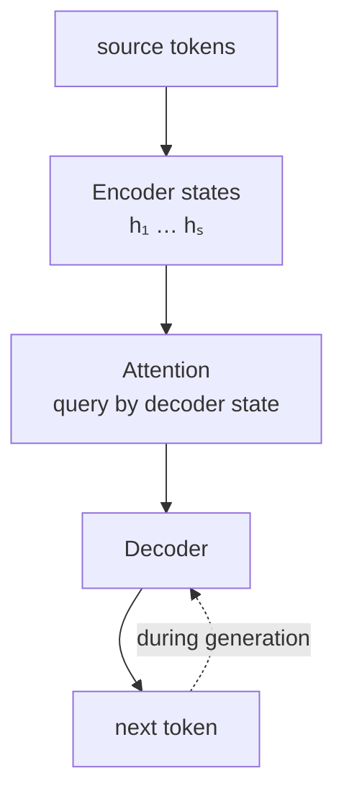

# Seq2Seq: encode and generate

[中文](seq2seq.md) · **English**

> Reading time: ~10 min · Last reviewed: 2026-10

Translating “明天见” into “See you tomorrow” does not require equal input and output lengths or a word-by-word match. Seq2Seq uses an encoder to read the input and a decoder to produce the output. When writing `tomorrow`, how can the decoder find the relevant time information? This gives us a reason to introduce attention. **Seq2Seq splits reading the input and writing the output between two modules; if the input passes through one fixed vector, the decoder cannot look up a single input position while generating, and attention lets it look back at every step.**

## Start with the overall structure {#start-with-the-overall-structure}

The input and the output need not have the same length. Translation, summarization, and question answering are all “read one passage to the end, then write another.” The first thing Seq2Seq does is split these two jobs cleanly: the encoder reads, the decoder writes.

## A fixed-length vector creates an information bottleneck {#a-fixed-length-vector-creates-an-information-bottleneck}

$$h_1,\ldots,h_S = \text{Encoder}(x_1,\ldots,x_S), \qquad c = h_S$$

$$s_t = \text{Decoder}(y_{t-1}, s_{t-1}, c), \qquad p(y_t)=\text{softmax}(W s_t)$$

The input length is $S$ and the output length is $T$; they need not match. The formula feeds $c$ into every decoder step; Sutskever et al. (2014) and the reversal experiment below instead use $c$ only to initialize the decoder state. Both variants are common. Each decoder step produces a distribution over the vocabulary. The shorthand $p(y_t)$ above leaves conditioning on the source and previous outputs implicit.

With one fixed vector, the decoder cannot revisit a particular input position after generation starts. This can make retaining details harder, but it does not mean every long sentence must fail. [Sutskever et al. (2014), §2](https://arxiv.org/html/1409.3215v3) describe the classic LSTM encoder–decoder; its effectiveness still depends on training and the task.

## Attention reads the encoder states on demand {#attention-reads-the-encoder-states-on-demand}

Instead of passing only the final state, keep the encoder state at each input position. At every output step, compute a new set of reading weights:

$$e_{tj}=\text{score}(s_{t-1},h_j), \qquad \alpha_{tj}=\text{softmax}_j(e_{tj})$$

$$c_t = \sum_j \alpha_{tj}h_j$$

$c_t$ can change at every step, rather than making one unchanged vector serve the entire output sequence. [Bahdanau et al., §3.1](https://arxiv.org/html/1409.0473v7) describe this form of attention in an RNN encoder–decoder. It mixes states by weight; it need not select a single word.

For states $h_1=(1,0),h_2=(0,1),h_3=(1,1)$, weights $(0.1,0.7,0.2)$ give $c_t=(0.3,0.9)$. At the next step, weights $(0.6,0.1,0.3)$ instead give $(0.9,0.4)$. These hand-chosen vectors do not imply that words have two literal semantic coordinates. Attention weights normalize over **input positions**, not output words. They are also not sufficient evidence of causal reliance on a source position.

## Training technique: teacher forcing {#training-technique-teacher-forcing}

At training step $t$, the decoder is fed the true $y_{t-1}$. During generation, it can only be fed the $\hat y_{t-1}$ it has just predicted.

The training loss is

$$\mathcal{L} = -\sum_{t=1}^{T}\log p_\theta(y_t \mid y_{<t}, x)$$

Training has access to the complete correct prefix; at inference, an error enters the later context and keeps propagating. This train–inference mismatch is commonly called exposure bias. Robot imitation learning has the same problem, with errors compounding along a trajectory; see [imitation learning](../../13-embodied/robot-learning/imitation.en.md).

For a target `9, 4, 7, EOS`, shifting by one gives these input–target pairs:

| Step | Teacher-forcing input | Token to predict |
| --- | --- | --- |
| 1 | BOS | 9 |
| 2 | 9 | 4 |
| 3 | 4 | 7 |
| 4 | 7 | EOS |

If generation produces `5` at step 2, step 3 consumes `5`, not the table's `4`. Low teacher-forced loss does not guarantee correct continuation from the model's own output. Evaluate free-running generation separately, checking both token accuracy and whether the entire sequence is correct.

## Training and generation see different input distributions {#training-and-generation-see-different-input-distributions}

| Concept | Training | Inference |
| --- | --- | --- |
| decoder input | the true prefix shifted right by one | the prefix it generated itself |
| time-step computation | an RNN is still sequential | sequential |
| termination | the target ends with EOS | EOS is generated or the length limit is reached |

Beam search only changes how candidate sequences are kept at inference time; it does not change the training objective.

## What remains unsolved: recurrent computation cannot be parallelized {#what-remains-unsolved-recurrent-computation-cannot-be-parallelized}

- the RNNs inside the encoder and decoder cannot be parallelized over time;
- the information path between two arbitrary positions can still be very long;
- attention provides dynamic reading, but recurrent state still limits parallel computation across time.

The Transformer's key move was not “inventing attention.” It was removing recurrence entirely and keeping only attention and position-wise computation.

## Experiment: learn sequence reversal {#experiment-learn-sequence-reversal}

Run [`../code/sequence_torch.py`](../code/sequence_torch.py) with `--task reverse` for a baseline **without attention**. The encoder's final state initializes the decoder; generation never reads the per-position encoder states again.

This minimal script fixes both input and output length at 7 tokens, stops after that known length, and does not train EOS. Its `same_batch_greedy_accuracy` is token accuracy on the batch just used for training, not an independent validation metric. It illustrates teacher forcing versus autoregressive generation, not variable-length generalization or attention alignment.

[`../code/vanilla_demo.py`](../code/vanilla_demo.py) demonstrates a Transformer with cross-attention, variable-length inputs, padding, and EOS. The scripts differ in task details and training budget, so their printed scores are not a fair comparison. To compare architectures, first match data, budget, and evaluation protocol, then check free-running generation. An attention plot is an additional observation, not proof that the outputs are correct.

## Self-check {#self-check}

  <strong>Try explaining these three things to someone who has never studied them:</strong>
  <ol>
    <li>Why does it not matter that the source and the target have different lengths?</li>
    <li>Compared with a fixed context vector, exactly which assumption does attention relax?</li>
    <li>Why does teacher forcing make training easy yet cause exposure bias at generation time?</li>
  </ol>

## Next {#next}

Continue to [Vanilla Transformer](vanilla-transformer.en.md) to see how self-attention lets both the encoder and the decoder be trained in parallel internally.

## Quick learning: how the Seq2Seq bottleneck led to attention {#quick-learning-how-the-seq2seq-bottleneck-led-to-attention}

The encoder–decoder spine, teacher forcing, and exposure bias

**Quick memory**: the encoder turns the source into states and the decoder generates the target autoregressively. Squeezing the whole sentence into a single vector creates a bottleneck; attention instead lets every step read all encoder states on demand.

**Interview answer**

> Classic Seq2Seq conditions the decoder on the encoder's final state, so the information in a long sequence is forced into a fixed-length vector. Attention lets every decode step address all encoder states with its current query. During training, teacher forcing supplies the true prefix; at inference the model can only consume its own outputs, which produces exposure bias.

<b>Deep dive</b>: what did attention solve, and what did it not solve?

It relieves the information bottleneck and improves alignment, but it does not remove the decoder's recurrence over time: target token $t$ still depends on what was generated before it, and the prefix distributions in training and inference still differ. What the Transformer later parallelized is the sequence computation at training time, not autoregressive generation itself.

