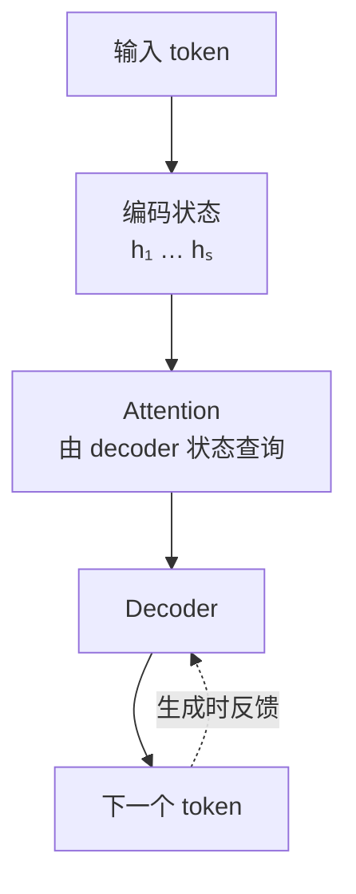

# Seq2Seq：编码与生成

**中文** · [English](seq2seq.en.md)

> 阅读时间：约 10 分钟 · 最近审阅：2026-10

把“明天见”翻成 “See you tomorrow”，输入和输出既不等长，也不用逐字对应。Seq2Seq 用一个 encoder 读取输入，再让 decoder 逐步生成输出。问题是：写到 `tomorrow` 时，decoder 怎样找到输入里与时间有关的信息？这正是 attention 要解决的问题。**Seq2Seq 把“读输入”和“逐步写输出”分给两个模块；只靠一个固定向量传递输入，decoder 生成时就不能再单独查某个输入位置，attention 让它每一步都能回头查。**

## 先建立整体结构 {#_1}

输入和输出不一定一样长。翻译、摘要、问答都是“先读完一段，再写出另一段”。Seq2Seq 做的第一件事，就是很干脆地把这两件事拆开：encoder 负责读，decoder 负责写。

## 固定长度向量形成信息瓶颈 {#_2}

$$h_1,\ldots,h_S = \text{Encoder}(x_1,\ldots,x_S), \qquad c = h_S$$

$$s_t = \text{Decoder}(y_{t-1}, s_{t-1}, c), \qquad p(y_t)=\text{softmax}(W s_t)$$

输入长度是 $S$，输出长度是 $T$，二者无需相等。decoder 的每一步都会输出一个词表上的概率分布；上式的 $p(y_t)$ 是简写，完整写法要以输入和已生成的前缀为条件。上式让 $c$ 在每一步都输入 decoder；Sutskever 等（2014）和下面的反转实验则只用 $c$ 初始化 decoder 的状态，两种做法都常见。

固定向量的限制在于：生成开始后，decoder 不能再单独读取某个输入位置。这会增加保留细节的难度，但不是说固定向量遇到长句就一定失败。[Sutskever 等（2014），§2](https://arxiv.org/html/1409.3215v3)介绍了经典 LSTM encoder–decoder；具体效果仍取决于训练和任务。

## Attention 按需读取 Encoder states {#attention-encoder-states}

不必只把最后一个状态交给 decoder。保存各个输入位置的 encoder state，生成每个 token 时，重新算一组读取权重：

$$e_{tj}=\text{score}(s_{t-1},h_j), \qquad \alpha_{tj}=\text{softmax}_j(e_{tj})$$

$$c_t = \sum_j \alpha_{tj}h_j$$

$c_t$ 每一步都可以不同，不再要求一个不变的向量承担整个输出序列的信息需求。早期 RNN attention 的具体做法见 [Bahdanau 等，§3.1](https://arxiv.org/html/1409.0473v7)。它按权重混合状态，不是必须只选一个词。

例如三个状态为 $h_1=(1,0),h_2=(0,1),h_3=(1,1)$。某一步的权重是 $(0.1,0.7,0.2)$，就读出 $c_t=(0.3,0.9)$；下一步改用 $(0.6,0.1,0.3)$，则读出 $(0.9,0.4)$。这些是手设的二维向量，不代表单词真有这两个语义维度。attention 权重是在**输入位置**上归一化，不是最终输出词的概率，也不能单靠权重证明模型用了哪条因果证据。

## 训练技巧：Teacher forcing {#teacher-forcing}

训练第 $t$ 步时，decoder 输入真实的 $y_{t-1}$；生成时，它只能输入自己刚预测的 $\hat y_{t-1}$。

训练损失是：

$$\mathcal{L} = -\sum_{t=1}^{T}\log p_\theta(y_t \mid y_{<t}, x)$$

训练时可以知道完整正确前缀，推理时错误会进入后续上下文并继续传播。这种 train–inference mismatch 常被称为 exposure bias。机器人模仿学习里也有同一个问题，误差会沿轨迹累积，见[模仿学习](../../13-embodied/robot-learning/imitation.md)。

把目标设成 `9, 4, 7, EOS`，右移一位后，decoder 的输入和监督目标这样配对：

| 步骤 | teacher forcing 输入 | 要预测的 token |
| --- | --- | --- |
| 1 | BOS | 9 |
| 2 | 9 | 4 |
| 3 | 4 | 7 |
| 4 | 7 | EOS |

如果生成时第 2 步误出了 `5`，第 3 步吃到的就是 `5`，而不是表里的 `4`。teacher forcing 下 loss 很低，不保证接着自己的回答还能写对。评估时要另做自由生成（free-running generation），同时看逐 token 正确率和整段是否全对。

## 训练与生成的输入分布不同 {#_3}

| 概念 | 训练 | 推理 |
| --- | --- | --- |
| decoder 输入 | 真实前缀右移一位 | 自己生成的前缀 |
| 时间步计算 | RNN 仍需串行 | 串行 |
| 终止 | 目标末尾有 EOS | 生成 EOS 或达到长度上限 |

Beam search 只改变推理时怎样保留候选序列，不改变模型训练目标。

## 仍未解决的问题：递归计算无法并行 {#_4}

- encoder / decoder 里的 RNN 无法按时间并行；
- 任意两位置之间的信息路径仍可能很长；
- attention 提供了动态读取，但 recurrent state 仍限制时间维的并行。

Attention 在 Transformer 之前就有了；Transformer 的关键动作是把 recurrence 全部拿掉，只保留 attention 与逐位置计算。

## 实验：学习序列反转 {#_5}

运行 [`../code/sequence_torch.py`](../code/sequence_torch.py) 的 `--task reverse`，先看**不带 attention** 的基线：encoder 的最终状态初始化 decoder，生成过程中不再读取 encoder 的逐位置状态。

这份最小脚本固定输入和输出都为 7 个 token，按已知长度停止，没有训练 EOS；日志中的 `same_batch_greedy_accuracy` 是刚训练过的批次上的逐 token 正确率，不是独立验证集指标。它能帮你读懂 teacher forcing 与自回归生成的不同，但不能拿来证明可变长度泛化或 attention 对齐。

[`../code/vanilla_demo.py`](../code/vanilla_demo.py) 则演示带 cross-attention 的 Transformer，包含变长输入、padding 与 EOS。两份脚本的任务细节和训练预算不同，不能直接把打印分数当成公平对比。想比较架构，先统一数据、预算和评估协议，再检查自由生成；attention 图只是额外观察，不是正确性证据。

## 自检 {#_6}

  <strong>试着把这三件事讲给没学过的人：</strong>
  <ol>
    <li>为什么 source 和 target 长度不一样也没关系？</li>
    <li>attention 相比固定 context vector，究竟放松了哪个假设？</li>
    <li>teacher forcing 为什么让训练容易，却在生成时带来 exposure bias？</li>
  </ol>

## 继续阅读 {#_7}

进入 [Vanilla Transformer](vanilla-transformer.md)，看 self-attention 怎样让 encoder 和 decoder 内部都可以并行训练。

## 快速学习：Seq2Seq 的瓶颈怎样催生 Attention {#seq2seq-attention}

Encoder–Decoder 主线、teacher forcing 与 exposure bias

**快速记忆**：Encoder 先编码输入，Decoder 再逐步生成输出。早期做法把整段输入压成一个向量，长句容易丢信息；attention 让 Decoder 每一步都能重新查看 Encoder 的各个状态，挑出当前需要的信息。

**面试回答**

> 经典 Seq2Seq 把 Encoder 的最终状态交给 Decoder，作为生成输出的依据。但输入再长，也得挤进一个固定长度的向量。Attention 改成每一步都用当前 query 去匹配 Encoder 的全部状态，按权重读取信息。训练时，teacher forcing 给的是正确的前文；生成时，模型接着自己已经生成的内容往下写。这种差异就是 exposure bias 的来源。

<b>深挖</b>：Attention 解决了什么，又没解决什么？

它缓解信息瓶颈并改善对齐，却没有移除 decoder 的时间递归：第 $t$ 个 target token 仍依赖前面生成结果，训练与推理前缀分布也仍不同。Transformer 后来并行化的是训练期的序列计算，不是自回归生成本身。

