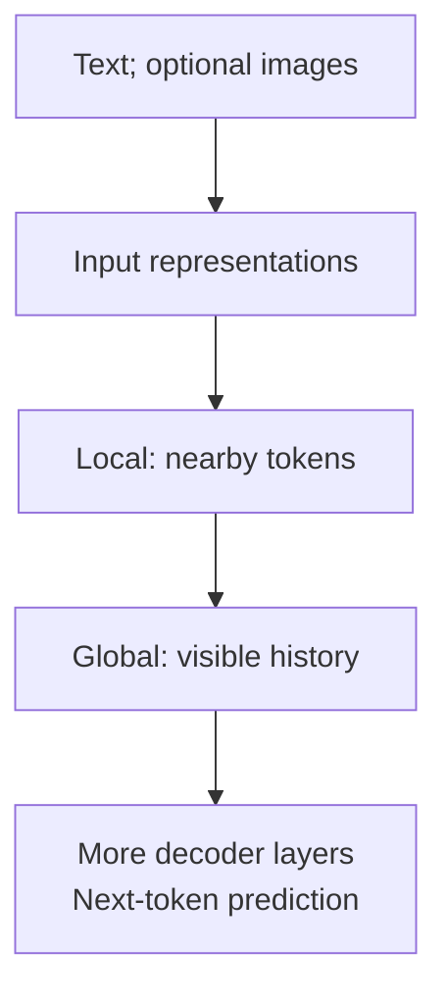

# Gemma deep dive: model design from deployment constraints

[中文](gemma.md) · **English**

> Reading time: ~15 min · Type: model family deep dive · Last reviewed: 2026-10

A long document may fit the input limit while still making generation expensive. Start with **Gemma 3's local/global attention** to work out why, then compare 3n and 4. For the mechanism, read through the cache example; for model selection, continue to the version differences and evaluation plan.

<div class="lesson-recipe advanced">
  <div><span>Core question</span><strong>How can smaller open models combine long context, vision, and local deployment?</strong></div>
  <div><span>Main components</span><strong>Local / global attention · GQA · multimodal input</strong></div>
  <div><span>Training line</span><strong>distillation during pretraining; post-training improves response behavior</strong></div>
  <div><span>After reading</span><strong>explain architecture through cache, latency, and device limits—not benchmarks alone</strong></div>
</div>

## Which Gemma 3 variant are we reading? {#one-sentence-position}

Most Gemma 3 layers read nearby tokens; a smaller number read the full history. This reduces cache requirements, though long contexts still incur storage and computation costs. Image support also varies by model size.

The [official model list](https://ai.google.dev/gemma/docs/get_started) distinguishes text-only Gemma 3 270M/1B from image-and-text 4B/12B/27B. Their context limits are 32K and 128K respectively, shared by input and generated tokens. [Gemma 3 model card](https://ai.google.dev/gemma/docs/core/model_card_3)

## Start with the long-context bill



This is an inference path; no teacher is on it. The Gemma 3 report uses five local layers per global layer and a local window of 1024. The smaller examples below explain the idea rather than reproduce a checkpoint. [Report, §2](https://arxiv.org/html/2503.19786v1#S2)

<span id="local-reach"></span>

### A single-layer window is not the whole receptive field

Take eight positions numbered 0–7 and a causal window of three, **including the current position**. Position 7 directly reads 5, 6, and 7, not 4. But position 5 in the preceding layer can already read 3, 4, and 5. A second local layer therefore gives position 7 an indirect path to 3 and 4.

| Computation at position 7 | Original positions that can influence it |
| --- | --- |
| One local layer | 5, 6, 7 |
| Two local layers | 3, 4, 5, 6, 7 |
| One causal global layer | 0–7 |

This is reachability in the computation graph, **not a guarantee that information survives**. Repeated mixing may lose useful detail; task performance must be checked. A global layer, in contrast, can directly read the complete visible history, not just labels summarizing nearby windows.

<span id="cache-example"></span>

### How much cache do six layers need?

Consider a hypothetical six-layer model: five local layers, one global layer, eight KV heads per layer, head width 128, and BF16 K/V. One request has 32768 positions; local layers retain only the latest 1024. Each cached position in a layer costs `2 × 8 × 128 × 2 = 4096` bytes.

<figure class="worked-update" id="gemma-cache-trace" lang="en">
  <figcaption>One six-layer example, changing only the retained history</figcaption>
  <ol>
    <li><strong>All global</strong><span>All six layers retain 32768 positions.</span><b>768 MiB</b></li>
    <li><strong>Five local + one global</strong><span>Five short caches and one full cache.</span><b>148 MiB</b></li>
    <li><strong>Extend to 131072 positions</strong><span>Local caches stop growing; the global cache does not.</span><b>532 MiB</b></li>
  </ol>
</figure>

<details markdown="1">
<summary>Work through the calculation and change the length</summary>

For this equal-width example without cross-layer sharing, let $T$ be history length, $W$ the local window, and $L_l,L_g$ the numbers of local and global layers:

$$
M_{\mathrm{KV}}=2B H_{\mathrm{KV}}d_h b\,[L_l\min(T,W)+L_gT].
$$

$B$ counts requests and $b$ is bytes per value; the leading 2 counts K and V. The code uses $B=1$ and the remaining settings from the figure.

```python
def mixed_cache_mib(tokens, local_layers=5, global_layers=1, window=1024):
    positions = local_layers * min(tokens, window) + global_layers * tokens
    bytes_per_position = 2 * 8 * 128 * 2
    return positions * bytes_per_position / (1024 ** 2)

assert mixed_cache_mib(32768) == 148
assert mixed_cache_mib(32768, local_layers=0, global_layers=6) == 768
assert mixed_cache_mib(131072) == 532
assert mixed_cache_mib(512) == 12
```

</details>

There is an implementation condition: local layers must actually reclaim or overwrite cache outside their windows. Applying a mask while allocating full-length K/V at every layer does not produce these memory savings. We also excluded weights, block-allocation waste, temporary tensors, and the vision encoder. This is storage arithmetic, not a GPU benchmark.

Separate prefill from decode, too. An efficient windowed implementation makes local attention work grow with $TW$, while global layers can still grow with $T^2$. During decode they read up to $W$ and $T$ historical positions respectively. Projections, FFNs, and real kernel latency are separate costs.

## What else changes the cost and behavior? {#three-ideas-worth-keeping}

1. **A window restricts direct reads.** Stacked layers still transmit information; global layers provide shorter paths. Do not describe this as identical global attention at a lower cost.
2. **Images consume a budget.** Gemma 3 compresses an image view into 256 visual tokens; Pan & Scan can add crop views. Shrinking a document may hide small text, while processing more views adds work. [Report, §2.1 and §5.5](https://arxiv.org/html/2503.19786v1#S2.SS1)
3. **Distillation need not follow pretraining.** The report uses teacher distributions during pretraining and distillation signals in post-training. Students may inherit teacher bias, but there is no general theorem that they cannot outperform the teacher on any task. [Report, §2.2 and §3](https://arxiv.org/html/2503.19786v1#S2.SS2)

<span id="newer-variants"></span>

## What changes in Gemma 3n and 4?

As of 2026-10-10, Gemma 3 is not a complete account of the family. These distinctions help when reading newer variants; this is not a catalog of every derivative.

| Version or branch | Check first | Why it matters |
| --- | --- | --- |
| Gemma 3n | MatFormer, per-layer embeddings (PLE), optional modality loading | E2B/E4B effective counts are not total downloaded parameters |
| Gemma 4 E2B/E4B | Smaller effective sizes; text/image/audio inputs | Inspect how the runtime places PLE and modality components |
| Gemma 4 12B Unified | Image patches and audio chunks projected into decoder inputs | The “attach a SigLIP encoder” diagram no longer applies |
| Gemma 4 26B A4B | MoE with about 3.8B active parameters, not 4B total weights | Active parameters inform compute estimates, not total weight memory |
| Gemma 4 31B | Dense, with text/image inputs | Family membership does not imply audio support |

Version sources: [3n overview](https://ai.google.dev/gemma/docs/gemma-3n), [Gemma 4 model and modality tables](https://ai.google.dev/gemma/docs/core/model_card_4). **Effective, active, and total measure different things.** As a teaching example, 26B resident BF16 weights require roughly 52 GB (decimal) of raw storage. Activating roughly 4B per token does not make the other weights disappear.

Gemma 4 E2B / E4B also share the KV cache across layers, with sharing ratios of 20/35 and 18/42 according to the report. The independent-cache formula above, with two separate K/V tensors in every layer, is therefore a baseline—not a Gemma 4 memory calculator. Sharing is built into the model, not permission to discard half of an arbitrary model's cache. [Gemma 4 report v2 (2026-07-24), §2](https://arxiv.org/html/2607.02770v2#S2)

Likewise, thinking mode does not mean longer answers are always better. Hold tasks and tool permissions fixed; record output budgets, success rates, and latency separately. Comparing a thinking-enabled model with a disabled one does not isolate architecture gains. For comparing at matched compute, see [Test-time compute: comparing and reading numbers](../../11-frontier/test-time-compute/measuring.en.md).

## Trade-offs

| Choice | What it buys | What it costs |
| --- | --- | --- |
| More local attention | Lower long-context cost with appropriate windowed caches/kernels | More indirect cross-window information flow |
| Periodic global attention | Preserved long-range interaction | Global layers remain expensive |
| Visual input | Image-text tasks and grounded understanding | More tokens, latency, and modality conflict |
| Distillation | Learn the teacher's relative preferences across candidates | Limited coverage and biased targets still require independent evaluation |

## Try it on a concrete task {#how-i-would-use-the-family}

Suppose you are building an assistant that finds wiring instructions in equipment manuals. Fitting the PDF is only the first check. Try a small experiment in this order:

| Change | Observe | Conclusion to avoid |
| --- | --- | --- |
| Move the relevant passage to the beginning, middle, and end | Answer and citation correctness | One successful retrieval proves all long-document tasks work |
| Original diagram, obscured wiring diagram, diagram from another model | Whether answers respond appropriately to visual evidence | A drop after masking proves complete visual understanding |
| Add irrelevant pages without changing the task | First-token latency, cache use, success rate | Accepting more pages proves accurate integration |
| Hold the checkpoint fixed; vary deployment precision or crop budget | Peak memory, throughput, and errors | Smaller weights reduce every inference cost proportionally |

Keep some manuals out of tuning. Record the checkpoint, processor/chat template, input/output lengths, cache implementation, and device. This is a proposed experiment; this site verifies the arithmetic above, not Gemma training or vendor performance results.

## Self-check

- Why does local attention reduce cost without immediately cutting off global information?
- How do visual tokens affect context and latency?
- How would you test whether the model looked at the image rather than guessed from text priors?
- Why does a distilled model still need independent evaluation?
- Why do A4B, E4B, and 4B total parameters give different memory estimates?

Continue with [KV cache](../deep-dives/kv-cache-and-inference.en.md), [MoE systems costs](../moe/systems.en.md), or [distillation](../../05-post-training/distillation.en.md).

## Primary sources

- [Gemma 3 Technical Report](https://arxiv.org/abs/2503.19786)
- [Gemma: Open Models Based on Gemini Research and Technology](https://arxiv.org/abs/2403.08295)
- [Gemma 3n overview](https://ai.google.dev/gemma/docs/gemma-3n)
- [Gemma 4 Technical Report](https://arxiv.org/abs/2607.02770)
