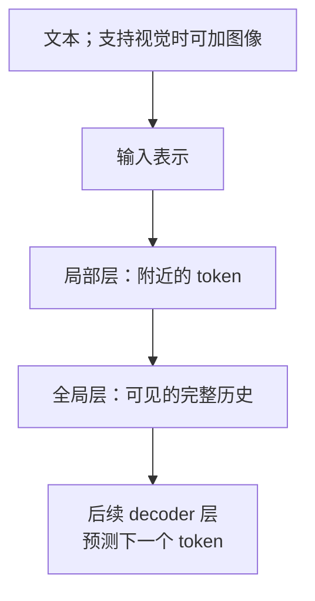

# Gemma 精读：从部署约束反推模型设计

**中文** · [English](gemma.en.md)

> 阅读时间：约 15 分钟 · 类型：模型家族精读 · 最近审阅：2026-10

长文档放得进去，不代表生成时的显存和延迟也能接受。这篇先用 **Gemma 3 的 local / global attention** 把这笔账算清，再看 3n 和 4 改了哪些地方。想先懂原理，读到缓存算例就够；准备选模型，可以接着看版本区别与评估方法。

<div class="lesson-recipe advanced">
  <div><span>核心问题</span><strong>较小的开放模型怎样兼顾长上下文、视觉输入与本地部署？</strong></div>
  <div><span>重点组件</span><strong>局部 / 全局注意力 · GQA · 图像输入</strong></div>
  <div><span>训练主线</span><strong>预训练中使用蒸馏；后训练再改善回答行为</strong></div>
  <div><span>读完要会</span><strong>从 cache、延迟和设备限制解释架构，而不是只看 benchmark</strong></div>
</div>

## 先分清 Gemma 3 的几个尺寸 {#_1}

Gemma 3 的一个关键选择是：多数层只读取附近的 token，少数层读取完整历史。它减少了长上下文的缓存需求，但不是让长上下文免费，也不是每个型号都支持图像。

先认准型号：[官方型号列表](https://ai.google.dev/gemma/docs/get_started)中的 Gemma 3 270M / 1B 是文本模型；4B / 12B / 27B 支持图文输入。前两者的上下文为 32K，后三者为 128K；输入和生成内容共用这份长度预算。[Gemma 3 model card](https://ai.google.dev/gemma/docs/core/model_card_3)

## 先看长上下文的账 {#_2}



这是推理路径；teacher 不在这条路径里。Gemma 3 报告采用每五个局部层接一个全局层的安排，局部窗口为 1024。下面缩小数字来理解它，不复刻某个 checkpoint。[报告 §2](https://arxiv.org/html/2503.19786v1#S2)

<span id="local-reach"></span>

### 一层看不到，不代表多层都看不到

假设只有八个位置，编号 0–7，因果窗口宽度为 3，**包含当前位置**。位置 7 在一层里直接读取 5、6、7，读不到 4。但上一层的位置 5 已经能读取 3、4、5，所以再叠一层，位置 7 就有了接触 3、4 的间接通路。

| 位置 7 的计算 | 能影响它的原始位置 |
| --- | --- |
| 一层 local attention | 5、6、7 |
| 两层 local attention | 3、4、5、6、7 |
| 一层 causal global attention | 0–7 |

这说明的是计算图里“有路可走”，**不是远处的信息一定被保留下来**。信息经过多次混合，具体还记住多少要用任务检验。反过来，一个全局层也不是只给附近窗口贴标签：它可以直接读取完整的可见历史。

<span id="cache-example"></span>

### 六层的缓存，差多少？

自拟一个六层模型：五层 local、一层 global；每层有 8 个 KV heads，每头 128 维，K/V 用 BF16。一个请求已经有 32768 个位置，local 层仅保留最近 1024 个。各层的每个缓存位置需要 `2 × 8 × 128 × 2 = 4096` bytes。

<figure class="worked-update" id="gemma-cache-trace" lang="zh-CN">
  <figcaption>同一个六层算例：只改变各层保留多少历史</figcaption>
  <ol>
    <li><strong>全部 global</strong><span>六层各存 32768 个位置。</span><b>768 MiB</b></li>
    <li><strong>五层 local + 一层 global</strong><span>五份短缓存，加一份完整缓存。</span><b>148 MiB</b></li>
    <li><strong>长到 131072 个位置</strong><span>local 缓存不再增长，global 仍会增长。</span><b>532 MiB</b></li>
  </ol>
</figure>

<details markdown="1">
<summary>展开计算，自己改长度试试</summary>

对这个没有跨层共享、各头等宽的算例，记 $T$ 为历史长度、$W$ 为 local 窗口，$L_l,L_g$ 为两类层数：

$$
M_{\mathrm{KV}}=2B H_{\mathrm{KV}}d_h b\,[L_l\min(T,W)+L_gT].
$$

$B$ 是请求数，$b$ 是单个数的字节数；最前面的 2 对应 K、V。下面默认 $B=1$，其余数值与图一致。

```python
def mixed_cache_mib(tokens, local_layers=5, global_layers=1, window=1024):
    positions = local_layers * min(tokens, window) + global_layers * tokens
    bytes_per_position = 2 * 8 * 128 * 2
    return positions * bytes_per_position / (1024 ** 2)

assert mixed_cache_mib(32768) == 148
assert mixed_cache_mib(32768, local_layers=0, global_layers=6) == 768
assert mixed_cache_mib(131072) == 532
assert mixed_cache_mib(512) == 12
```

</details>

这个结果有实现前提：local 层需要真正回收或覆盖窗口之外的缓存。若程序只是加 attention mask，却仍为每层分配完整长度的 K/V，显存不会自动降到这个数。图中也没有权重、分块浪费、临时张量或图像编码器；它是存储量算例，不是 GPU benchmark。

还要分开看 prefill 与 decode。理想窗口实现中，local 层的 attention 工作量随 $T W$ 增长，而全局层仍可能随 $T^2$ 增长；decode 时则分别读取至多 $W$ 和 $T$ 个历史位置。投影、FFN 和实际 kernel 速度需要另算。

## 结构之外，还要看什么 {#_3}

1. **窗口限制的是直接读取范围。** 多层仍能传播信息，全局层提供更直接的远距离通路；不要把“少看一些历史”写成“和全局 attention 一样，只是更便宜”。
2. **图像也要花预算。** Gemma 3 的视觉编码器把一个图像视图压成 256 个视觉 token；Pan & Scan 可以增加裁剪视图。读整页小字时，缩图可能丢掉线索，多看裁剪又会增加工作量。[报告 §2.1、§5.5](https://arxiv.org/html/2503.19786v1#S2.SS1)
3. **蒸馏不是必须等预训练结束才做。** 报告的预训练就使用 teacher 分布，后训练也使用蒸馏信号。teacher 的偏差可能被继承，但没有一般定理保证 student 每项能力都不超过 teacher。[报告 §2.2、§3](https://arxiv.org/html/2503.19786v1#S2.SS2)

<span id="newer-variants"></span>

## 再看 Gemma 3n 和 4：哪些不能照搬？

截至 2026-10-10，不能再把 Gemma 3 的配置当作这个家族的完整介绍。下面是阅读较新型号时最有用的区别，不是所有衍生版本的目录。

| 版本 / 分支 | 先看什么 | 为什么影响选型 |
| --- | --- | --- |
| Gemma 3n | MatFormer、per-layer embeddings（PLE）、按需加载模态组件 | E2B / E4B 的 effective 参数不等于下载文件里的总参数 |
| Gemma 4 E2B / E4B | 较小的有效参数规模、文本 / 图像 / 音频输入 | 要核对运行时如何存放 PLE 和模态组件 |
| Gemma 4 12B Unified | 图像 patch 和音频块直接投影到 decoder 输入 | 不能沿用“外接一个 SigLIP encoder”的结构图 |
| Gemma 4 26B A4B | MoE：约 3.8B active，不是总权重只有 4B | active 参数有助于估算计算量，不能直接当权重显存 |
| Gemma 4 31B | Dense，文本 / 图像输入 | 不要因为同属 Gemma 4 就假定它也接收音频 |

版本依据：[3n 官方说明](https://ai.google.dev/gemma/docs/gemma-3n)、[Gemma 4 型号与模态表](https://ai.google.dev/gemma/docs/core/model_card_4)。**effective、active、total 是不同口径**。例如一份教学假设里的 26B 权重，如果全部以 BF16 常驻，就约有 52 GB（十进制）的原始权重；每个 token 只激活约 4B，并不会把剩下的权重文件变没。

Gemma 4 的 E2B / E4B 还在层间共享 KV cache，报告给出的共享比例分别是 20/35 和 18/42；因此上面的“两份 K/V × 每层各存一份”只是独立缓存的基线，不能直接当 Gemma 4 的显存计算器。共享是模型结构的一部分，不是推理时随意删一半缓存。[Gemma 4 报告 v2（2026-07-24）§2](https://arxiv.org/html/2607.02770v2#S2)

同样，支持 thinking mode 不代表回答越长就越好。比较时固定任务和工具权限，分别记录输出预算、成功率和延迟；不能拿一个开 thinking 的版本与另一个关闭的版本，仅凭总分推断架构收益。

## 取舍表 {#_4}

| 选择 | 得到什么 | 付出什么 |
| --- | --- | --- |
| 较多 local attention | 在窗口缓存 / kernel 正确实现时，减少长上下文开销 | 跨窗口信息传播更间接 |
| 周期性 global attention | 保留长距离交互 | 全局层仍然昂贵 |
| 视觉输入 | 图文任务与 grounded understanding | 更多 token、延迟和模态冲突 |
| 蒸馏 | 学到 teacher 对多个候选的相对偏好 | teacher 覆盖不足或有偏差，仍需独立评估 |

## 拿一个实际任务试试 {#_5}

例如做一个“从设备说明书找出正确接线方法”的助手，先别只问它能否放进整份 PDF。可以按下面的顺序做一组小实验：

| 改什么 | 观察什么 | 不能急着得出的结论 |
| --- | --- | --- |
| 把关键段落移到开头、中间、结尾 | 答案与引用是否仍然正确 | 一次找对，不代表所有长文任务都没问题 |
| 原图、遮住关键接线图、替换为另一型号的图 | 答案是否随视觉证据合理变化 | 遮图后下降只能说明依赖某些图像信息，不直接证明理解了全部细节 |
| 保持任务不变，增加无关页数 | 首 token 延迟、缓存与成功率 | 能接收更多页，不等于仍能准确整合 |
| 固定型号，比较部署精度或裁剪预算 | 峰值显存、吞吐与错例 | 权重变小，不等于所有推理成本同比下降 |

保留一组没参与调参的说明书。每次记录 checkpoint、processor / chat template、输入和输出长度、缓存实现与设备。这些是建议做的实验；本站只验证了上面的算术，没有运行 Gemma 模型或复现厂商性能。

## 自检 {#_6}

- local attention 为什么能降低成本，又为什么不会立刻切断全局信息？
- 视觉 token 对上下文和延迟有什么影响？
- 怎样验证模型真的看了图，而不是猜文本先验？
- 蒸馏提升小模型时，为什么仍需要独立评估？
- 为什么 A4B、E4B 和总共 4B 不能混着算显存？

继续读：[KV cache](../deep-dives/kv-cache-and-inference.md) · [MoE 的系统代价](../moe/systems.md) · [蒸馏](../../05-post-training/distillation.md)。

## 原始资料 {#_7}

- [Gemma 3 Technical Report](https://arxiv.org/abs/2503.19786)
- [Gemma: Open Models Based on Gemini Research and Technology](https://arxiv.org/abs/2403.08295)
- [Gemma 3n 官方说明](https://ai.google.dev/gemma/docs/gemma-3n)
- [Gemma 4 Technical Report](https://arxiv.org/abs/2607.02770)
