# Transformer 架构

**中文** · [English](transformer.en.md)

> 阅读时间：约 12 分钟 · 最近审阅：2026-10

<div class="lesson-recipe advanced">
  <div><span>这次要拆什么</span><strong>把 Transformer 从框图拆回矩阵运算和可以检查的性质</strong></div>
  <div><span>需要先会</span><strong>矩阵乘 · softmax · residual · causal LM</strong></div>
  <div><span>真正的主角</span><strong>Q/K/V · norm · RoPE · GQA · KV cache</strong></div>
  <div><span>最后要能证明</span><strong>实现满足因果性、位置相对性与 cache 等价性</strong></div>
</div>

<span id="transformer"></span>

<span id="_1"></span>

## Attention 汇聚上下文，FFN 逐位置变换 {#attention-ffn}

Transformer 就是[上一页](from-linear-to-neural.md)那个「学出来的坐标变换 $\phi$」的一种具体做法：**注意力负责跨位置搬运信息，FFN 负责在单个位置上加工**，两者交替堆叠，最后仍然是一个线性分类器读出答案。

- **注意力**：让每个位置根据相关性读取其他位置的信息。
- **FFN**：在每个位置内部独立变换特征。
- **残差连接**：保留原状态，并把每个子层的改动叠加上去。
- **堆叠 N 层**：反复进行跨位置通信与逐位置变换，逐层形成可用于预测的表示。

这一页把这些零件串起来，每个零件的推导各有一篇主讲：缩放、mask 和 Q/K/V 在[多头注意力](core/multi-head-attention.md)，norm 放在哪里在[归一化](core/normalization.md)，SwiGLU 在 [FFN 与门控](core/ffn-and-gates.md)。这里自己负责的是 Q/K/V 的三种用法、RoPE 的代码、Noam 调度的一个坑，以及怎样用测试证明从零实现没写错。

## 核心公式：缩放点积注意力 {#_2}

$$\text{Attention}(Q, K, V) = \text{softmax}\!\left(\frac{QK^\top}{\sqrt{d_k}}\right)V$$

先把 shape 写全：

$$Q\in\mathbb{R}^{T_q\times d_k},\qquad
K\in\mathbb{R}^{T_k\times d_k},\qquad
V\in\mathbb{R}^{T_k\times d_v}.$$

$Q$ 与 $K$ 的最后一维必须相同才能点积；$V$ 只需和 $K$ 有相同的 token 数 $T_k$，特征维 $d_v$ 可以不同。标准 multi-head attention 为了拼接方便令 $d_v=d_k=d_{\text{model}}/h$，这是常见设计，不是公式的要求。缩放用的是每个头的 $d_k$：$d_{\text{model}}=768,h=12$ 时 $d_k=64$，除的是 $\sqrt{64}$，不是 $\sqrt{768}$。

拆开看单个查询 $\mathbf{q}_i$：

$$\alpha_{ij} = \frac{\exp\!\big(\mathbf{q}_i^\top \mathbf{k}_j / \sqrt{d_k}\big)}{\sum_{j'} \exp\!\big(\mathbf{q}_i^\top \mathbf{k}_{j'} / \sqrt{d_k}\big)}, \qquad \mathbf{o}_i = \sum_j \alpha_{ij}\, \mathbf{v}_j$$

也就是：**用相似度当权重，对 value 做加权平均**。$\alpha_{ij}$ 每一行加起来是 1。

### Softmax 不是 argmax，而是可微的分配 {#softmax-argmax}

Softmax 把任意实数分数变成正数且总和为 1 的权重：

$$\operatorname{softmax}(z)_i=\frac{e^{z_i}}{\sum_j e^{z_j}}.$$

例如 $[2,1,0]$ 会变成约 $[0.665,0.245,0.090]$。它不是只留下最高分，而是允许一个 query 同时读取多个位置。Attention 对 score 矩阵的**最后一维逐行**做 softmax：第 $i$ 行回答「query $i$ 应该把多少权重分给每个 key $j$」。一句话：$QK^\top$ 决定**从哪里读**，权重乘 $V$ 决定**按什么比例把读到的内容合起来**。

<span id="python"></span>

三个常被追问的细节都在[多头注意力](core/multi-head-attention.md)里算过一遍：

- <span id="sqrtd_k"></span>**为什么除以 $\sqrt{d_k}$**：在各分量相互独立、均值为 0、方差为 1 的简化假设下，点积的方差是 $d_k$；除以 $\sqrt{d_k}$ 把它拉回 1，避免 softmax 只因维度变大就过早变尖。方差推导、`[8, −8]` 的例子和梯度为什么变小，见[那一节](core/multi-head-attention.md#sqrtd_k)。
- **mask 放在哪**：softmax 之前把禁止位置设为 `-inf`；设成 0 仍会分到权重，softmax 之后只置零又不重新归一化，也不等价。两个分数的例子见[六个易错处](core/multi-head-attention.md#_5)。
- **$Q=K$ 会怎样**：缩放前的分数 $QQ^\top$ 对称，逐行 softmax 之后一般不再对称，注意力也不会失效；见[面试常见问题](core/multi-head-attention.md#_7)。

### 三个投影矩阵到底有没有“实际意义” {#_3}

对 self-attention 的输入 $X$，模型学习

$$Q=XW_Q,\qquad K=XW_K,\qquad V=XW_V.$$

这个问题要分两层回答：

- **单个参数值或某一维通常没有固定的人类语义。** 换一个随机种子，坐标轴和权重数值可以完全不同，模型仍实现相近功能；对任意可逆矩阵 $R$，把 $Q,K$ 换成 $QR$、$KR^{-\top}$，分数完全不变。
- **三个矩阵承担的计算角色有意义。** $W_Q$ 产生查询，$W_K$ 产生用于匹配的 key，$W_V$ 决定匹配之后真正传递什么内容。$W_Q$、$W_K$ 分开，$W_QW_K^\top$ 才可以不对称，表达“$i$ 查 $j$”和“$j$ 查 $i$”不同的关系；$W_V$ 让「为什么找到它」和「从它那里拿走什么」解耦。

## 同一模块的三种用法：改变 Q/K/V 的来源 {#qkv}

这是原论文（2017）的 encoder-decoder 结构里最该盯住的地方。`self_attn(x, x, x)` 和 `cross_attn(x, memory, memory)` 是同一个类，只是喂进去的三个张量不同：

| 用法 | Q 来自 | K, V 来自 | mask | 注意力形状 |
| --- | --- | --- | --- | --- |
| encoder 自注意力 | src | src | 只挡 padding，**双向** | $(B,h,S,S)$ |
| decoder 自注意力 | tgt | tgt | padding **∨** 因果 | $(B,h,T,T)$ |
| **交叉注意力** | **tgt** | **memory** | 挡 src 的 padding | $(B,h,T,S)$ ← 非方阵 |



交叉注意力是 encoder 和 decoder 唯一交换信息的地方：decoder 每生成一步，每一层都拿当前状态当查询，去 encoder 的输出里查一次。

[`code/vanilla_demo.py`](code/vanilla_demo.py) 训练模型把序列反过来，再打印交叉注意力矩阵。下面画的是直观的反向对齐示意，不是注意力必须学成的唯一答案：encoder 的每个位置本身已经混合了上下文，输出正确也不保证某个头呈反对角线。

```
        1  2  3  4  5  6  7  8   <- source (encoder)
  BOS                        @
    1                     @
    2                  @
    3               @
    4            #  :
    5         @
    6      @
    7   @
  ^ decoder step
```

字符越密，权重越大：`@` 接近 1；第 4 步的 `#` 和 `:` 表示权重分在了相邻两个位置上。实际效果要看脚本中的独立生成检查，而不是只看这张图。即使一个小批次全部预测正确，也不能说明模型对任意长度或未见分布都能泛化。

## 多头注意力：为什么不是一个大注意力 {#_4}

$$\text{MultiHead}(Q,K,V) = \text{Concat}(\text{head}_1, \ldots, \text{head}_h)W^O, \quad \text{head}_i = \text{Attention}(QW_i^Q, KW_i^K, VW_i^V)$$

上式沿用原论文的接口记号，Q/K/V 指**投影前的三组输入**，self-attention 中都等于 X，不是在本页开头的投影结果上再投影一次。

一个头只有一套 softmax 权重；固定总宽度切成 $h$ 个头，就能在相近的投影成本下同时得到 $h$ 套注意力关系。实现上不需要 $h$ 组小矩阵：用一个 $(d_{\text{model}}, d_{\text{model}})$ 的投影再 reshape 成 $h$ 个头，只做一次 GEMM。reshape 的顺序是从零实现最常见的错，为什么多头不是“把维度做大”，都见[多头注意力](core/multi-head-attention.md)。

## 训练稳定性：post-norm 为什么依赖 warmup {#post-norm-warmup}

论文写的是

$$\mathbf{x} \leftarrow \text{LayerNorm}\big(\mathbf{x} + \text{Sublayer}(\mathbf{x})\big)$$

**层归一化在残差加法外面**（post-norm）。很多后来的模型采用 pre-norm：

$$\mathbf{x} \leftarrow \mathbf{x} + \text{Sublayer}\big(\text{Norm}(\mathbf{x})\big)$$



两者改变了梯度路径，不只是书写顺序：Pre-LN 在残差主干保留恒等项，通常更容易训练，但初始化、深度和学习率仍需一起考虑，也不保证可以取消 warmup。Jacobian 推导和 [Xiong 等人](https://arxiv.org/abs/2002.04745)对 warmup 的结论见[归一化](core/normalization.md#_3)第 3 问。

原论文使用的 Noam 调度为

$$\text{lr}(t) = d_{\text{model}}^{-0.5} \cdot \min\big(t^{-0.5},\; t \cdot t_{\text{warmup}}^{-1.5}\big)$$

先线性升高，再与步数的平方根成反比衰减。不能说“堆到 6 层必炸”或“没有这条调度就无法训练”。

> 实测提醒：`LambdaLR` 是拿 **base_lr 乘** lambda 的。把 Adam 的 `lr` 设成 0 再挂 Noam 调度，学习率会永远是 0，而 loss 因为 dropout 噪声看起来还在动。这个坑很常见。

## 位置编码从正弦到 RoPE {#rope}

没有位置编码和顺序相关 mask 时，self-attention 对置换是**等变**的：输入调换，输出跟着调换。Causal mask 已经提供前后约束，位置编码则进一步表示位置与距离；不要把整个因果模型说成“一袋词”。

### 原版：固定正弦 {#_5}

$$PE_{(pos,\, 2i)} = \sin\!\left(\frac{pos}{10000^{2i/d}}\right), \qquad PE_{(pos,\, 2i+1)} = \cos\!\left(\frac{pos}{10000^{2i/d}}\right)$$

**加**到 embedding 上（不是拼接）。波长是从 $2\pi$ 到接近 $10000\cdot 2\pi$ 的等比数列，相当于多组不同速度的时钟。对固定偏移 k，$PE_{pos+k}$ 可以由 $PE_{pos}$ 线性变换得到，因此这种编码便于表示相对偏移，但不保证模型一定学会使用它。

### 现在：RoPE {#rope_1}

不加到输入上，而是在**每一层的 $q$ 和 $k$ 上做旋转**。把 $\mathbf{q}$ 的通道两两配对成复数，位置 $m$ 处旋转角 $m\theta_i$：

$$\tilde{\mathbf{q}}_m = R_m \mathbf{q}, \qquad R_m = \begin{pmatrix} \cos m\theta & -\sin m\theta \\ \sin m\theta & \cos m\theta \end{pmatrix} \ \ (\text{每个通道对})$$

固定 q/k 内容与旋转频率时，RoPE 引入的**显式位置因子**只依赖 $n-m$。实际 q/k 还受上下文和 mask 影响，不能因此说整个模型只看距离。常见实现不对 V 施加这一步旋转；V 来自已有上下文表示，仍可能携带位置信息。

<details markdown="1">
<summary><b>进阶</b>：相对性是怎么来的</summary>

旋转矩阵是正交的，且绕同一平面的旋转可以相加：$R_m^\top = R_{-m}$，$R_a R_b = R_{a+b}$。于是

$$\langle R_m\mathbf{q},\; R_n\mathbf{k}\rangle
= \mathbf{q}^\top R_m^\top R_n \mathbf{k}
= \mathbf{q}^\top R_{n-m}\mathbf{k}$$

$m$ 和 $n$ 在这项旋转恒等式里只以差出现，但这不是长上下文泛化保证。更长输入会带来未训练过的相位、距离和注意力分布，还需要专门的长度扩展与评估。

这也是为什么不能只旋转 $\mathbf{q}$ 不旋转 $\mathbf{k}$：那样 $R_m^\top$ 没有配对的 $R_n$，绝对位置就消不掉了。

</details>

```python
def apply_rope(x, cos, sin):
    """x: (B, H, T, d)   cos/sin: (T, d/2)"""
    x1, x2 = x.chunk(2, dim=-1)                     # split-half（GPT-NeoX / HF 转换后的 Llama）
    return torch.cat([x1 * cos - x2 * sin,
                      x1 * sin + x2 * cos], dim=-1)
```

⚠️ 配对方式有两种：split-half（通道 $i$ 配 $i + d/2$，GPT-NeoX、HF Transformers 转换后的 Llama）和相邻配对（通道 $2i$ 配 $2i+1$，RoFormer 论文与 [Meta 原版 Llama 代码](https://github.com/meta-llama/llama/blob/main/llama/model.py)）。两者差一个通道置换，**权重不能互换**：HF 的转换脚本会重排 $W_Q$/$W_K$ 来配合 split-half。转模型时这是经典踩坑点，具体数字见[RoPE 与长上下文](deep-dives/position-and-context.md#rotary-layout)。

## 现代 Decoder-only 还改了什么 {#decoder-only}

这里对照的是本页教学代码采用的一组常见选择，不是所有现代模型的统一配置。

| | vanilla (2017) | 本页 decoder-only 实现 |
| --- | --- | --- |
| 结构 | encoder + decoder | 只有 decoder |
| 归一化 | post-norm LayerNorm | pre-norm RMSNorm |
| 位置 | 正弦，加在输入上 | RoPE，每层在 q/k 上旋转 |
| 注意力 | MHA（$h$ 个头各有 K/V） | GQA（K/V 头更少） |
| FFN | ReLU，$4d$ | SwiGLU，$\tfrac{8}{3}d$ |
| 推理 | 自回归，可缓存 self/cross-attention 的 K/V | 预分配 KV cache |

更新的模型还在这张表之外改了几处：QK-norm、MLA，以及把部分层换成线性注意力，见 [Decoder-only](core/decoder-only.md#1-block)。

- **RMSNorm** 去掉减均值，也没有偏置，只按均方根缩放（公式与“能否推出均值没用”见[归一化](core/normalization.md)）。这里的代码用 fp32 算平方均值，再转回激活 dtype，以减少低精度归约误差；平方均值不是方差。
- **SwiGLU** 用一个门控投影换掉 ReLU，三个矩阵约 $3dh$ 个参数；取 $h=\frac83d$ 时，与隐藏宽度 $4d$ 的两矩阵 FFN 参数相同。算例见 [FFN 与门控](core/ffn-and-gates.md)的“参数预算”一节。

**GQA** 让每组 $n_{\text{rep}}$ 个查询头共享一组 K/V 头。单条序列、所有层均使用同一配置时，原始 KV cache 的字节数是

$$2 \cdot n_{\text{layer}} \cdot n_{\text{kv}} \cdot d_{\text{head}} \cdot T \cdot \text{sizeof(dtype)}$$

其他条件不变，把 $n_{\text{kv}}$ 从 32 降到 8，会把 **KV cache 本体**缩到原来的四分之一，不是整个模型的显存或延迟都缩小四倍。完整例子见 [KV cache 与推理成本](deep-dives/kv-cache-and-inference.md)。

## 动手：从零实现，并检查常见错误 {#_6}

[`code/`](code/) 里两版实现都不调 `nn.MultiheadAttention` 和 `F.scaled_dot_product_attention`，只用 `nn.Linear` 和裸张量运算：

- [`vanilla.py`](code/vanilla.py) —— 2017 原版 encoder-decoder，含 Noam 调度和标签平滑
- [`model.py`](code/model.py) —— 现代 decoder-only（RMSNorm + RoPE + GQA + SwiGLU + KV cache）

从零实现最容易错的四个地方，[`test_model.py`](code/test_model.py) 逐个验证：

```
  因果性：      改下标 9 的 token，它前面 9 个位置的 logits 差 0.0（严格 0）
  KV cache：    增量解码 vs 一次性前向，max 误差 3.6e-07
  RoPE 相对性： score(5,2) = score(20,17) = +5.6092，score(20,10) = +0.4579
  初始 loss：   4.19  vs  ln(V) = 4.16
```



带 cache 时最容易出错的是 mask：query 的绝对位置是 `cache.pos + i`，key 从 0 数到 `cache.pos + T - 1`，已有前缀时 mask 是非方阵 $(T,S)$；RoPE 也要从 `cache.pos` 切片。本实现中 `cache.pos` 每次模型前向只推进一次，在整个层循环之后。等价性检查还要求同一参数、前缀、位置和可见范围，关闭 dropout；不能拿改过权重或被截断的 cache 与完整前向直接比较。

来源：[原版 Transformer](https://arxiv.org/abs/1706.03762)、[RoFormer](https://arxiv.org/abs/2104.09864)、[RMSNorm](https://arxiv.org/abs/1910.07467)、[GLU variants](https://arxiv.org/abs/2002.05202)。

## 自检 {#_7}

<div class="taste-check advanced">
  <strong>完成这一章后，至少要能解释四个关键问题：</strong>
  <ol>
    <li>为什么 attention score 要除以 $\sqrt{d_k}$？</li>
    <li>pre-norm 把 norm 挪到残差分支里以后，梯度多了哪条直通的路径？</li>
    <li>RoPE 的相对性为什么要求同时旋转 Q 和 K？</li>
    <li>怎样证明 KV cache 是正确实现，而不是只让生成结果“看起来没坏”？</li>
  </ol>
</div>

## 继续阅读 {#_8}

- [从线性模型到神经网络](from-linear-to-neural.md) —— 为什么分类网络的最后一层常常只是线性分类器
- [Post-Training](../05-post-training/) —— 这些参数后来怎么被继续改
- [系统总览](../06-systems/) —— 它在整套系统里的位置

## 快速学习：Transformer 到底做了什么 {#transformer_1}

<details class="interview" markdown="1">
<summary>先记主线，再展开标准回答与 deep dive</summary>

**快速记忆**

- Attention：token 之间交换信息。
- FFN：每个 token 独立做非线性变换。
- Residual + Norm：让两类计算可以稳定堆深。
- Position information：让模型知道顺序与相对距离。

**面试回答**

> Transformer block 交替执行 token mixing 和 channel mixing。Self-attention 根据 QK 相似度在序列位置间汇总 V；FFN 对每个位置独立地扩维、激活再压回。Residual path 保留旧表示并提供梯度通路，Norm 控制子层输入尺度，位置编码补上 attention 本身缺失的顺序信息。

<details markdown="1">
<summary><b>深挖</b>：为什么最后是 linear head，整个模型却不是 linear？</summary>

Attention 权重依赖输入：

$$
A(X)=\operatorname{softmax}\left(\frac{XW_Q(XW_K)^\top}{\sqrt{d_k}}\right).
$$

因此 $A(X)XW_V$ 已经是输入相关的非线性映射；FFN activation 又增加一层非线性。最终 linear head 只负责从学好的 hidden state 中读出 logits，不会把前面几十层重新变成线性模型。

</details>

</details>

## 参考论文 {#_9}

- [Attention Is All You Need](https://arxiv.org/abs/1706.03762) — 原版
- [On Layer Normalization in the Transformer Architecture](https://arxiv.org/abs/2002.04745) — Post-LN 为什么依赖 warmup；在论文的设置下，Pre-LN 可以不用 warmup
- [RoFormer](https://arxiv.org/abs/2104.09864) — RoPE
- [GQA](https://arxiv.org/abs/2305.13245) — 分组查询注意力
- [GLU Variants Improve Transformer](https://arxiv.org/abs/2002.05202) — SwiGLU
