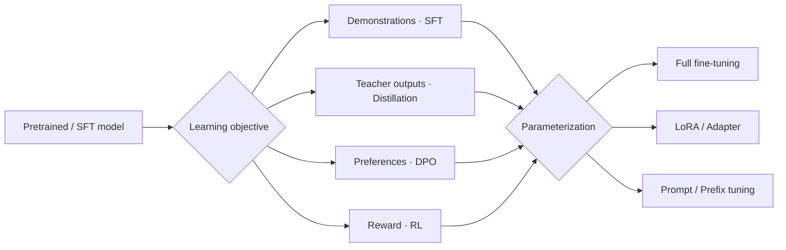

# Model Adaptation: Full Fine-Tuning, LoRA, Prompt Tuning, and Distillation

[中文](model-adaptation.md) · **English**

> Reading time: about 15 minutes · Last reviewed: 2026-10

Suppose you want a model to sort support messages into three categories—refunds, shipping, and product questions—and return the result in a required JSON format. Choosing a training method involves two decisions: what signal to learn from, and which parameters to update.

For the first, you could use demonstrations for supervised fine-tuning (SFT), or compare pairs of responses for preference training. For the second, you could update all weights or train only the extra parameters introduced by Low-Rank Adaptation (LoRA). These choices are compatible: one training run can use both LoRA and SFT. Output formatting needs its own checks, which we will return to in the classification example.

This page compares the methods. For worked calculations, continue with:

- [Prompt / Prefix / Adapter](parameter-efficient-tuning.en.md): update locations, parameter counts, and serving costs on the same small model.
- [LoRA / QLoRA](lora-and-qlora.en.md): low-rank gradients, initialization, memory, and quantization.
- [Distillation](distillation.en.md): soft targets, top-k tail mass, and on-policy prefixes.

## Four parameter-adaptation mechanisms {#four-parameter-adaptation-mechanisms}

### Full fine-tuning: every model weight may move {#full-fine-tuning-every-model-weight-may-move}

Full-parameter fine-tuning computes gradients for all parameters:

$$
\theta\leftarrow\theta-\eta\nabla_\theta\mathcal L.
$$

With every weight available for updating, training needs gradients and optimizer state for all of them. A full checkpoint also stores the complete set of weights. For the same base model, precision, and optimizer, these costs are usually higher than when training a small set of added parameters.

Full fine-tuning is worth considering when the task needs substantial adaptation and enough data and compute are available. More adjustable parameters do not guarantee better results, though. Limited data or a poorly chosen learning rate can lead to overfitting or regressions, so compare it with lighter alternatives.

### LoRA: learn a weight update rather than retraining the full matrix {#lora-learn-a-weight-update-rather-than-retraining-the-full-matrix}

For a frozen linear layer $W_0\in\mathbb R^{d_{out}\times d_{in}}$, LoRA learns a
low-rank update:

$$
W=W_0+\Delta W,\qquad \Delta W=\frac{\alpha}{r}BA,
$$

where $A\in\mathbb R^{r\times d_{in}}$, $B\in\mathbb R^{d_{out}\times r}$, and
$r\ll\min(d_{in},d_{out})$; $\alpha/r$ controls the update scale. Only $A,B$ train.
LoRA changes the linear maps in selected layers, whereas prompt tuning influences the model through its input. Different update locations and constraints do not, by themselves, tell us which method will work better. LoRA adapters can be loaded separately or, when the weight format permits it, merged into the base weights. See [LoRA / QLoRA](lora-and-qlora.en.md) for the calculations.

### Prompt Tuning: learn virtual tokens before the input {#prompt-tuning-learn-virtual-tokens-before-the-input}

Prompt tuning freezes the original model and prepends $m$ learned vectors $P$ to the input embeddings. This adds $m\,d_{model}$ parameters, where $d_{model}$ is the embedding width. The vectors form a **soft prompt**, often described as virtual tokens.

They can move freely in embedding space rather than match words in the vocabulary. A framework may assign them placeholder indices, but that does not make them a hidden natural-language instruction. [Section 2 of the original paper](https://arxiv.org/html/2104.08691v2#S2) describes the concatenation. For parameter counts and why a frozen model still needs backpropagation, see [Prompt / Prefix / Adapter](parameter-efficient-tuning.en.md).

Each task can store a tiny $P_k$ while sharing one large model:

```text
P_refund  + customer message → frozen model → refund output
P_routing + customer message → frozen model → routing output
P_summary + conversation     → frozen model → summary
```

The soft prompt remains part of the input at inference; training has not absorbed it into the base weights. It consumes $m$ context positions. In the decoder-only setting used here, every layer also processes those extra positions.

<details class="interview" markdown="1">
<summary>Worked example: Prompt Tuning for commerce-support routing</summary>

Suppose the valid classes are `refund / shipping / product question`. Train five
virtual-token embeddings for this task:

$$P_{route}=[p_1,p_2,p_3,p_4,p_5].$$

One training item is

```text
input: When will my package arrive?
label: shipping
```

The model actually receives

```text
[p1][p2][p3][p4][p5] When will my package arrive?
```

If the model assigns “shipping” a low probability, a classification loss or cross-entropy on the label tokens supplies a gradient. The model weights stay fixed; only the five $p_i$ vectors update. The aim is to make the model more likely to select the right category when these vectors are prepended. Every new message receives the same $P_{route}$ at deployment.

This adjusts how an existing model performs a task, but does not establish that it has reliably learned new policies or product facts. Correctly selecting “shipping,” for example, does not mean the model knows the store's holiday delivery schedule. Test new knowledge separately and consider retrieval, continued pretraining, LoRA, or full fine-tuning. Frequently changing rules are usually easier to maintain in a queryable data source.

</details>

### Prefix Tuning: parameters enter every layer {#prefix-tuning-parameters-enter-every-layer}

Prompt tuning adds vectors at the input embedding layer. Prefix tuning directly supplies learned prefix keys and values (K/V) to attention in each layer, where ordinary token queries can attend to them. This lets us adjust each layer's prefix states directly rather than influence them only through one set of input vectors.

Consider a decoder-only model with $L$ layers and $m$ prefix positions per layer. Storing the K/V states directly takes about $2Lmd_{KV}$ parameters, where $d_{KV}$ is the actual K/V width per layer. With grouped-query attention (GQA) or multi-query attention (MQA), this width is usually smaller than $d_{model}$. If a small multilayer perceptron (MLP) generates the prefixes, include its parameters too. [Section 4 of the original paper](https://arxiv.org/html/2101.00190v1#S4) describes the prefixes and their reparameterization; see [Prompt / Prefix / Adapter](parameter-efficient-tuning.en.md) for a worked parameter count.

```text
Prompt Tuning: prepend P to input embeddings
Prefix Tuning: add learned K/V prefixes at every attention layer
```

Both are forms of parameter-efficient fine-tuning (PEFT). Adjusting more layers provides more points of control, but task performance still depends on the model, data, and training setup—not just the parameter count.

<details class="interview" markdown="1">
<summary>One-sentence distinction: Prompt Tuning also produces K/V at every layer, so why is it different?</summary>

Soft prompts pass through the frozen model like ordinary input embeddings, producing K/V at each layer. Those states all follow from **the same set of input vectors and the frozen model's computations**. Prefix tuning supplies the per-layer K/V directly. Even if a shared small network generates them, they need not follow the original model's layer-to-layer transformations.

</details>

## Guaranteeing valid classification output {#guaranteeing-valid-classification-output}

Even when the correct label becomes more likely, the model may add an explanation or use a category name the application does not recognize. A soft prompt **cannot guarantee the required output format**. Label scoring, constrained decoding, and classification heads offer ways to restrict the output.

### Score a fixed label set {#score-a-fixed-label-set}

Avoid free generation and compare candidate sequence log-probabilities (the $P$ in the condition is the learned soft prompt, and $c_j$ is the $j$-th token of label $c$):

$$
\hat c=\arg\max_{c\in\mathcal C}\log P(c\mid P,x),
\qquad
\log P(c\mid P,x)=\sum_j\log P(c_j\mid P,x,c_{<j}).
$$

One option is to use labels such as `A/B/C` that each occupy one token in the actual generation context, then map them to the business categories. This removes differences in label length, but not the model's preferences for particular letters. Check whether changing the label mapping changes the results.

### Constrained decoding {#constrained-decoding}

Constrain **complete label sequences**, not a fixed whitelist containing every token
that appears in a label. If the legal labels are the two-token sequences `a b` and
`a c`, allowing `a/b/c` still permits the invalid sequence `b a`. Even single-token
labels `A/B/C` can produce the invalid output `AA` if generation continues for two steps.

A prefix tree can represent multi-token labels. At each step, use the **generated label
prefix** to allow only next tokens that can still lead to a legal label. Allow termination
only when the prefix is already a complete label. When one label is a prefix of another,
both termination and a valid continuation may be allowed. Mask all other logits to $-\infty$.

Here letters stand for already determined token IDs, and the reserved symbol `<EOS>`
means termination; it is not part of any label. `prefix` contains only the generated
label, not the input question. This computes allowed next tokens, not a complete decoder:

```python
def legal_next_tokens(prefix, labels):
    allowed = set()
    for label in labels:
        if label[:len(prefix)] != prefix:
            continue
        allowed.add("<EOS>" if len(prefix) == len(label) else label[len(prefix)])
    return allowed


labels = (("a", "b"), ("a", "c"))
print(sorted(legal_next_tokens((), labels)))
print(sorted(legal_next_tokens(("a",), labels)))
print(sorted(legal_next_tokens(("a", "b"), labels)))
print(sorted(legal_next_tokens(("b",), labels)))
```

The four outputs are `['a']`, `['b', 'c']`, `['<EOS>']`, and `[]`. An empty set means
the path is invalid: report failure rather than falling back to unconstrained generation.
Serving still needs tokenization, logits masking, and stopping rules. **An incomplete
label cut off by a length or time limit must not be returned as a valid result.**

If each business label has been verified to occupy one token under the actual tokenizer
and generation context, allow those tokens, **generate exactly one step and stop**, then
map that token to the enum. Prefix constraints and this single-step special case enforce
format on successful completion, not classification accuracy or successful completion
of every request.

For an implementation interface, see the [Transformers v5.20.0 prefix-constraint documentation](https://huggingface.co/docs/transformers/v5.20.0/internal/generation_utils#transformers.PrefixConstrainedLogitsProcessor)
(checked 2026-10). This example does not call the library or assume behavior in other versions. When serving through an
inference engine, the engine usually provides such constraints itself: for example,
[vLLM's structured outputs](https://docs.vllm.ai/en/stable/features/structured_outputs.html) can use `choice` to make the output exactly one of
several candidates, and also support regex, JSON schema, and grammar constraints (stable docs checked 2026-10).

### Add a classification head {#add-a-classification-head}

Take a hidden state $h$ and train a fixed-width classifier:

$$
p(c\mid x)=\operatorname{softmax}(W_ch+b).
$$

For a fixed classification-only task, this is often more direct than free-form generation. Keep the backbone frozen, train a soft prompt and small head, then map the highest-scoring class to its required label.

> Check category accuracy and output validity separately. A model can always return a valid label yet keep choosing “refund” for shipping questions. It can also choose correctly but add unwanted prose. “Output only the label” is not enough to guarantee a parsable response.

## Distillation: supervision comes from a Teacher {#distillation-supervision-comes-from-a-teacher}

Knowledge distillation trains a student model using a teacher's outputs or distributions. The teacher is usually more capable or expensive to run; the student is the model we want to train and deploy. Distillation specifies where supervision comes from, not which student parameters may change.

Three forms are common:

<span id="response-distillation"></span>**Response distillation**: the teacher generates answers, and selected responses become SFT demonstrations for the student. These are concrete outputs, not the full distribution over alternatives at each step. Sampling several answers to a question still does not expose the teacher's complete token distributions.

<span id="logit-distribution-distillation"></span>**Logit / distribution distillation**: the student matches the teacher's
token distribution, classically through a KL between both distributions softened by temperature $T$, multiplied
by $T^2$; keeping only the teacher's top-$k$ logits requires explicit handling of residual probability mass,
tokenizer mapping, masking, and normalization.

<span id="on-policy-distillation"></span>**On-policy distillation**: the student generates responses with its current policy, and the teacher supplies next-token distributions for those prefixes. This targets situations the student actually encounters, at the cost of ongoing sampling, teacher inference, and synchronizing and tracking weight versions.

For worked examples and the details of temperature and top-k, see [distillation](distillation.en.md).

The student can use full fine-tuning, LoRA, or another parameter-adaptation method. The teacher usually stays frozen and supplies supervision; the student updates from that signal.

## Choosing a method {#choosing-a-method}

| Goal | Natural starting point | Why |
| --- | --- | --- |
| many simple tasks sharing one huge model | Prompt / Prefix Tuning | store only a small task state |
| adjust model behavior with limited training resources | LoRA-SFT | directly changes selected layers; usually stores far fewer gradients, optimizer states, and task parameters than full fine-tuning |
| enough data and compute to remove constraints such as low-rank updates | Full fine-tuning | all weights can change; check task gains, resource costs, and regressions together |
| transfer a large model's capability into a small model | Distillation | Teacher can generate demonstrations at scale; logit distillation also supplies denser information than hard labels |
| fixed enum classification | Label scoring or classification head | avoid free-generation uncertainty |
| missing, changing external facts | Retrieval / tool use | model parameters should not act as a live database |

## Three interview-ready sentences {#three-interview-ready-sentences}

1. Prompt tuning learns continuous vectors rather than revising a natural-language instruction. The base model stays frozen, and the vectors remain part of the input at inference.
2. LoRA, prompt tuning, and full fine-tuning specify which parameters may change. SFT, Direct Preference Optimization (DPO), and distillation describe supervision and losses. These choices can be combined.
3. Check classification accuracy and output format separately. Label scoring, constrained decoding, or a classification head can restrict successfully returned outputs to valid categories without guaranteeing the correct category.

## Self-check {#self-check}

<div class="taste-check">
  <strong>Questions to check your understanding:</strong>
  <ol>
    <li>Why does a soft prompt not correspond to vocabulary tokens, and why can it usually not be read as words?</li>
    <li>Where do Prompt Tuning and Prefix Tuning inject their parameters?</li>
    <li>Why is “LoRA versus SFT” an incomplete comparison?</li>
    <li>How can a generative classifier be forced to return only legal enum values?</li>
    <li>What information does response distillation lose compared with token-distribution distillation?</li>
  </ol>
</div>

## Continue reading {#continue-reading}

- [SFT: how a conversation becomes a training signal](sft-and-its-ceiling.en.md)
- [Post-training infrastructure](post-training-infrastructure.en.md)

## Quick learning: separate the two axes {#quick-learning-separate-the-two-axes}

<details class="interview" markdown="1">
<summary>Explain the whole map in two minutes</summary>

First consider **the training signal and objective**. Demonstrations can train SFT; a teacher's responses or distributions can support distillation; preferred and rejected answers can train DPO; rewards for attempts can train reinforcement learning (RL).

Then decide **which parameters may change**. Update all weights, train LoRA or adapters, or learn only an input-side soft prompt. Combine these choices as needed: LoRA-SFT, LoRA-DPO, or a student trained with LoRA and teacher supervision.

> Distillation uses a teacher for supervision. LoRA and prompt tuning specify which parts of the model to update.

<details markdown="1">
<summary><b>Deep dive</b>: why does the distinction matter?</summary>

“LoRA beats SFT” does not tell us what was compared. One experiment could compare full-parameter SFT with LoRA-SFT using the same data and loss. Another could fix the trainable parameters and compare human demonstrations with teacher-generated ones, or hard-target cross-entropy with a teacher-distribution loss. State what changed before attributing the improvement to it.

</details>
</details>



## Papers {#papers}

- [The Power of Scale for Parameter-Efficient Prompt Tuning](https://arxiv.org/abs/2104.08691)
- [Prefix-Tuning](https://arxiv.org/abs/2101.00190)
- [LoRA](https://arxiv.org/abs/2106.09685)
- [Distilling the Knowledge in a Neural Network](https://arxiv.org/abs/1503.02531)
