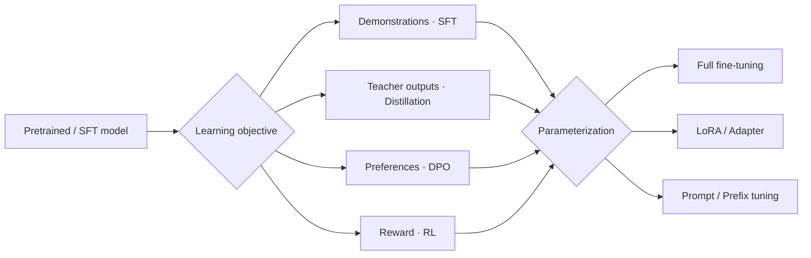

# Model Adaptation: Full Fine-Tuning, LoRA, Prompt Tuning, and Distillation

[中文](model-adaptation.md) · **English**

> Reading time: about 15 minutes · Last reviewed: 2026-10

To make a model reliably produce a required JSON format, you might update all parameters or train LoRA adapters. The signal might come from demonstrations or preference comparisons. Which parameters change and which objective trains them are separate decisions: LoRA and SFT can be used together.

This page compares the methods. For worked calculations, continue with:

- [Prompt / Prefix / Adapter](parameter-efficient-tuning.en.md): update locations, parameter counts, and serving costs on the same small model.
- [LoRA / QLoRA](lora-and-qlora.en.md): low-rank gradients, initialization, memory, and quantization.
- [Distillation](distillation.en.md): soft targets, top-k tail mass, and on-policy prefixes.

## Four parameter-adaptation mechanisms {#four-parameter-adaptation-mechanisms}

### Full fine-tuning: every model weight may move {#full-fine-tuning-every-model-weight-may-move}

Full-parameter fine-tuning computes gradients for all parameters:

$$
\theta\leftarrow\theta-\eta\nabla_\theta\mathcal L.
$$

It gives the optimizer the most freedom and usually consumes the most training memory,
optimizer state, and checkpoint storage. With limited data or poor learning-rate
control, it can also overfit or damage existing capability. It fits settings with
enough data, substantial task shift, and a real need to change internal representations.

### LoRA: learn a weight update rather than retraining the full matrix {#lora-learn-a-weight-update-rather-than-retraining-the-full-matrix}

For a frozen linear layer $W_0\in\mathbb R^{d_{out}\times d_{in}}$, LoRA learns a
low-rank update:

$$
W=W_0+\Delta W,\qquad \Delta W=\frac{\alpha}{r}BA,
$$

where $A\in\mathbb R^{r\times d_{in}}$, $B\in\mathbb R^{d_{out}\times r}$, and
$r\ll\min(d_{in},d_{out})$; $\alpha/r$ controls the update scale. Only $A,B$ train.
LoRA changes internal linear maps and
therefore has more freedom than an input-only soft prompt. Adapters can be loaded
dynamically or merged for serving.

### Prompt Tuning: learn virtual tokens before the input {#prompt-tuning-learn-virtual-tokens-before-the-input}

Prompt Tuning freezes the model and only prepends $m$ learned vectors $P$ to ordinary token
embeddings; the direct parameter count is $m\,d_{model}$. $P$ is a **soft prompt**. It is not a hidden
natural-language sentence and does not correspond to lexical token IDs in the vocabulary (a framework may
assign placeholder indices). It generally cannot be translated into readable words. For the equations, the
parameter count, and why gradients must still pass through a frozen model, see
[Prompt / Prefix / Adapter](parameter-efficient-tuning.en.md).

Each task can store a tiny $P_k$ while sharing one large model:

```text
P_refund  + customer message → frozen model → refund output
P_routing + customer message → frozen model → routing output
P_summary + conversation     → frozen model → summary
```

The soft prompt must still be prepended at inference; it is not absorbed into the base
weights. It also consumes $m$ context positions and adds those positions to every layer.

<details class="interview" markdown="1">
<summary>Worked example: Prompt Tuning for commerce-support routing</summary>

Suppose the valid classes are `refund / shipping / product question`. Train five
virtual-token embeddings for this task:

$$P_{route}=[p_1,p_2,p_3,p_4,p_5].$$

One training item is

```text
input: When will my package arrive?
label: shipping
```

The model actually receives

```text
[p1][p2][p3][p4][p5] When will my package arrive?
```

If “shipping” initially has low probability, a classification loss or label-token CE
produces a gradient. The model weights stay fixed while the five $p_i$ vectors update.
Across many examples, they learn to place the frozen model into a useful support-routing
state. Every new production message receives the same $P_{route}$.

These vectors mainly **invoke and reorganize capability already present in the model**.
If the base does not know a new company policy or product fact, a few prompt parameters
are a poor knowledge store; retrieval, continued pretraining, LoRA, or full fine-tuning
is more appropriate.

</details>

### Prefix Tuning: parameters enter every layer {#prefix-tuning-parameters-enter-every-layer}

Prompt Tuning usually adds virtual tokens only at the embedding layer. Prefix Tuning
directly provides learned prefix keys and values to attention at every layer, and ordinary token
queries can attend to them at every layer. The directly stored state is about $2Lmd_{KV}$, where
$d_{KV}$ is the actual KV width per layer, smaller than $d_{model}$ under GQA / MQA; if a small MLP
generates the per-layer prefixes, the trainable count must include that MLP. For the parameter
count term by term, see [Prompt / Prefix / Adapter](parameter-efficient-tuning.en.md). Prefix Tuning
influences every attention block more directly, uses more parameters, and often has greater capacity:

```text
Prompt Tuning: prepend P to input embeddings
Prefix Tuning: add learned K/V prefixes at every attention layer
```

Both are parameter-efficient fine-tuning (PEFT), but they are different mechanisms.

<details class="interview" markdown="1">
<summary>One-sentence distinction: Prompt Tuning also produces K/V at every layer, so why is it different?</summary>

Prompt tokens propagate like ordinary tokens and therefore produce K/V at every layer,
but those states evolve indirectly from **one shared set of input embeddings**. Prefix
Tuning directly supplies layer-specific prefix K/V, giving each layer its own control
signal.

</details>

## Guaranteeing valid classification output {#guaranteeing-valid-classification-output}

A soft prompt can make the right label more probable, but **cannot by itself guarantee
the output schema**. A reliable system separates predictive accuracy from output
validity.

### Score a fixed label set {#score-a-fixed-label-set}

Avoid free generation and compare candidate sequence log-probabilities (the $P$ in the condition is the learned soft prompt, and $c_j$ is the $j$-th token of label $c$):

$$
\hat c=\arg\max_{c\in\mathcal C}\log P(c\mid P,x),
\qquad
\log P(c\mid P,x)=\sum_j\log P(c_j\mid P,x,c_{<j}).
$$

Production systems often use single-token, equal-length labels such as `A/B/C` and map
them to business classes, avoiding tokenization and label-length bias.

### Constrained decoding {#constrained-decoding}

Constrain **complete label sequences**, not a fixed whitelist containing every token
that appears in a label. If the legal labels are the two-token sequences `a b` and
`a c`, allowing `a/b/c` still permits the invalid sequence `b a`. Even single-token
labels `A/B/C` can produce the invalid output `AA` if generation continues for two steps.

A prefix tree can represent multi-token labels. At each step, use the **generated label
prefix** to allow only next tokens that can still lead to a legal label. Allow termination
only when the prefix is already a complete label. When one label is a prefix of another,
both termination and a valid continuation may be allowed. Mask all other logits to $-\infty$.

Here letters stand for already determined token IDs, and the reserved symbol `<EOS>`
means termination; it is not part of any label. `prefix` contains only the generated
label, not the input question. This computes allowed next tokens, not a complete decoder:

```python
def legal_next_tokens(prefix, labels):
    allowed = set()
    for label in labels:
        if label[:len(prefix)] != prefix:
            continue
        allowed.add("<EOS>" if len(prefix) == len(label) else label[len(prefix)])
    return allowed


labels = (("a", "b"), ("a", "c"))
print(sorted(legal_next_tokens((), labels)))
print(sorted(legal_next_tokens(("a",), labels)))
print(sorted(legal_next_tokens(("a", "b"), labels)))
print(sorted(legal_next_tokens(("b",), labels)))
```

The four outputs are `['a']`, `['b', 'c']`, `['<EOS>']`, and `[]`. An empty set means
the path is invalid: report failure rather than falling back to unconstrained generation.
Serving still needs tokenization, logits masking, and stopping rules. **An incomplete
label cut off by a length or time limit must not be returned as a valid result.**

If each business label has been verified to occupy one token under the actual tokenizer
and generation context, allow those tokens, **generate exactly one step and stop**, then
map that token to the enum. Prefix constraints and this single-step special case enforce
format on successful completion, not classification accuracy or successful completion
of every request.

For an implementation interface, see the [Transformers v5.20.0 prefix-constraint documentation](https://huggingface.co/docs/transformers/v5.20.0/internal/generation_utils#transformers.PrefixConstrainedLogitsProcessor)
(checked 2026-10). This example does not call the library or assume behavior in other versions. When serving through an
inference engine, the engine usually provides such constraints itself: for example,
[vLLM's structured outputs](https://docs.vllm.ai/en/stable/features/structured_outputs.html) can use `choice` to make the output exactly one of
several candidates, and also support regex, JSON schema, and grammar constraints (stable docs checked 2026-10).

### Add a classification head {#add-a-classification-head}

Take a hidden state $h$ and train a fixed-width classifier:

$$
p(c\mid x)=\operatorname{softmax}(W_ch+b).
$$

For a fixed classification-only task this is often more direct than free-form decoder
generation. The backbone can remain frozen while a soft prompt and small head train.

> **The model or soft prompt improves accuracy; a serving constraint guarantees the schema.** Do not rely on a natural-language instruction saying “output only the label.”

## Distillation: supervision comes from a Teacher {#distillation-supervision-comes-from-a-teacher}

Knowledge Distillation normally has a capable or expensive Teacher and a Student that
will be deployed. It is not one fixed parameter-update method; it is a family of
supervision sources.

Three forms are common:

<span id="response-distillation"></span>**Response distillation**: the Teacher generates answers and the Student treats them
as SFT demonstrations; this is simple but keeps only one sampled output and loses the Teacher's relative
preference over alternative tokens.

<span id="logit-distribution-distillation"></span>**Logit / distribution distillation**: the Student matches the Teacher's
token distribution, classically through a KL between both distributions softened by temperature $T$, multiplied
by $T^2$; keeping only Teacher top-$k$ logits requires explicit handling of residual probability mass,
tokenizer mapping, masking, and normalization.

<span id="on-policy-distillation"></span>**On-policy distillation**: the Student samples from its current
policy, then the Teacher scores token distributions on those prefixes; supervision follows states the Student
actually visits, at the cost of continuous rollouts, Teacher inference, and weight-version management.

For worked examples and the details of temperature and top-k, see [distillation](distillation.en.md).

Distillation combines with any parameterization: the Student may full fine-tune or train
only LoRA. The Teacher is normally frozen; the Student is optimized and deployed.

## Choosing a method {#choosing-a-method}

| Goal | Natural starting point | Why |
| --- | --- | --- |
| many simple tasks sharing one huge model | Prompt / Prefix Tuning | store only a small task state |
| substantial behavior change under limited resources | LoRA-SFT | more capacity than a soft prompt; far fewer trainable parameters, less optimizer state, and smaller checkpoints than full FT |
| ample data, large task shift, maximum adaptation ceiling | Full Fine-Tuning | fewest parameter constraints, highest cost and regression risk |
| transfer a large model's capability into a small model | Distillation | Teacher can generate demonstrations at scale; logit distillation also supplies denser information than hard labels |
| fixed enum classification | Label scoring or classification head | avoid free-generation uncertainty |
| missing, changing external facts | Retrieval / tool use | model parameters should not act as a live database |

## Three interview-ready sentences {#three-interview-ready-sentences}

1. Prompt Tuning learns continuous virtual-token embeddings, not a natural-language prompt; the model is frozen and the prompt remains prepended at inference.
2. LoRA, Prompt Tuning, and full fine-tuning specify which parameters update; SFT, DPO, and distillation specify supervision and objective, so the two sets compose.
3. For classification, training improves accuracy while fixed-label scoring, constrained decoding, or a classification head guarantees output validity.

## Self-check {#self-check}

<div class="taste-check">
  <strong>If you understand the page, you can explain:</strong>
  <ol>
    <li>Why does a soft prompt not correspond to vocabulary tokens, and why can it usually not be read as words?</li>
    <li>Where do Prompt Tuning and Prefix Tuning inject their parameters?</li>
    <li>Why is “LoRA versus SFT” an incomplete comparison?</li>
    <li>How can a generative classifier be forced to return only legal enum values?</li>
    <li>What information does response distillation lose compared with token-distribution distillation?</li>
  </ol>
</div>

## Continue reading {#continue-reading}

- [SFT: how a conversation becomes a training signal](sft-and-its-ceiling.en.md)
- [Post-training infrastructure](post-training-infrastructure.en.md)

## Quick learning: separate the two axes {#quick-learning-separate-the-two-axes}

<details class="interview" markdown="1">
<summary>Explain the whole map in two minutes</summary>

The first axis is the **learning objective**: demonstrations produce SFT, teacher
distributions produce distillation, chosen/rejected pairs produce DPO, and rewards
produce RL.

The second axis is **parameterization**: update all weights, train LoRA / Adapters, or
train only an input-side soft prompt. The axes can be combined: LoRA-SFT, LoRA-DPO, or
a LoRA-parameterized student trained by distillation.

> **Distillation determines that supervision comes from a teacher. LoRA and Prompt Tuning determine which parameters gradients may change.**

<details markdown="1">
<summary><b>Deep dive</b>: why does the distinction matter?</summary>

“LoRA beats SFT” is an incomplete experiment: LoRA is an update mechanism while SFT is
a data-and-loss choice. Compare full-parameter SFT with LoRA-SFT, or compare SFT with
distillation under the same parameterization. Otherwise two variables changed at once.

</details>
</details>



## Papers {#papers}

- [The Power of Scale for Parameter-Efficient Prompt Tuning](https://arxiv.org/abs/2104.08691)
- [Prefix-Tuning](https://arxiv.org/abs/2101.00190)
- [LoRA](https://arxiv.org/abs/2106.09685)
- [Distilling the Knowledge in a Neural Network](https://arxiv.org/abs/1503.02531)
