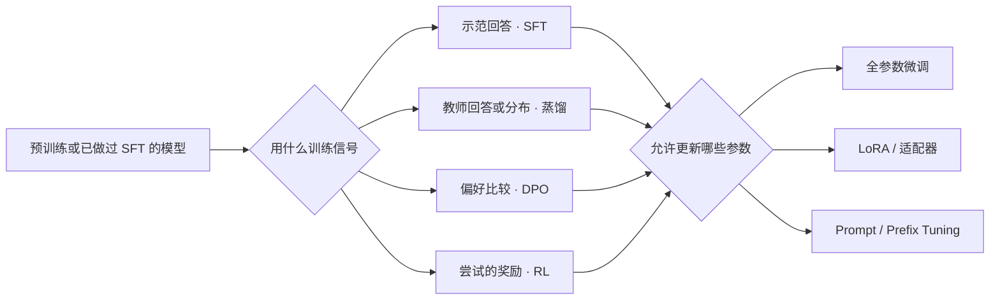

# 模型适配：Full Fine-Tuning、LoRA、Prompt Tuning 与蒸馏

**中文** · [English](model-adaptation.en.md)

> 阅读时间：约 15 分钟 · 最近审阅：2026-10

假设你想让模型把客服消息分成“退款、物流、商品咨询”三类，再按规定的 JSON 格式输出。选训练方法时，会遇到两个问题：用什么信号教它，以及允许修改哪些参数。

前一个问题，可以用示范做监督微调，也可以用成对回答做偏好训练；后一个问题，可以更新全部权重，也可以只训练低秩适配（Low-Rank Adaptation，LoRA）的附加参数。因此，LoRA 和 SFT 并不冲突：一次训练完全可以同时用到两者。输出格式还需要单独检查，后面会用这个分类任务继续说明。

这页负责比较方法。想看具体计算，可以接着读：

- [Prompt / Prefix / Adapter](parameter-efficient-tuning.md)：同一小模型里，更新位置、参数量和部署成本怎样不同。
- [LoRA / QLoRA](lora-and-qlora.md)：低秩更新的梯度、初始化、显存与量化。
- [蒸馏](distillation.md)：软标签、top-k 尾部概率与 on-policy 前缀。

## 四种参数适配方式 {#_2}

### 全参数微调：更新整套权重 {#full-fine-tuning}

全参数微调（full fine-tuning）允许更新模型的全部参数：

$$
\theta\leftarrow\theta-\eta\nabla_\theta\mathcal L.
$$

因为所有权重都可以改变，训练时需要为它们计算梯度，并保存相应的优化器状态；保存完整检查点也要存下整套权重。在同一个基座、精度和优化器设置下，这些开销通常比只训练少量附加参数更大。

如果新任务需要较大的调整、数据和预算也足够，全参数微调值得尝试。不过，“能改的参数多”不等于效果一定更好。数据不足或学习率不合适时，它可能过拟合，也可能让原有能力下降；仍要与更轻量的方法比较。

### LoRA：学习权重更新，而不是重训整块权重 {#lora}

对冻结的线性层 $W_0\in\mathbb R^{d_{out}\times d_{in}}$，LoRA 学习低秩增量：

$$
W=W_0+\Delta W,\qquad \Delta W=\frac{\alpha}{r}BA,
$$

其中 $A\in\mathbb R^{r\times d_{in}}$、$B\in\mathbb R^{d_{out}\times r}$，且
$r\ll\min(d_{in},d_{out})$；$\alpha/r$ 控制增量尺度。基础权重冻结，只更新 $A,B$。
它直接改变所选层的线性变换，而 Prompt Tuning 从输入侧影响模型。两者的更新位置和约束不同，不能仅凭这一点断定谁的效果更好。LoRA 部署时可以单独加载，也可以在权重格式允许时合并到基础权重中；具体计算见 [LoRA / QLoRA](lora-and-qlora.md)。

### Prompt Tuning：在输入前加一组可学习向量 {#prompt-tuning-virtual-tokens}

Prompt Tuning 冻结原模型，在输入的嵌入向量前拼接 $m$ 个可学习向量 $P$，直接参数量是 $m\,d_{model}$，其中 $d_{model}$ 是嵌入维度。这组向量叫**软提示（soft prompt）**，也常被称为虚拟 token（virtual tokens）。

这些向量可以在连续空间里更新，不必对应词表中的某个词。框架即使给它们分配了占位索引，也不代表它们是一句藏起来的自然语言指令。[原论文的第 2 节](https://arxiv.org/html/2104.08691v2#S2)给出了这种拼接方式；参数量的计算和“模型冻结了，为什么还需要反向传播”，见 [Prompt / Prefix / Adapter](parameter-efficient-tuning.md)。

每个任务可以保存一份很小的 $P_k$，共享同一个大模型：

```text
P_refund  + 用户消息 → 冻结模型 → 退款任务输出
P_routing + 用户消息 → 冻结模型 → 路由任务输出
P_summary + 对话记录 → 冻结模型 → 摘要
```

推理时仍要在输入前放上这组软提示，训练并没有把它写入基础权重。代价是多占 $m$ 个上下文位置；以这里的 decoder-only 模型为例，每层也都要处理这些额外位置。

<details class="interview" markdown="1">
<summary>完整例子：用 Prompt Tuning 做电商客服分类</summary>

假设固定类别为 `退款 / 物流 / 商品咨询`。为这个任务训练五个虚拟 token 的嵌入向量：

$$P_{route}=[p_1,p_2,p_3,p_4,p_5].$$

一条训练数据是：

```text
输入：我的包裹什么时候到？
标签：物流
```

模型实际接收：

```text
[p1][p2][p3][p4][p5] 我的包裹什么时候到？
```

如果模型给“物流”的概率很低，就可以用分类损失，或标签 token 的交叉熵计算梯度。模型权重保持不变，只更新这五个 $p_i$。训练的目标是让拼上它们之后的模型更容易选对类别。上线时，每条新消息都使用同一组 $P_{route}$。

这组向量适合用来调整已有模型的任务行为，但不能因此假定它已经可靠学会新政策或新商品知识。例如，“物流”分类正确，不代表模型知道这家店春节期间的发货安排。涉及新事实时，要另外测试，也可以比较检索、继续预训练、LoRA 和全参数微调；更新频繁的规则通常更适合放在可查询的数据源里。

</details>

### Prefix Tuning：不只在输入层加向量 {#prefix-tuning}

Prompt Tuning 在输入嵌入层加向量；Prefix Tuning 则为各层注意力直接提供可学习的前缀键和值（prefix keys and values，K/V）。普通 token 在计算注意力时，可以通过查询向量关注这些前缀。区别在于：现在可以直接调整每层的前缀状态，不必全靠一组输入向量逐层传过去。

这里以 decoder-only 模型为例。若有 $L$ 层、每层 $m$ 个前缀位置，直接存下这些 K/V 约需 $2Lmd_{KV}$ 个参数，其中 $d_{KV}$ 是每层实际的 K/V 宽度。使用分组查询注意力（GQA）或多查询注意力（MQA）时，这个宽度通常小于 $d_{model}$；若用一个小型多层感知机（MLP）生成各层前缀，还要把它的参数算进去。[原论文第 4 节](https://arxiv.org/html/2101.00190v1#S4)介绍了前缀及其重参数化方式；逐项计算见 [Prompt / Prefix / Adapter](parameter-efficient-tuning.md)。

```text
Prompt Tuning：在输入嵌入向量前加 P
Prefix Tuning：在每层注意力中加入可学习的 K/V 前缀
```

两者都属于参数高效微调（parameter-efficient fine-tuning，PEFT）。直接调整更多层给了我们更多控制位置，但任务效果仍取决于模型、数据和训练设置，不能只按参数量排高低。

<details class="interview" markdown="1">
<summary>一句话分清：为什么 Prompt Tuning 也会产生每层 K/V，却仍不等于 Prefix Tuning？</summary>

软提示像普通 token 的嵌入一样，从输入层向后传播，因此也会产生每层的 K/V。不过，这些状态都由**同一组输入向量经过冻结的模型计算得到**。Prefix Tuning 则直接提供各层的前缀 K/V；即使用一个共享的小网络生成它们，也不必受原模型逐层传播关系的限制。

</details>

## 分类输出怎么保证只落在合法标签里 {#_3}

即使模型更倾向于正确标签，也可能多写一句解释，或输出业务代码不认识的名称。软提示本身**不能保证输出符合规定的格式（schema）**，还需要选择标签打分、约束解码或分类头等方式来限制输出。

### 方法一：直接给固定标签打分 {#_4}

一种直接做法是不给模型自由发挥的空间，而是分别计算各个候选标签的序列对数概率。条件里的 $P$ 是前面学到的软提示，$c_j$ 是标签 $c$ 的第 $j$ 个 token：

$$
\hat c=\arg\max_{c\in\mathcal C}\log P(c\mid P,x),
\qquad
\log P(c\mid P,x)=\sum_j\log P(c_j\mid P,x,c_{<j}).
$$

可以选用在当前上下文中各占一个 token 的 `A/B/C`，再映射到业务标签。这样能去掉标签长度不同带来的影响，但并不消除模型对字母本身的偏好；仍应检查换一种标签映射后结果是否稳定。

### 方法二：约束解码 {#constrained-decoding}

约束解码（constrained decoding）限制的是**完整标签序列**，不能只把标签里出现过的 token 合成一张固定白名单。
例如合法标签是两个 token 组成的 `a b` 和 `a c`，仅允许 `a/b/c` 仍会生成非法的
`b a`。即使标签都是单 token 的 `A/B/C`，连续生成两步也可能得到非法的 `AA`。

多 token 标签可以组织成前缀树：每一步根据**已经生成的标签前缀**，只保留仍能到达某个
合法标签的下一 token；只有当前前缀已经是完整标签，才允许结束。若一个标签也是另一个
标签的前缀，可以结束，也可以沿合法分支继续。对其余 logits 置 $-\infty$。

下面用字母代指已经确定的 token ID，用保留符号 `<EOS>` 表示结束；它不属于任何标签。
`prefix` 只包含新生成的标签部分，不包含输入问题。这只是下一步允许集合的示例，不是完整解码器：

```python
def legal_next_tokens(prefix, labels):
    allowed = set()
    for label in labels:
        if label[:len(prefix)] != prefix:
            continue
        allowed.add("<EOS>" if len(prefix) == len(label) else label[len(prefix)])
    return allowed


labels = (("a", "b"), ("a", "c"))
print(sorted(legal_next_tokens((), labels)))
print(sorted(legal_next_tokens(("a",), labels)))
print(sorted(legal_next_tokens(("a", "b"), labels)))
print(sorted(legal_next_tokens(("b",), labels)))
```

四行输出依次是 `['a']`、`['b', 'c']`、`['<EOS>']`、`[]`。最后一个空集合表示路径已非法，
应报告失败，不能退回“不加约束”。实际服务还要处理 tokenization、logits mask 和停止条件；
被长度或时间上限截断的**未完成标签不能作为合法结果返回**。

若已验证业务标签在当前 tokenizer 和生成上下文中分别对应一个 token，则可以只允许这些
token，**恰好生成一步就停止**，再映射回业务枚举。前缀约束或这个单步特例保证的是成功完成
时的格式，不是分类准确率；它们也不保证每次请求都能成功完成。

实现接口可参考 [Transformers v5.20.0 的前缀约束文档](https://huggingface.co/docs/transformers/v5.20.0/internal/generation_utils#transformers.PrefixConstrainedLogitsProcessor)
（2026-10 核对）；这里没有调用该库，也没有假设其他版本的行为。用推理服务部署时，引擎通常自带这类约束：例如
[vLLM 的 structured outputs](https://docs.vllm.ai/en/stable/features/structured_outputs.html) 可以用 `choice` 让输出恰好是几个候选之一，
也支持正则、JSON schema 和语法约束（2026-10 核对 stable 文档）。

### 方法三：分类头 {#classification-head}

取一个 hidden state $h$，训练固定输出维度的分类头：

$$
p(c\mid x)=\operatorname{softmax}(W_ch+b).
$$

类别固定、只需要分类时，这通常比让解码器自由生成更直接。可以冻结主干模型，同时训练软提示与一个小分类头；随后取分数最高的类别，映射成规定的标签。

> 选对类别和返回合法格式，需要分别检查。模型可能稳定返回合法标签，却总把“物流”判成“退款”；也可能分类正确，却夹带额外解释。单靠一句“请只输出标签”，不能保证后端一定能解析。

## 蒸馏：用教师模型提供监督 {#distillation-teacher}

知识蒸馏（knowledge distillation）用教师模型的输出或分布训练学生模型。教师通常能力更强，或运行成本更高；学生是我们想训练和部署的模型。“蒸馏”说明监督从哪里来，还没有规定学生的哪些参数可以更新。

常见的有三种：

<span id="response-distillation"></span>**回答蒸馏（response distillation）**：教师先生成答案，学生把筛选后的回答当示范做 SFT。保存的是具体生成结果，看不到每一步其他 token 的完整概率；即使一个问题采样多份回答，也不等于拿到了教师的完整分布。

<span id="logit-distribution-distillation"></span>**分布蒸馏（logit / distribution distillation）**：学生拟合教师的 token 分布。经典做法是用温度 $T$ 软化两边分布后计算 KL 散度，再乘 $T^2$。如果只存教师概率最高的 $k$ 个 token，还要处理剩余概率、词表对应关系，以及哪些位置参与损失、损失怎样取平均。

<span id="on-policy-distillation"></span>**同策略蒸馏（on-policy distillation）**：学生先用当前策略生成回答，教师再对这些前缀给出下一 token 的分布。这样能针对学生实际会生成的内容提供指导，代价是持续采样、运行教师模型，以及同步和记录使用的权重版本。

三种做法的算例、温度和 top-k 的细节见[蒸馏](distillation.md)。

学生可以做全参数微调，也可以只训练 LoRA，或采用其他参数适配方式。教师通常保持冻结，用来提供监督；学生则根据这些信号更新。

## 怎么选 {#_5}

| 目标 | 更自然的起点 | 原因 |
| --- | --- | --- |
| 多个简单任务共享同一超大模型 | Prompt / Prefix Tuning | 每个任务只保存少量参数 |
| 需要调整模型行为，但训练资源有限 | LoRA-SFT | 直接调整所选层；通常比全参数微调少存很多梯度、优化器状态和任务参数 |
| 数据和预算充足，希望解除低秩等参数约束 | 全参数微调 | 所有权重都可更新；需要同时检查任务收益、资源成本和原有能力回退 |
| 把大模型能力迁到小模型 | 蒸馏 | 可以用教师生成示范，或提供候选 token 的概率，而不只给一个目标答案 |
| 固定枚举分类 | 标签打分或分类头 | 直接在合法类别中选，不需要自由生成 |
| 缺少会变化的外部事实 | 检索或工具调用 | 把易变信息放在可更新、可查询的数据源里 |

## 面试时最值得说清楚的三句话 {#_6}

1. Prompt Tuning 学的是连续向量，不是反复修改一句自然语言提示；基础模型冻结，推理时仍要把这组向量拼到输入前。
2. LoRA、Prompt Tuning 和全参数微调说明哪些参数可以更新；SFT、直接偏好优化（Direct Preference Optimization，DPO）和蒸馏说明怎样提供监督、怎样计算损失，两类选择可以组合。
3. 分类准确率和输出格式要分别验证。固定标签打分、约束解码或分类头能把成功返回的结果限制在合法类别里，但不保证选对类别。

## 自检 {#_7}

<div class="taste-check">
  <strong>可以用这几个问题检查自己的理解：</strong>
  <ol>
    <li>为什么软提示不必对应词表里的某个词，也不一定能还原成可读的句子？</li>
    <li>Prompt Tuning 与 Prefix Tuning 分别在哪一层加入参数？</li>
    <li>为什么“LoRA 和 SFT 哪个更好”不是一个完整的问题？</li>
    <li>如何让生成式分类器保证只返回合法枚举值？</li>
    <li>只保存教师的回答，和保存每一步的 token 分布，能给学生提供的信息有何不同？</li>
  </ol>
</div>

## 继续阅读 {#_8}

- [SFT：一条对话怎样变成训练信号](sft-and-its-ceiling.md)
- [后训练基础设施](post-training-infrastructure.md)

## 快速学习：先把两条轴分开 {#_1}

<details class="interview" markdown="1">
<summary>两分钟讲清这些方法到底差在哪里</summary>

**先看训练信号和目标**：示范可以用于 SFT；教师的回答或分布可以用于蒸馏；一对较好与较差的回答可以用于 DPO；对尝试结果的奖励可以用于强化学习。

**再看允许更新的参数**：可以更新全部权重，训练 LoRA 或适配器（Adapter），也可以只训练输入侧的软提示。两种选择可以组合，例如 LoRA-SFT、LoRA-DPO，或用 LoRA 训练一个接受教师监督的学生模型。

> 蒸馏用教师提供监督；LoRA 和 Prompt Tuning 决定更新模型的哪些部分。

<details markdown="1">
<summary><b>深挖</b>：为什么这个区分很重要？</summary>

如果实验说“LoRA 比 SFT 好”，我们还不知道它究竟比了什么。可以在相同数据和损失下比较全参数 SFT 与 LoRA-SFT；也可以固定参数更新方式，比较人工示范与教师生成的示范，或者比较目标答案的交叉熵与教师分布的蒸馏损失。要先说清哪一项发生了变化，才能判断提升来自哪里。

</details>
</details>



## 参考论文 {#_9}

- [The Power of Scale for Parameter-Efficient Prompt Tuning](https://arxiv.org/abs/2104.08691)
- [Prefix-Tuning](https://arxiv.org/abs/2101.00190)
- [LoRA](https://arxiv.org/abs/2106.09685)
- [Distilling the Knowledge in a Neural Network](https://arxiv.org/abs/1503.02531)
