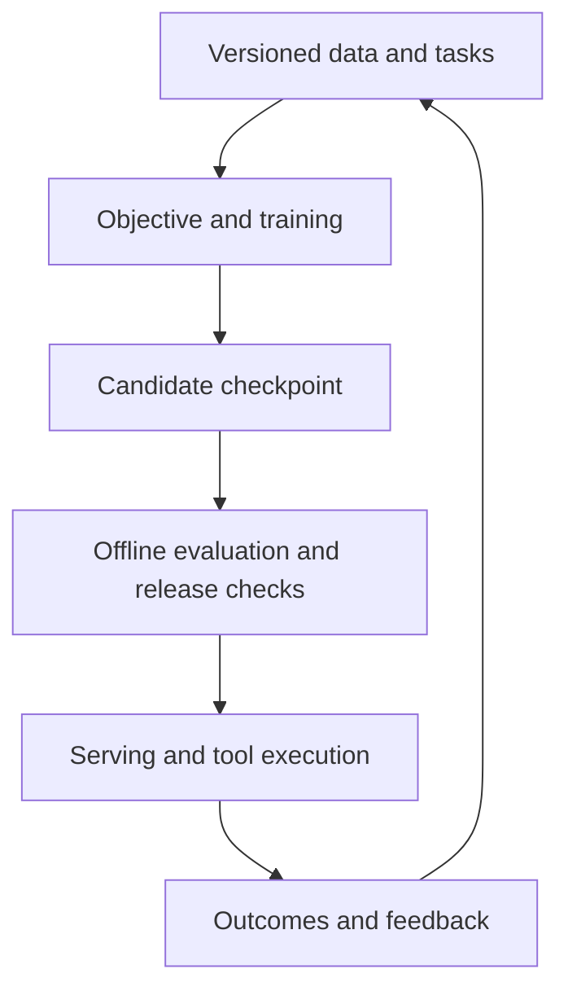
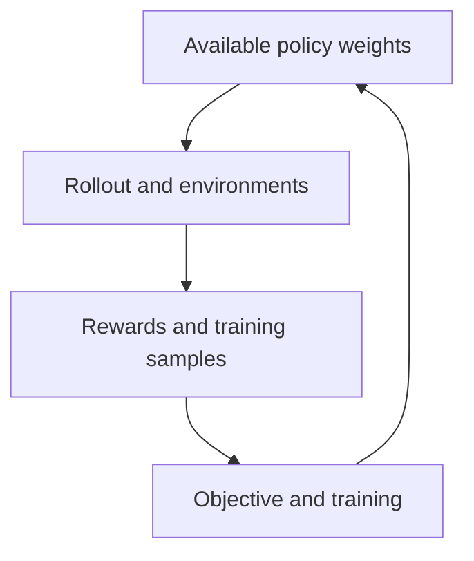

# ML and LLM systems: from data and models to running services

[中文](mlsys-llmsys-map.md) · **English**

A user asks, “What drove revenue growth in this report?” A demo might retrieve a few passages and pass them to a model. Once people start using it, there is more to handle: is the report current, is this user allowed to read it, will concurrent requests slow each other down, and does a new model actually give better answers?

ML systems connect this work. The model matters, but so do the data, computing resources, services, and feedback around it. These notes use the document assistant to explain a request, a training update, and multi-GPU execution, before looking at why RL repeatedly generates data and updates the model.

If you are new to the topic, start with the request flow below; you do not need to recognize every framework name yet. If you already work with these systems, jump to [bottleneck analysis](mlsys-llmsys-map.en.md#budgets) or the [source walkthroughs](../practice/runtime-reading/README.en.md). The assistant is a hypothetical project, and the numbers are worked examples rather than a product's internal design or measured performance.

## What has to work besides the model? {#scope}

Putting a model into use means different things for different tasks. A classifier may need to wait for labels to arrive. A recommender needs to record which items were shown. An LLM service has to schedule generation and caching for requests of different lengths. Computation, storage, communication, and scheduling support these concrete needs.

A research project can focus on one problem, such as reducing communication. A product also needs the other pieces to work together: data and model updates, releases, recovery from failures, and user feedback.

| Setting | Work beyond the model | An easy detail to miss |
| --- | --- | --- |
| Classification and prediction | Feature pipelines, delayed labels, batch or online scoring | Is the training feature available at prediction time? |
| Search and recommendation | Candidates, indexes, ranking, exposure and feedback | Unshown candidates are not automatically negative labels |
| LLM training and post-training | Large model state, long sequences, rollout, rewards, weight synchronization | Which policy generated the sample? |
| LLM serving and agents | KV cache, request scheduling, tools, permissions and deadlines | Correct text and successful actions need separate checks |

LLM systems are one area within ML systems. These notes focus on long token sequences, generation state, splitting large models across GPUs, and coordinating training with inference. [An ML system from data to users](../practice/ml-system/README.en.md) covers the broader data, index, serving, and feedback process. [Hidden Technical Debt in ML Systems](https://research.google/pubs/hidden-technical-debt-in-machine-learning-systems/) also explains why so many dependencies accumulate outside the model code.

## Follow a question through the service {#layers}

Follow the user's question once. Assume the documents have already been cleaned and indexed. The request uses fixed model weights; training is not happening while this user waits:

| Request stage | What it produces | What a failure might look like |
| --- | --- | --- |
| Retrieve report passages the user is allowed to access | The question and supporting evidence | Fluent answers based on the wrong material |
| Assemble the prompt, tokenize, and queue | A request with lengths and generation settings | Excessive waiting or incorrect input truncation |
| Run prefill | Input KV and logits for the first output token | Long inputs delay the first word |
| Continue with decode | New tokens and a growing cache | A quick first word followed by slow output; exhausted cache capacity |
| Return the answer and retain useful timings and feedback | A user-visible result and evidence for investigation | Client timeouts after computation finishes; failures that cannot be reproduced |

A wrong answer might come from retrieving the wrong report or from the model misunderstanding it. A delayed answer might still be waiting in a queue, before model computation has begun. Following the request helps locate the problem before changing the model.

Retrieval, modeling, inference services, and the compute platform may belong to different teams. Understanding the whole system does not mean implementing every module yourself. It means knowing what reaches your part and who depends on what you produce.

### First: how does the system deliver a result?

The assistant needs clean, indexed reports before it can retrieve passages and generate answers. When investigating a mistake, you want the report, permissions, model version, and result from that request. If the report has since changed, reproducing the mistake can otherwise be difficult. A recommender retrieves candidate items and returns a ranked list instead, but still needs defined inputs and a way to judge its output.

Training a new model involves more than launching a script. You need data and labels, offline evaluations that cover real problems, and a way to restore the previous version if a release goes wrong. [Data to models](../practice/ml-system/data-to-model.en.md) and [post-training practice](../practice/post-training/README.en.md) walk through that work.

### Second: how does the model execute computation?

The question and report become tokens, then tensors the model can process. Generation processes the input and predicts new tokens one at a time. Training also computes a loss, runs backward, and updates parameters. Even with the same model, these tasks retain different intermediate results and use GPUs differently. Compute, memory capacity, bandwidth, and communication between GPUs all affect execution.

PyTorch provides model computation and automatic differentiation; FSDP2 and Megatron organize multi-GPU training; vLLM and SGLang schedule generation requests. These separate jobs make the frameworks easier to place. See [training frameworks](training-frameworks.en.md), [inference engines](inference-frameworks.en.md), and [distributed training](distributed-training.en.md).

### Third: how does computation obtain devices and run reliably?

A finished training script does not guarantee available GPUs. Processes still need machines and devices, and the machines must communicate correctly. If the run fails halfway through, it needs a state to resume from. CUDA, communication libraries, cluster scheduling, and application recovery all matter here. Continue with [CUDA](../12-infra/cuda.en.md) and [execution boundaries](execution-boundaries.en.md).

With these levels in mind, the tools are easier to place. Several may coexist in a system; not every system needs all of them:

| Tool or mechanism | Main responsibility in this path |
| --- | --- |
| NeMo RL, verl, AReaL | Connect RL sampling, rewards, learning and weight updates |
| FSDP2, Megatron | Organize training computation, model state and multi-GPU cooperation |
| vLLM, SGLang | Schedule generation requests, execute models and manage generation state |
| CUDA and operator libraries | Express and execute device computation and data movement |
| Kubernetes, Slurm | Manage cluster workloads and resource allocation |
| Ray | Provide a runtime for distributed tasks, actors and placement |

For example, NeMo RL can sample through a generation backend and pass the samples to a training backend for parameter updates. Kubernetes might place those processes on machines in a cluster. Seeing several framework names in one deployment is normal: each does part of the work. The supported combinations still depend on their versions and configuration.

## After the request, how does the model improve? {#loops}

Once the user receives an answer, that request is finished. If the answer was wrong, improving the next model starts another process: curate data, train, evaluate, and decide whether to release. That process is separate from the few seconds the user spends waiting for a response.

### Model release and user feedback

Suppose users report answers citing the wrong reports. First investigate whether retrieval or generation caused the mistakes, then select suitable training examples. The existing model can keep serving users while the next version is trained and evaluated. Logs help identify problems, but their feedback needs cleaning, evaluation, and selection before it can become a label.

### RL training contains another sampling loop

RL repeatedly samples and updates within a training run. The policy generates actions, interacts with an environment, and records outcomes and rewards; this sampling process is called a rollout. Training uses those records to update parameters, which can then be used for subsequent sampling.

Sampling can use vLLM or SGLang too, but it differs from serving answers to users. Weights may change frequently, samples must retain the information training needs, and failures must recover the training state. RL frameworks therefore also manage sample queues, policy versions, and weight synchronization.

In the implementation, telling a trainer to start may take only a small RPC, while samples, weights, and gradients travel through another channel. The arrows above show dependencies between steps. Following the code reveals where HTTP, shared memory, or NCCL is used, and where tensors are actually copied.

## Where is it slow, and what did the change improve? {#budgets}

“The answer is slow” needs unpacking. For a delayed first word, separate queueing, retrieval, and prefill. For quick initial output followed by long pauses, investigate decode, streaming, and networking. These are starting points; timings and traces establish the actual bottleneck.

1. **Recover the configuration first.** Which data, model, and tokenizer versions were used? Did sampling settings, masks, or rewards change? Otherwise, the two runs may not be comparable.
2. **Break down memory use.** How much do parameters, optimizer state, activations, KV, communication buffers, and workspaces occupy, and which coexist?
3. **Break down elapsed time too.** How much goes to queueing, preparation, compute, communication, synchronization, and recovery? GPU utilization explains only part of this.
4. **Compare complete runs.** At a fixed GPU count, what are elapsed time and GPU-hours? Faster steps may not save money if more steps are needed to reach the same quality.

Now consider training. Suppose generation, learning, and synchronization run serially. Training becomes twice as fast; the other phases stay unchanged:

| Phase | Before | After |
| --- | --- | --- |
| Generate answers | 60 seconds | 60 seconds |
| Update the model | 25 seconds | 12.5 seconds |
| Synchronize weights | 5 seconds | 5 seconds |
| **Whole cycle** | **90 seconds** | **77.5 seconds** |

The overall speedup is 90 / 77.5 ≈ **1.16×**. Training really is twice as fast, but it was not the largest part of the cycle. Even this calculation excludes additional communication and changes in output length. A 2× kernel improvement does not establish a 2× system improvement. [Async RL](async-rl.en.md) explains why overlapping phases also requires resource and learning-quality accounting.

## Choose what to read next {#learning-route}

| Order | What you want to understand | Something to try |
| --- | --- | --- |
| 1 | How does data become a model users can access? | Draw the path to release, including versions, evaluation, and rollback |
| 2 | What must forward, backward, and an optimizer update retain? | Pick a tiny model, write down shapes and dtypes, and estimate memory |
| 3 | What does each GPU store and exchange? | Draw the data and communication paths for DDP, FSDP, and TP |
| 4 | How do prefill and decode use cached state? | Trace one request and estimate its KV bytes |
| 5 | How does a rollout become a training sample? | Inspect tokens, behavior logprobs, groups, masks, and policy versions |
| 6 | When generation overlaps training, which policy produced each sample? | Draw queues and version changes, then add backpressure and recovery |
| 7 | What improves after a kernel or cluster change? | Change one variable, compare results, and find where the change stops helping |

You do not need to finish the table before doing useful work. Start with the problem in front of you. After changing a gather operation, use a small experiment to check gradients, peak memory, and distributed correctness before scaling up. If a job is stuck Pending and has no GPU yet, inspect resources and scheduling; a faster attention kernel cannot help at that point.

For a first pass: [CPU-to-GPU execution](execution-boundaries.en.md#runtime) → [one update and Megatron basics](megatron-basics.en.md) → return to [cluster and GPU scheduling](execution-boundaries.en.md#scheduling) → [RL framework dataflow](rl-systems.en.md) → [async RL and AReaL](async-rl.en.md). For online serving first, begin with [one request end to end](llm-serving.en.md), then read vLLM / SGLang.

To connect these concepts to real code, continue with the [source walkthroughs](../practice/runtime-reading/README.en.md): distinguish prefill from decode on one request, follow vLLM/SGLang scheduling and NeMo RL training, then examine how loss, masks, numerics, and recovery affect training stability.
