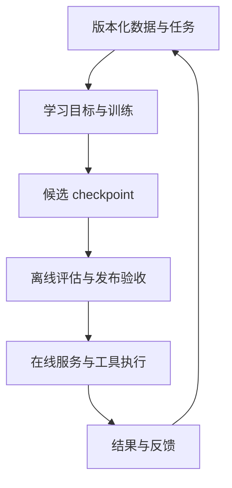
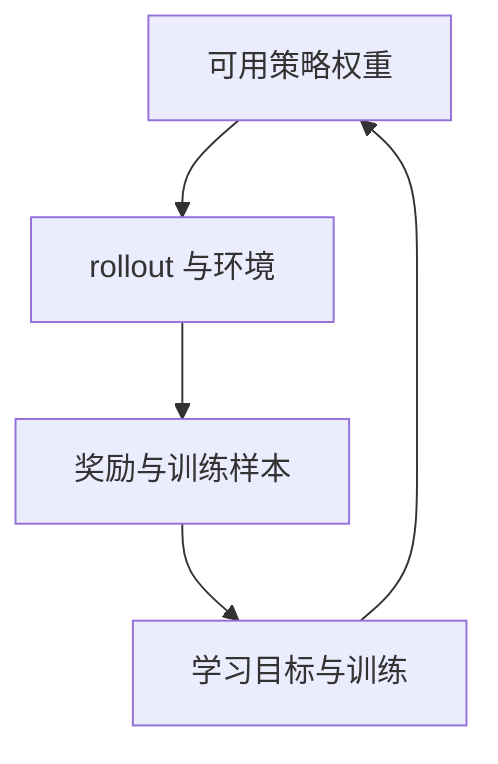

# ML / LLM 系统：从数据和训练到上线服务

**中文** · [English](mlsys-llmsys-map.en.md)

用户问：“这份报告里，收入增长的主要原因是什么？”做一个能回答的 demo，可能只要检索出几段材料，再调用模型。真的让大家用起来，事情就多了：报告有没有更新，用户能不能看，很多人同时问时会不会卡住，换了新模型以后答案是否更可靠。

机器学习系统（ML systems）关心的就是这些工作怎样配合。模型是其中很重要的一部分，数据、计算资源、服务和反馈也得跟上。这组笔记会用这个资料助手，把一次请求、一次训练更新和多卡运行串起来，再看 RL 为什么需要反复生成数据、更新模型。

第一次接触，可以从下面的请求流程读起，不用先认识所有框架。已经在做相关工作，可以直接看[瓶颈分析](mlsys-llmsys-map.md#budgets)，或去[源码拆解](../practice/runtime-reading/README.md)找感兴趣的实现。资料助手是贯穿讲解的假设项目，后面的数字也是算例，并非某个产品的内部架构或实测结果。

## 先看全貌：模型之外还有哪些工作？ {#scope}

同样是“把模型用起来”，不同任务要操心的事并不一样。分类服务可能要等标签回传，推荐系统要记录展示过什么，LLM 服务则要为长短不一的请求安排生成和缓存。计算、存储、通信和调度都在为这些具体工作服务。

研究里可以挑一个问题深入做，比如减少通信量；产品里还要把其他环节接好，包括数据和模型更新、发布、失败恢复及用户反馈。

| 场景 | 除了模型，还要处理什么 | 容易忽略的问题 |
| --- | --- | --- |
| 分类、预测 | 特征流水线、标签延迟、批处理或在线打分 | 训练时的特征能否在预测时取得？ |
| 搜索、推荐 | 候选池、索引、排序、曝光与反馈 | 没有展示的候选不能直接当负例 |
| LLM 训练与后训练 | 模型和优化器状态、长序列、采样、奖励、权重同步 | 样本到底由哪个策略生成？ |
| LLM 服务与 Agent | KV cache、请求调度、工具执行、权限与超时 | 输出正确与动作执行成功要分别验证 |

大语言模型系统（LLM systems）是其中一个方向。处理长 token 序列、保存生成状态、把大模型分到多张卡，以及协调训练端和推理端，是这组笔记的重点。更完整的数据、索引、服务和反馈流程，放在[一个 ML 系统，从数据到用户](../practice/ml-system/README.md)；[Hidden Technical Debt in ML Systems](https://research.google/pubs/hidden-technical-debt-in-machine-learning-systems/)也讨论了为什么模型代码之外会积累这么多依赖。

## 一次请求怎样从问题变成回答？ {#layers}

沿着刚才的问题往下看。假设文档已经清洗并建好索引，请求使用固定的模型，不在用户等待回答时训练：

| 步骤 | 得到什么 | 可能出现的问题 |
| --- | --- | --- |
| 检索报告，筛选当前用户可见的段落 | 问题和相关证据 | 模型可能回答得流畅，却引用错了材料 |
| 组织提示词，转成 token，进入队列 | 包含输入长度和生成设置的请求 | 排队过久；输入被错误截断 |
| Prefill 处理输入 | 输入位置的 KV，以及用来生成第一个输出的 logits | 长输入处理慢，首字迟迟不来 |
| Decode 继续生成 | 新 token 和不断增长的缓存 | 首字不慢，但后续输出很慢；缓存占满显存 |
| 返回回答，记录耗时与可用反馈 | 用户看到的结果和后续排查依据 | 模型算完了，客户端却超时；错误难以复现 |

假如回答错了，原因可能是检索拿错了报告，也可能是模型没理解对；如果迟迟不出字，可能还在排队，模型根本没开始算。顺着这条流程看，比一遇到问题就去改模型更容易找准位置。

实际工作中，检索、模型、推理服务和计算平台可能由不同团队负责。理解全貌，不是要求一个人写完所有模块，而是知道交到自己手里的是什么，自己改动后又会影响谁。

### 第一层问题：系统怎样向用户交付结果

对资料助手来说，先得把报告清洗好、建好索引，再检索和生成。排查一次错误时，最好能找回当时用的报告、用户权限、模型版本和返回结果，否则报告后来更新了，错误就很难重现。换成推荐系统，检索的可能是候选内容，返回的是排序列表；同样要说清输入是什么、结果怎样才算合格。

决定训练新模型后，工作也不只是启动训练脚本。数据从哪里来，标签怎么做，离线评估能否覆盖真实问题，新模型出了问题怎么退回旧版，都需要提前安排。具体可以接着读[数据到模型](../practice/ml-system/data-to-model.md)与[后训练实践](../practice/post-training/README.md)。

### 第二层问题：模型怎样完成一次计算

问题和报告会被转成 token，再变成模型处理的张量。生成回答时，模型先处理输入，再逐个预测新 token；训练时，除了前向计算，还要算损失、做反向传播、更新参数。同一份模型做这两件事，需要保存的中间结果和使用 GPU 的方式并不相同。算力、显存容量、带宽和多卡通信都会影响执行速度。

PyTorch 提供模型计算和自动求导，FSDP2、Megatron 组织多卡训练，vLLM 和 SGLang 安排生成请求。把这些工作分开以后，框架之间的关系就容易理解了，详见[训练框架](training-frameworks.md)、[推理引擎](inference-frameworks.md)与[多卡训练](distributed-training.md)。

### 第三层问题：计算怎样拿到设备并可靠运行

训练脚本写好了，也不代表立刻有卡可用。进程要在哪台机器启动、分到哪张 GPU、几台机器能否正常通信，都是接下来要解决的事。跑到一半失败，还得知道从哪份状态接着跑。这里会接触到 CUDA、通信库、集群调度，以及应用自己的恢复逻辑，可以继续看 [CUDA](../12-infra/cuda.md)与[从进程到 GPU](execution-boundaries.md)。

把工作分清以后，再看这些工具各自解决什么问题。它们可以出现在同一个系统中，但不一定全部用得上：

| 工具或机制 | 在这条链路里的主要职责 |
| --- | --- |
| NeMo RL、verl、AReaL | 连接 RL 的采样、奖励、训练与权重更新 |
| FSDP2、Megatron | 组织训练计算、模型状态与多卡协作 |
| vLLM、SGLang | 安排生成请求、执行模型并管理生成状态 |
| CUDA 与算子库 | 提交和执行 GPU 计算，处理主机与设备、设备之间的数据传输 |
| Kubernetes、Slurm | 管理集群工作负载与资源分配 |
| Ray | 为分布式任务、actor 和资源放置提供运行时 |

比如 NeMo RL 调用生成后端采样，再把样本交给训练后端更新参数；这些进程可以由 Kubernetes 安排到集群中的机器上。因此，同一套部署里出现几个框架名很正常，它们各管一部分。搭建时仍需核对具体版本和配置支持哪些组合。

## 用户请求结束以后，模型怎样继续改进？ {#loops}

用户拿到回答，这次请求就结束了。但如果答案有问题，我们还希望下一版模型能答对。这时才进入另一条流程：整理数据、训练、评估，再决定是否发布。它和用户等待回答的那几秒，是两件不同的事。

### 模型发布与用户反馈

例如，收集到一批“引用错报告”的反馈后，可以先查是检索问题还是生成问题，再挑出适合训练的样本。新模型评估通过，才替换线上版本。在这期间，服务完全可以一直使用旧模型。日志提供了排查线索，但其中的反馈要经过清洗、评估和筛选，不能直接把每条日志当成标签。

### RL 训练内部还有一条采样环

RL 在一次训练过程中，就要反复采样和更新。策略生成动作、与环境交互，记录结果和奖励，这段过程叫 rollout；训练端用记录下来的样本更新参数，再交给后续采样使用。

采样时也可以用 vLLM 或 SGLang，但这和给用户提供回答不完全一样：权重可能频繁变化，样本要带回训练所需的信息，出错后还要恢复训练状态。RL 框架因此需要额外管理样本队列、策略版本和权重同步。

实现里，“通知训练端开始工作”可能只是一条很小的远程调用（RPC），样本、参数和梯度则走另外的数据通道。所以上图画的是步骤之间的关系；追到源码以后，才会知道哪里用 HTTP、共享内存或 NCCL，以及哪里真的复制了张量。

## 怎样找到瓶颈，判断优化是否有效？ {#budgets}

“回答慢”还不够具体。等很久才出第一个字，先拆排队、检索和 prefill；第一个字很快，后面却一顿一顿，再看 decode、流式传输和网络。它们只是排查方向，日志和时间线才能告诉你实际卡在哪里。

1. **先找回当时的配置。** 数据、模型、分词器用了哪个版本？采样设置、掩码和奖励有没有变化？否则两次运行可能根本不在比较同一件事。
2. **把显存占用拆开。** 参数、优化器状态、激活、KV 缓存、通信缓冲区、算子工作区各占多少，哪些会同时存在？
3. **把时间也拆开。** 排队、预处理、计算、通信、同步和故障恢复各花了多久？GPU 忙不忙，只能解释其中一部分。
4. **最后看整次运行。** 固定卡数下用了多少时间、多少 GPU 小时？如果训练更快，却需要更多步才能达到同样质量，未必省钱。

再看一个训练例子。假设 RL 的生成、训练、同步依次执行，只把训练加速两倍，其他阶段不变：

| 一轮花在哪里 | 原来 | 改动后 |
| --- | --- | --- |
| 生成回答 | 60 秒 | 60 秒 |
| 训练更新 | 25 秒 | 12.5 秒 |
| 同步权重 | 5 秒 | 5 秒 |
| **整轮** | **90 秒** | **77.5 秒** |

整轮的加速比是 90 / 77.5 ≈ **1.16 倍**。训练部分的耗时确实减半了，但它原本就不是最耗时的部分。这里还没考虑额外通信和生成长度变化；即使一个核函数的耗时减半，整个训练过程也未必能省下一半时间。[异步 RL](async-rl.md)会继续讨论：让生成和训练同时进行以后，怎样重新比较资源开销和学习效果。

## 按自己需要的部分往下读 {#learning-route}

| 次序 | 想弄清什么 | 可以自己试一下 |
| --- | --- | --- |
| 1 | 数据怎样变成可供用户使用的模型？ | 画出从数据到上线的流程，标出在哪里记录版本、做评估和回滚 |
| 2 | 前向、反向和参数更新分别要保存什么？ | 选一个小模型，写出张量形状、精度，估算显存 |
| 3 | 每张卡保存什么，又要和别的卡交换什么？ | 分别画一遍 DDP / FSDP / TP 的数据和通信过程 |
| 4 | Prefill 和 decode 怎样使用缓存？ | 画一条请求的时间线，算它需要多少 KV 字节 |
| 5 | 一份采样结果怎样变成 RL 训练样本？ | 对照 token、生成时的概率、分组、掩码和策略版本 |
| 6 | 生成和训练同时跑，怎样知道样本来自哪版模型？ | 画出队列和版本变化，再加上队列满时的背压与失败恢复 |
| 7 | 换了核函数或集群配置，到底快在哪里？ | 每次只改一个变量，看收益多大、什么条件下不再有效 |

不需要按表格把所有内容学完才动手。从手头遇到的问题开始就好：改了一处 gather 操作，先用小实验确认梯度一致、峰值显存确实下降、分布式路径仍然正确，再扩大规模。作业如果一直 Pending，连 GPU 都没拿到，应该先查资源和调度，优化注意力算子还帮不上忙。

第一次可以按这条路线读：[CPU 到 GPU 的执行](execution-boundaries.md#runtime) → [一次更新与 Megatron 基础](megatron-basics.md) → 回到[集群与 GPU 调度](execution-boundaries.md#scheduling) → [RL 框架链路](rl-systems.md) → [异步 RL 与 AReaL](async-rl.md)。想先理解在线服务，可以从[一次请求怎样跑完](llm-serving.md)进入，再读 vLLM / SGLang。

想把这些概念对应到真实代码，继续读[源码拆解](../practice/runtime-reading/README.md)：先用一条请求分清 prefill 和 decode，再跟踪 vLLM / SGLang 的调度与 NeMo RL 的训练路径，最后检查 loss、mask、数值和恢复怎样共同影响训练稳定性。
