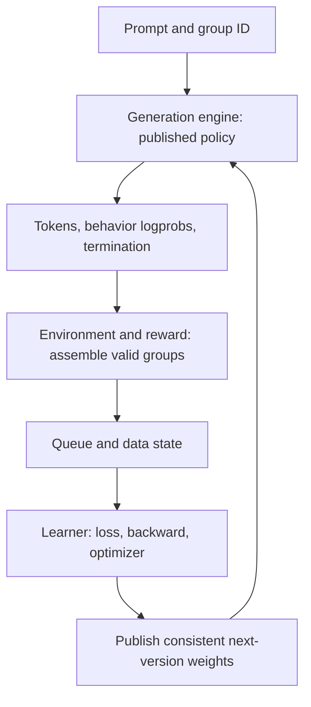

# One RL update: what NeMo RL, verl and AReaL connect

[中文](rl-systems.md) · **English**

Supervised training can repeatedly read batches from a fixed dataset. Online RL adds a feedback dependency: **a currently available policy first produces data, then its outcomes train the policy.** For example, sample four answers to one question, score them, update the model, and use the new model for the next questions. This involves both an algorithmic question—how to learn from outcomes—and a systems question—when data and weights become available.

Generation and learning can use different parallelism, precision, memory layouts and machines. A framework connects these execution modes while preserving the information the objective needs. We will follow four answers through one update before examining the interfaces and state each component requires.

For prerequisites, see [one update and Megatron](megatron-basics.en.md). For actions, observations and masks, see [post-training infrastructure](../05-post-training/post-training-infrastructure.en.md).

Framework descriptions use the linked official sources, checked on 2026-10-30. The four answers and later timing figures illustrate execution; they are not results from a three-framework performance comparison.

## Follow one question around the loop {#one-cycle}

### Produce answers, then build training data

Suppose policy v10 answers question q. A tokenizer first converts text into token IDs, which enter the generation backend with sampling settings. For example, NeMo RL's generation interface takes tensors such as `input_ids`; it does not ask the backend to tokenize the raw text again. The model runs and samples an answer. The rollout process also collects any tool calls, environment interactions and outcomes.

Label the four sampled answers R1–R4 and give them one `group_id`. They share a question, but each has its own tokens, sampling record and completion time. The group ID tells scoring and training which answers belong in the same comparison; an individual answer ID distinguishes results from retried deliveries.

Answer text is only part of the record. Learning also needs exact token positions, which positions the model chose, probability information from generation, termination and versions. The learner responsible for parameter updates uses these records to construct its objective. For example, a tool observation can provide context for later actions without itself being an action sampled by the model.

### Turn rewards into a learning signal

Let policy v10 produce four answers for question q, with rewards `[1,0,1,0]`. Subtracting the group mean 0.5 gives `[0.5,-0.5,0.5,-0.5]`. This is not a complete GRPO implementation: standard deviation, KL, masks, token aggregation and the loss still need their algorithm-specific definitions.

The four centered values describe performance relative to this group's mean. Rewards describe outcomes; advantages relate those outcomes to a baseline. The chosen loss then determines how that signal affects probabilities at the relevant answer-token positions.

To see that step, consider just one sampled action. Treat its advantage $A$ as fixed and write $p_\theta$ for its probability under the current model in the same context. Temporarily omit clipping and KL, and minimize this toy loss:

$$
\begin{aligned}
L_{\rm toy}&=-A\log p_\theta,\\
\frac{\partial L_{\rm toy}}{\partial\log p_\theta}&=-A.
\end{aligned}
$$

| Fixed advantage | Loss at probability 0.2 | Loss at probability 0.3 |
| --- | --- | --- |
| $A=0.5$ | About 0.805 | About 0.602, lower |
| $A=-0.5$ | About -0.805 | About -0.602, higher |

These use natural logarithms. In this term alone, positive advantage favors increasing the sampled action's probability; negative advantage favors the opposite direction. A real update combines gradients from other tokens and objective terms. This local example follows the [policy-gradient objective in the original PPO paper, §2.1](https://arxiv.org/pdf/1707.06347v2#page=2), with the sign changed for loss minimization. It is not full PPO or GRPO, nor a sufficient objective definition for repeated updates on one batch or asynchronous older data.

This explains why “correct answer” is insufficient training data: the learner needs the action positions, the group used to compute advantages, and the policy behind each probability required by the objective. The [async RL probability-ratio example](async-rl.en.md#objective) develops the distinction between generation-time and training-time probabilities.

### After training, make the new parameters available for generation



Data flow toward learning; updated weights return toward generation. The first update takes v10 to v11; subsequent cycles use the newly published policy. Computing v11 in the learner does not establish that every generation worker has received v11. A synchronization protocol sits between those events. The completed answers R1–R4 remain v10 data; publishing new weights does not change their origin.

Answers can finish at different times. If advantages require a full group, the first two completions are not automatically an unbiased subset of four. Waiting, dropping a timed-out group and changing the advantage estimator have different system or learning consequences. An async design must make this boundary explicit.

## Which component owns which state? {#contracts}

| Component | Input → output | State to retain or track |
| --- | --- | --- |
| Data and task assignment | Snapshot → prompts / groups | Sample IDs, task revision, consumption position |
| Rollout and environments | Prompts, weights → tokens / observations / outcomes | Behavior version, sampling, tool/action boundaries, completion |
| Scoring and assembly | Outputs and outcomes → rewards / advantages | Reward revision, group completeness, invalidity reason |
| Queue or buffer | Annotated groups → eligible training batches | Visibility, age, duplicate consumption and recovery rules |
| Learner | Batch, current parameters → updates and metrics | Masks, normalization, optimizer and random state |
| Weight synchronization | Learner weights → available rollout version | Conversion, partitioning, acknowledgements from all publication participants, cache handling |
| Supervisor / checkpoint | Runtime state → failure or recovery point | Pending tasks, data position, weight versions, persistent state |

### Why does one record need so much metadata?

Suppose the program stores only “correct answer, reward=1.” After restarting it still lacks the prompt, weight version, action positions and whether the answer has already trained. Complete-looking text can leave training state incomplete.

For R1, `prompt_id` identifies the question and `group_id` identifies its three companions. Tokens and the action mask locate the loss terms; behavior logprobs and the weight version describe how those actions were produced. Termination and consumption status help determine eligibility for this update. Implementations choose their own field names and formats, but these meanings must remain traceable.

Suppose R1 has already entered training, but its sender retries because an acknowledgement was lost. The queue needs to recognize a redelivery of the same result. Multiple passes deliberately scheduled by the algorithm can remain; accidental extra training caused by retries belongs in the consumption and recovery rules. Reward and answer text alone do not distinguish those cases well.

This is an interface checklist, not a claim that every framework has seven separate services. One process can own several roles. “Actor” may also mean a policy model or a Ray actor; identify the actual object.

## Compare frameworks through reading questions {#frameworks}

Use q to guide a source walkthrough: find where R1–R4 form a group, where they enter the loss, and how v11 reaches generation. The table gives starting points for following that same chain in each project.

| Framework | Starting point | Handoff to trace |
| --- | --- | --- |
| NeMo RL | Policy/generation interfaces and algorithm loops; a separate beta Single-Controller path | Learner/generator, refit, rollout groups, data plane, supervision |
| verl | HybridFlow separates high-level RL control flow from distributed model computation | Controller-to-worker calls, data dispatch, training/generation layouts |
| AReaL | Decoupled async rollout and learning, plus current agent-workflow interfaces | Rollout records, policy lag, objectives and weight updates |

Sources: [NeMo RL generation design](https://docs.nvidia.com/nemo/rl/latest/design-docs/generation.html), [verl HybridFlow](https://verl.readthedocs.io/en/latest/hybrid_flow.html), [AReaL](https://github.com/areal-project/AReaL). These are not categories of synchronous versus asynchronous frameworks. All three have async-related implementations, with different versions, configurations and backend support.

NeMo RL's [pinned Single-Controller guide](https://github.com/NVIDIA-NeMo/RL/blob/dd2e251da8ea1b4de6e76394b543e89d1e8cbe9e/docs/guides/single-controller.md) describes rollout and training as independent pumps coordinated by one control actor and a TransferQueue data plane. It explicitly labels the path beta. Do not apply its configuration semantics to the [legacy async GRPO path](https://github.com/NVIDIA-NeMo/RL/blob/dd2e251da8ea1b4de6e76394b543e89d1e8cbe9e/docs/guides/async-grpo.md).

## How do generation and training backends meet? {#engines}

### The generation engine handles evolving requests

Suppose a request contains eight prompt tokens and allows up to four new tokens. Prefill processes those eight positions, builds KV state, and provides the last position's output for sampling the first new token. In ordinary autoregressive generation, each subsequent decode step appends the latest token to the prefix and predicts the next.

If the request produces all four tokens without stopping early, this corresponds to one prefill followed by three decode steps to obtain those outputs. This example excludes speculative decoding. An engine may also chunk prefill, so these are not counts of GPU kernel launches.

Call the outputs y1–y4. The final prefill output is used to sample y1; the next three steps read y1, y2 and y3 to sample y2, y3 and y4 respectively. If the request ends there, producing these four tokens requires no further prediction with y4 as input. This ordering also helps check the alignment between tokens and prediction positions during training.

KV cache retains attention keys and values for reuse. Concurrent requests have different lengths and progress, so the engine must manage compute budgets, cache locations and request lifecycles. This makes scheduling central to vLLM and SGLang.

### The training backend handles parameter updates

When a learner receives an existing answer, its tokens are known: it does not have to sample the answer again. A standard causal Transformer can compute outputs at multiple positions together under a causal mask, then apply the action mask and training objective to form the loss. Backward and optimizer updates follow. Activations, gradients and optimizer state serve different purposes from generation KV and request queues.

For the same eight prompt tokens and four answer tokens, training evaluates y1–y4 under their respective prefixes; the input position containing y1 is not the position used to predict y1. The causal mask controls what each position can see. The action mask controls which prediction terms enter the policy loss. Computing the sequence together does not remove that distinction.

### Join the two execution modes

A generation engine receives tokens and sampling requests, manages batching/KV, and returns generation results. A training backend runs training forward, backward and optimizer updates. A model can be trained through FSDP2 or Megatron and generate through vLLM or SGLang. Consult a specific framework version and recipe: support for a model in several projects does not establish arbitrary combinations.

Training might partition a weight matrix across four ranks while inference uses two. Synchronization may require resharding, naming/layout conversion, quantization handling and confirmation that generation workers serving the same request see a consistent new version. A Megatron-native generation path can change these conversion costs.

Backend selection therefore involves two intervals: time spent sampling the answers, and time spent making updated parameters usable for the next round. Higher generation tokens/s need not shorten the whole update cycle if weight conversion or queueing takes longer.

The existing [inference-engine walkthrough](inference-frameworks.en.md) follows vLLM's scheduler / executor / model runner and SGLang's tokenizer manager / scheduler / model runner. This note builds on it rather than repeating the engine tutorial.

## Publishing weights is a protocol {#weight-publication}

### Prepare a complete version before publishing it

Suppose the learner has updated v10 to v11. Generation needs weights compatible with its own partitioning and a clear point at which new-version requests may begin. A simple teaching protocol is:

```text
Prepare v11 → pause or isolate affected requests → transfer and convert
→ all publication participants acknowledge v11 → invalidate or recompute old KV as required
→ permit generation using v11
```

Here “all” means the participants required for this publication. For example, if two GPUs jointly serve a request, both shards must be ready before that serving instance can use v11. A separate instance may retain v10 under an explicit protocol to finish older requests.

This does not mandate a global pause. Double buffering, version-pinned requests or partial rollout can use other protocols. Each must define request ownership, publication and failure recovery. Logging “v11 synchronized” while half the required participants still hold v10 is insufficient.

### Include caches and failure recovery in the update

If a third worker fails to receive weights after others have succeeded, the system must decide whether to wait, retry or abandon publication. Completion must account for every required participant, and the controller must observe failures.

KV depends on both historical tokens and weights. The same text generally has different KV under new weights. Retaining text does not validate old KV. A trajectory that changes versions midway also needs segment-level or token-level behavior provenance; see [async RL](async-rl.en.md).

## Three concrete engineering boundaries {#case-studies}

These independent public PRs illustrate boundaries. Being open does not mean merged, and they do not prove whole-framework performance.

| Example | System issue | Evidence to request |
| --- | --- | --- |
| [Reward KL configuration #4984](https://github.com/NVIDIA-NeMo/RL/pull/4984) | YAML settings must reach the actual objective | Real configuration-entry checks and numerical counterexamples |
| [Training-drain supervision #4985](https://github.com/NVIDIA-NeMo/RL/pull/4985) | Training can still fail after rollout stops producing | Drain, cancellation, checkpoint and failure-propagation scenarios |
| [Top-k allocation #4989](https://github.com/NVIDIA-NeMo/RL/pull/4989) | Dtype-conversion order changes state retained through backward | Identical-source output/gradient comparisons, memory scope and distributed boundaries |

Return to q's update: if a KL setting never reaches the calculation, the optimized objective may differ from the configured one. Rollout can finish while training on R1–R4 still fails. Large tensors retained through backward can make that batch exceed device memory. These examples concern objective semantics, control and reliability, and device execution respectively, with different evidence needed for each.

## Checks before using a GPU {#exercise}

Start with this hypothetical record. All four answers begin at second 0 on v10 and eventually terminate normally; lengths and times are chosen only for the exercise.

| Answer ID | Answer tokens | Reward | Completion time |
| --- | --- | --- | --- |
| R1 | 12 | 1 | Second 5 |
| R2 | 40 | 0 | Second 20 |
| R3 | 16 | 1 | Second 6 |
| R4 | 80 | 0 | Second 60 |

First assume the objective requires all four answers: the complete group enters the queue at second 60 and is consumed at second 65. Although R1 arrives early, it waits until second 60 for the full-group advantage calculation. The first completions, R1 and R3, both have reward 1. Recomputing the mean using only those two would give centered values `[0,0]`, rather than the 0.5 each receives in the full group.

Now set a 30-second timeout. R4 has not finished, so its eventual reward=0 at second 60 is not yet known. The system must choose whether to wait, drop the group or use a separately defined objective; it cannot silently equate a timeout with an incorrect answer. Next simulate a learner update to v11 followed by failed weight synchronization, and a duplicate delivery of R1. Add behavior versions, termination reasons, enqueue and consumption times. Use them to work through group eligibility, accidental repeat training and the state needed after restart, before attempting a small real run.

Continue: [async RL, AReaL and policy lag](async-rl.en.md), and [cluster scheduling and execution boundaries](execution-boundaries.en.md).
