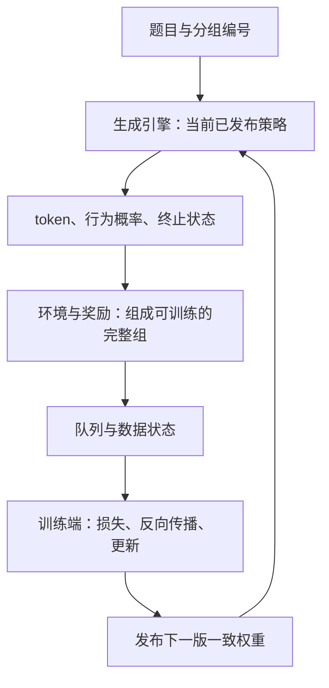

# 一次 RL 更新：NeMo RL、verl、AReaL 在连接什么

**中文** · [English](rl-systems.en.md)

普通监督训练可以不断从固定数据集中取出一批数据。在线 RL 多了一条反馈链：**先让当前可用的策略产生数据，再用结果更新策略。** 比如，对同一道题采样四个回答，评分后用它们更新模型，再让新模型回答下一批题。这里既有“怎样从结果中学习”的算法问题，也有“数据与权重何时可用”的系统问题。

生成端和训练端可能采用不同的并行方式、数值精度和内存布局，甚至运行在不同机器上。框架需要把两端接起来，同时保留训练目标所依赖的信息。下面先跟着四个回答走完一轮，再看各组件为什么需要那些接口和状态。

前置基础见[一次更新与 Megatron](megatron-basics.md)。关于动作、观察和 token 掩码，先看[后训练基础设施](../05-post-training/post-training-infrastructure.md)。

框架部分依据文中链接的官方资料整理（核对日期：2026-10-30）。四个回答和后面的时间数字用于讲解执行过程；本文没有做三套框架的性能对比实验。

## 跟一道题走完一圈 {#one-cycle}

### 先产生回答，再得到训练材料

假设用 v10 版权重回答题目 q。先由分词器把文本转换成 token 编号，再连同采样设置送入生成后端。例如，NeMo RL 的 generation 接口接收的是 `input_ids` 等张量，不需要后端再切分一次原始文本。模型运行后采样出回答；整个采样与交互过程（rollout）还会收集可能发生的工具调用、环境交互及其结果。

把这次为 q 采样的四个回答记作 R1–R4，并给它们同一个 `group_id`。它们回答同一道题，但各自有 token 序列、采样记录和完成时刻。组编号让评分与训练端知道哪些回答需要放在一起比较；单条回答的 ID 则用于区分不同结果，并识别重试时重复投递的结果。

回答文字只是记录的一部分。训练还需要知道 token 的准确位置、哪些位置由模型选择，以及生成时的概率、结束原因和策略版本。负责更新参数的训练端（learner）收到这些记录后，才能按选定目标计算损失。比如，工具返回的观察可以成为后续动作的上下文，却不能仅因它出现在文本中，就当成模型采样的动作。

### 奖励怎样变成学习信号

设题目 q 由策略版本 v10 生成 4 个回答，奖励分别是 `[1,0,1,0]`。为便于讲解，这里只减去组均值 0.5，得到 `[0.5,-0.5,0.5,-0.5]`。这不是完整的 GRPO 实现：如何使用标准差、KL 和掩码，如何聚合 token 上的信号，以及具体损失函数是什么，仍需按算法定义。

这四个数表达的是“比这组的平均结果好多少或差多少”。奖励描述结果，优势值则把结果与比较基准联系起来。接着，具体的损失函数决定这些信号如何影响回答中相应 token 的概率。

为了看清这一步，先只看一个已采样动作：把它的优势值记作固定的 $A$，当前模型在同一上下文中赋予它的概率记作 $p_\theta$。暂时省去裁剪和 KL，用下面这个简化的损失函数演示最小化过程：

$$
\begin{aligned}
L_{\rm toy}&=-A\log p_\theta,\\
\frac{\partial L_{\rm toy}}{\partial\log p_\theta}&=-A.
\end{aligned}
$$

| 固定的优势值 | 概率为 0.2 时的损失 | 概率为 0.3 时的损失 |
| --- | --- | --- |
| $A=0.5$ | 约 0.805 | 约 0.602，变小 |
| $A=-0.5$ | 约 -0.805 | 约 -0.602，变大 |

这里用自然对数。只看这一项，正优势值鼓励提高已采样动作的概率，负优势值的方向相反。真实更新还会合并其他 token 和目标项的梯度。这个局部例子对应[原始 PPO 论文 §2.1 的策略梯度目标](https://arxiv.org/pdf/1707.06347v2#page=2)，只是把符号改成了最小化损失的约定，并非完整的 PPO 或 GRPO。若要反复训练同一批数据，或处理异步产生的旧样本，还需要定义相应的目标，不能直接套用这个例子。

这也解释了为什么只知道“答案正确”还不足以构造训练批次：必须知道损失作用于哪些动作、优势值根据哪一组计算，以及目标所需的概率来自哪份策略。[异步 RL 的概率比示例](async-rl.md#objective)会继续区分生成时与训练时的概率。

### 训练完成以后，还要让生成端用上新参数



图中数据流向训练端，更新后的权重再返回生成端。第一轮从 v10 更新到 v11，后面的循环继续使用已发布的新版本。训练端算出 v11，不表示所有生成工作进程都已经拿到 v11：两者之间还要完成权重同步。此时已经完成的 R1–R4 仍是 v10 生成的数据，发布新权重不会改变它们的来源。

每条回答的到达时间可以不同。若优势值依赖完整组，就不能把最早到达的两条当成“从四条里无偏抽出的两条”。等组内回答收齐、超时后丢掉整组，或改用另一种优势估计，会改变等待时间或学习信号的含义。异步系统必须明确采用哪种处理方式。

## 各组件接收什么、交出什么、记住什么 {#contracts}

| 组件 | 输入 → 输出 | 需要保留或追踪 |
| --- | --- | --- |
| 数据与任务分配 | 数据快照 → 提示词 / 分组 | 样本 ID、任务版本、消费位置 |
| 采样与环境交互 | 提示词、权重 → token / 观察 / 结果 | 行为策略版本、采样设置、工具返回与模型动作的边界、完成状态 |
| 评分与组装 | 输出和环境结果 → 奖励 / 优势值 | 奖励版本、组是否完整、无效原因 |
| 数据队列或缓冲区 | 带元数据的组 → 符合要求的训练批次 | 可见性、样本年龄、重复消费与恢复规则 |
| 训练端 | 批次、当前参数 → 更新与指标 | 损失掩码、归一化、优化器、随机状态 |
| 权重同步 | 训练端权重 → 采样时可用的版本 | 转换、分片、所有参与发布的工作进程的确认与缓存处理 |
| 运行监督 / 检查点 | 运行状态 → 失败或恢复点 | 未完成任务、数据位置、权重版本和持久状态 |

### 一条记录为什么要保留这么多字段

假设程序只存了“答案正确，reward=1”。重启后，它仍然不知道这条答案对应哪个提示词、哪版权重、哪些 token 是动作，也不知道是否已经用它训练过。文本看起来完整，训练状态却缺了一部分。

以 R1 为例，`prompt_id` 用来找回题目，`group_id` 用来找回另外三个回答。token 序列与动作掩码确定在哪些位置计算损失，行为策略的对数概率与权重版本说明这些动作怎样产生。终止原因和消费状态则帮助判断它能否用于本次更新。具体字段与存储格式由实现决定，但这些信息必须能追溯。

假如 R1 已用于一次训练，发送端却因为没收到确认又投递了一遍，队列需要识别出这是同一结果的重送。算法有意安排的多轮训练可以保留；重试意外增加的训练次数应由消费与恢复规则处理。只看奖励和回答文本，很难区分这两种情况。

这张表是检查接口的方法，不表示每个框架都建立七个独立服务。一个进程可以承担多个角色；“actor”在不同上下文里也可能指策略模型或 Ray actor，需要看实际对象。

## 三个 RL 框架，分别从哪里读起 {#frameworks}

带着 q 的例子读框架，会比从模块名开始更容易：先找 R1–R4 在哪里分组、在哪里用于计算损失，再追踪 v11 怎样交给生成端。下面列出三个项目中适合沿这条链读下去的入口。

| 框架 | 从哪里开始理解 | 要追踪的交接 |
| --- | --- | --- |
| NeMo RL | policy 与 generation 接口、算法循环；另有 beta Single-Controller 路径 | 训练端与生成端的交接、权重同步、采样分组、数据平面及失败监督 |
| verl | HybridFlow 把高层 RL 控制流和分布式模型计算分开 | 控制器调用工作进程、数据分发、训练与生成之间的布局切换 |
| AReaL | 异步 RL 如何让采样与训练各自推进，以及当前的智能体工作流接口 | 采样与交互记录、策略滞后控制、训练目标与权重更新 |

依据：[NeMo RL generation 设计](https://docs.nvidia.com/nemo/rl/latest/design-docs/generation.html)、[verl HybridFlow](https://verl.readthedocs.io/en/latest/hybrid_flow.html)、[AReaL 项目](https://github.com/areal-project/AReaL)。这不是在把框架分成“同步”和“异步”两类：三者都有异步相关实现，但各条实现路径的配置、版本和后端支持并不相同。

NeMo RL 的 [Single-Controller 固定版本文档](https://github.com/NVIDIA-NeMo/RL/blob/dd2e251da8ea1b4de6e76394b543e89d1e8cbe9e/docs/guides/single-controller.md)把采样和训练组织成两个独立推进的循环（pump），由一个负责控制的 actor 与 TransferQueue 数据平面协调。文档明确把这条路径标为 beta；理解它的配置时，不能套用[旧 async GRPO 路径](https://github.com/NVIDIA-NeMo/RL/blob/dd2e251da8ea1b4de6e76394b543e89d1e8cbe9e/docs/guides/async-grpo.md)的配置含义。

## vLLM、SGLang 怎样与训练后端接起来 {#engines}

### 生成引擎处理的是持续变化的请求

假设一个请求的提示词有 8 个 token，最多生成 4 个新 token。预填充处理这 8 个输入位置，建立 KV 状态，并用最后一个位置的输出采样第一个新 token。在普通自回归生成中，之后的解码步骤每次把最新 token 接到前缀后面，再预测下一个。

如果恰好生成满 4 个 token，而且没有提前停止，可以把获得这四个输出的过程理解成“一次预填充，接着三次解码”。这里没有使用推测解码；实际引擎也可能把预填充分块执行，所以这个计数不等于 GPU 内核的启动次数。

把四个输出记作 y1–y4：预填充的最后一个输出用于采样 y1；后续三步依次读入 y1、y2、y3，采样 y2、y3、y4。若请求到这里就结束，为了得到这四个 token，并不需要再读入 y4 做一次预测。这个顺序也能帮助核对训练时的 token 与预测位置有没有对齐。

KV 缓存保存注意力计算需要复用的键和值。并发请求的长度与进度不同，因此生成引擎需要同时管理计算预算、缓存位置，以及请求从开始到结束的状态。这正是 vLLM/SGLang 中调度器的重要职责。

### 训练端处理的是怎样更新参数

训练端收到一段已经生成的回答时，token 序列已知，不必把每个回答 token 重新采样一遍。对常见的因果 Transformer，可以在因果掩码的约束下同时计算多个位置的输出，再按动作掩码和训练目标计算损失。随后才执行反向传播和优化器更新。训练时保存的激活、梯度和优化器状态，与生成时的 KV 和请求队列承担不同职责。

仍用上面提示词的 8 个 token 和回答的 4 个 token：训练端要评估 y1–y4 各自在其前缀下的概率，不能把读入 y1 的位置当成预测 y1 的位置。因果掩码约束每个位置能看到什么；动作掩码决定哪些预测项计入策略损失。两者用途不同，即使对整段序列一起做前向计算，也要保留这个区别。

### 两种运行方式怎样组成一个系统

生成引擎接收 token 和采样请求，组织批次、管理 KV，再返回生成结果；训练后端则执行训练前向计算、反向传播和优化器更新。一个模型可以由 FSDP2 或 Megatron 训练，再由 vLLM 或 SGLang 生成。具体组合是否受支持，必须查对应框架版本和配套的配置示例。几个项目都支持某个模型，并不表示它们可以任意组合。

训练端可能把一个权重矩阵拆给 4 个进程（rank），生成端却只用 2 个。同步时不只是把字节传过去，还可能要重新分片、对齐命名与布局、处理量化。系统还必须确认，参与同一请求的生成工作进程使用的是同一个新版本。采用 Megatron 自带的生成路径，也可能改变这部分转换成本。

因此，选择后端时要一起考虑两段时间：采样这批回答用了多久，把更新后的参数变成下一轮可用的权重又用了多久。如果每秒生成的 token 更多，却要花更长时间转换权重或排队，整轮更新未必更快。

已有[推理引擎拆解](inference-frameworks.md)会跟踪 vLLM 的 scheduler / executor / model runner 与 SGLang 的 tokenizer manager / scheduler / model runner；这里不再另写一份引擎教程。

## 新权重什么时候才算发布完成 {#weight-publication}

### 先让一个版本完整地准备好

假设训练端刚完成从 v10 到 v11 的更新。生成端下一次要使用 v11，就需要接收与自身分片布局兼容的权重，还要知道何时可以开始处理使用新版本的请求。下面用一个便于逐步核对的协议来说明：

```text
准备 v11 → 暂停或隔离受影响请求 → 完成所需传输与转换
→ 所有参与发布的 worker 确认 v11 → 使旧 KV 失效或按实现重算 → 允许使用 v11 生成
```

这里的“所有”指本次发布所需的参与者。例如，两张卡共同承接一个请求时，两边的分片必须就绪，才算这个生成实例可以使用 v11；另一个实例可以按明确协议保留 v10，继续完成旧请求。

这并不要求所有实现都全局暂停。使用双缓冲、为请求固定版本，或在部分生成后换权重继续运行，都可以采用不同协议。但每种协议都要说明请求属于哪个版本、何时可以发布、失败后怎样回退。若本次发布所需的工作进程还有一半停留在 v10，就不能只写一条“v11 已同步”的日志。

### 缓存与失败恢复也属于这次更新

假如第三个工作进程传输失败，而其余工作进程已收到权重，系统要决定继续等待、重试还是撤回发布。判断发布是否完成时，必须检查所有需要参与的工作进程；发生失败，也要让控制端知道。

KV 依赖历史 token 和模型权重。同一文本在新权重下算出的 KV 一般不同，保留文本不意味着旧 KV 仍有效。若允许一条轨迹中途换版本，还要按分段或逐 token 记录生成它的行为策略，见[异步 RL](async-rl.md)。

## 从三个具体工程问题理解整条链 {#case-studies}

以下几个独立的公开 PR 用来说明具体工程问题，不作为框架整体性能的证明。PR 已提交，不等于已经合并。

| 例子 | 说明的系统问题 | 应该要求什么证据 |
| --- | --- | --- |
| [Reward KL 配置 #4984](https://github.com/NVIDIA-NeMo/RL/pull/4984) | YAML 里的设置必须真正用于目标计算 | 从实际配置入口验证，并给出数值反例 |
| [训练收尾监督 #4985](https://github.com/NVIDIA-NeMo/RL/pull/4985) | 采样停止产生数据以后，尚未结束的训练仍可能失败 | 等待剩余工作完成、取消任务、保存检查点与传播失败等场景 |
| [Top-k 分配 #4989](https://github.com/NVIDIA-NeMo/RL/pull/4989) | 数据类型的转换顺序也会改变保留到反向传播时的内存占用 | 基于同一源码的输出与梯度对照、显存测量的时间范围，以及分布式场景下的适用边界 |

把这些问题放回 q 的更新里看：KL 配置没有用于计算，实际优化的目标就可能与配置不同。采样与交互已经结束，R1–R4 的训练却仍可能失败。需要保留到反向传播时的张量太大，又可能导致显存装不下这批训练。三个例子分别涉及目标如何定义、任务如何控制并可靠完成，以及设备如何执行，需要的验证证据也不同。

## 不开 GPU 也能先检查什么 {#exercise}

可以从下面这份假设记录开始。四个回答都在第 0 秒用 v10 启动，最终正常结束；表中的长度和时刻只用于推演。

| 回答 ID | 回答 token 数 | 奖励 | 完成时刻 |
| --- | --- | --- | --- |
| R1 | 12 | 1 | 第 5 秒 |
| R2 | 40 | 0 | 第 20 秒 |
| R3 | 16 | 1 | 第 6 秒 |
| R4 | 80 | 0 | 第 60 秒 |

先假设目标要求四条回答全部到齐，完整组在第 60 秒入队，第 65 秒被训练端取出使用。R1 的结果虽然早已到达，也要等到第 60 秒才能和全组一起计算优势值。最先完成的 R1、R3 恰好奖励都为 1；若提前拿这两条重新算均值，中心化结果会是 `[0,0]`，与完整组中各自的 0.5 不同。

接着把超时设成 30 秒：R4 尚未完成，它在第 60 秒才得到的 reward=0 此时还不可知。系统需要决定继续等齐整组、丢掉整组，还是采用另有定义的目标，不能默认把超时当成答错。再模拟训练端已更新到 v11、权重同步却失败，以及 R1 被重复投递的情况。补上生成版本、完成原因、入队与消费时刻，就能推演这组数据是否可用、会不会重复训练，以及哪些状态在重启后必须保留。先把这些情况讲清，再做小规模真实运行。

继续读：[异步 RL、AReaL 与数据滞后](async-rl.md)，以及[集群调度与执行边界](execution-boundaries.md)。
