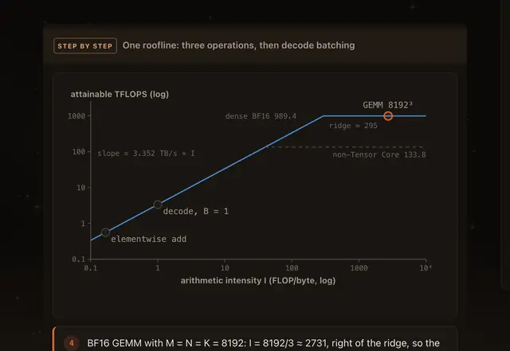
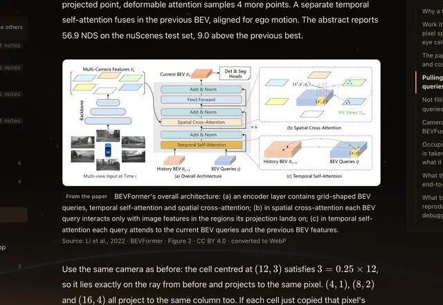
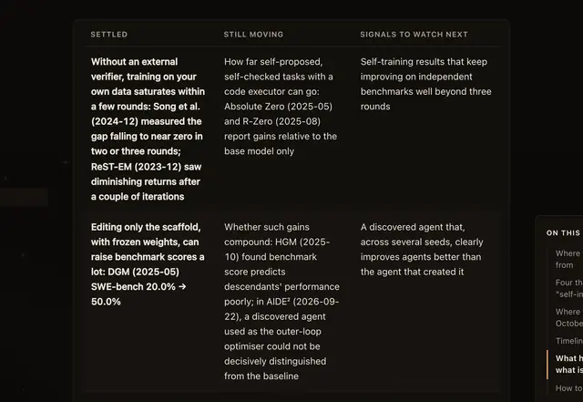

# Cooking AGI

**ML / LLM notes for learning, building, and interview preparation.**

<!-- repository-only -->

<span id="si-study-notes"></span>
<span id="agi-study-notes"></span>

<p align="center"><a href="https://tianyi-zhang-02.github.io/cooking-agi/index.en.html"></a></p>

<p align="center"><a href="https://tianyi-zhang-02.github.io/cooking-agi/index.en.html"><b>Read the notes →</b></a> &nbsp;·&nbsp; <a href="README.zh.md">中文</a> &nbsp;·&nbsp; <a href="#contributors">Contributors</a> &nbsp;·&nbsp; <a href="CONTRIBUTING.md#english">Contribute</a></p>

<p align="center"><a href="https://github.com/tianyi-zhang-02/cooking-agi/actions/workflows/site.yml"></a> <a href="LICENSE.md"></a> <a href="LICENSE.md"></a></p>

<table>
  <tr>
    <td align="center" width="33%">
      <picture><source media="(prefers-color-scheme: light)" srcset=".github/media/tour/en-figure-light.webp"></picture>
      <br><b>Step by step</b><br>Follow the worked example, pausing or replaying the calculation as needed.
    </td>
    <td align="center" width="33%">
      <picture><source media="(prefers-color-scheme: light)" srcset=".github/media/tour/en-paper-light.webp"></picture>
      <br><b>From the papers</b><br>Architecture figures alongside their explanations, with sources and licences.
    </td>
    <td align="center" width="33%">
      <picture><source media="(prefers-color-scheme: light)" srcset=".github/media/tour/en-frontier-light.webp"></picture>
      <br><b>Frontier watch</b><br>What new methods have demonstrated and what remains open, with dates and sources.
    </td>
  </tr>
</table>

<!-- /repository-only -->

When I started preparing for industry roles, my materials were scattered across lectures, papers, documentation, and bookmarks. Finding a good explanation took time. Working out what to read next took more. These notes grew out of trying to bring that material together.

Here you'll find ML and LLM notes in English and Chinese, with examples, diagrams, code, and project walkthroughs. **They're free to read and will stay that way.** You can start with the basics, review for an interview, or explore a field outside your own. The aim is to make useful material easier to find and follow, even if you're new to it.

**English or 中文:** use the switch at the top of any note. It opens the same article in the other language; Chinese notes keep familiar English technical terms. The site starts in English and remembers your choice in this browser. A direct link to a language opens that version.

<span id="_1"></span>

## Start here

| What brings you here? | A place to start |
| --- | --- |
| I'm new to ML | [Starting out](interview/speedrun-start.en.md) — work through a prediction, a loss, and a parameter update. Python pointers are included. |
| I want a learning plan | [Study at your pace](interview/study-plan.en.md) — choose a route and fit reading and practice around your week. |
| I have an interview soon | [Quick review](interview/speedrun.en.md) — focus on topics relevant to the role and the time you have. |
| I want to check what I know | [Coding checks](interview/coding-checks.en.md) · [Role-based preparation](interview/ai-roles-prep.en.md) — try first, then revisit what was difficult. |
| I'm here out of curiosity | [Choose a topic](learn/choose-your-path.en.md#topics) · [Tech history](learn/technology-timeline.en.md) — explore a question or follow how a field developed. |

Choose for the topic, not your job title. You might know systems well and still want an introduction to RL.

### How to use the notes

1. **Pick something you want to understand.** Use a route above, or the [topic guide](learn/choose-your-path.en.md). You don't need to read the site in order.
2. **Follow the example, then try it.** Work through a calculation or run the code. Continue to the derivation and tradeoffs when you want more detail. We're still improving this progression in some chapters.
3. **Keep your place.** Choose “Save this page” under a note's title, and find it later under “My reading” at the top right; a note reopens where you stopped. No account or fork is needed. Records stay in this browser; [export a JSON backup](interview/study-plan.en.md#backups) to keep a copy or move devices.

Time estimates mean focused learning time, not a daily target. Split a session if you need to; there is no streak to maintain.

### What's in each section

- **[Foundations](learn/README.en.md)** — How models work, learn, and are evaluated. The [study guide](00-foundations/study-guide.en.md) is a starting point for language models.
- **[Interview prep](interview/README.en.md)** — ML / LLM review, ML coding, Python, and reusable algorithm patterns.
- **[Engineering practice](practice/README.en.md)** — Recommendation, RAG, and post-training systems: how data, training, serving, and evaluation fit together.
- **[Tech history](learn/technology-timeline.en.md)** — Developments in power, chips, networks, software, and AI, with links to original sources.
- **[Career notes](career/README.en.md)** — What I tried during internship and new-grad searches, and what I'd do differently.

Diagrams show the main idea without requiring interaction. The controls are there when you want to change an input or compare outcomes.

<span id="interview-coach"></span>

### Practice with your AI agent (interview coach skill)

Install the skill into an AI agent such as Claude Code or Codex to practice against the notes: one question at a time, feedback and follow-ups after your answer, and a record of what to revisit next time. The notes and questions come from the site's read-only data API and update with the site. Progress records are saved on your machine; the script does not upload them to this site. Answers you enter into your AI agent are still handled according to that agent's and model provider's settings—this does not make the conversation local-only.

```bash
npx skills add https://github.com/tianyi-zhang-02/cooking-agi --skill cooking-agi-interview
```

Then ask, for example, "Mock interview for an LLM inference engineer role, 5 questions" or "What am I weak at? Quiz me on that". See [skills/README.md](skills/README.md) for details. The skill was contributed by [@Juggernaut0825](https://github.com/Juggernaut0825).

<span id="_2"></span>

## What's inside

<!-- repository-only -->

<a href="https://tianyi-zhang-02.github.io/cooking-agi/learn/coverage.en.html"><picture><source media="(prefers-color-scheme: dark)" srcset="https://tianyi-zhang-02.github.io/cooking-agi/static/readme-topics-en-dark.svg"></picture></a>

<!-- /repository-only -->

A few articles to start reading now:

- **How models work:** [Transformer walkthrough](https://tianyi-zhang-02.github.io/cooking-agi/00-foundations/transformer-lab.en.html) · [BERT](00-foundations/core/bert.en.md) · [CLIP and multimodal learning](03-multimodal-learning/clip.en.md).
- **How models learn:** [Training basics](learn/pretraining/README.en.md) · [Deep RL](05-post-training/deep-rl/README.en.md) · [Post-training](05-post-training/README.en.md) · [LLM-as-a-Judge](07-evaluation/llm-as-a-judge/README.en.md).
- **How models get used:** [Inference](learn/inference/README.en.md) · [Search and retrieval](04-search/README.en.md) · [Agents and tools](10-agents/README.en.md).
- **What's moving:** [Frontier watch](11-frontier/README.en.md) (world models, self-improvement, test-time compute) · [AI infrastructure](12-infra/README.en.md) and [perception, robots and driving](13-embodied/README.en.md).

For practice, head to [ML coding](learn/ml-exercises/README.en.md), [Python](interview/python.en.md), [algorithm patterns](interview/leetcode.en.md), or [system design](learn/system-design/README.en.md).

**Still being worked on:** some explanations and source comparisons need more review. The [coverage and backlog](learn/coverage.en.md) separates material that exists from material that has been checked. Small tested examples are not claims of full-model training or benchmark reproduction.

## Roadmap

<!-- repository-only -->

<picture><source media="(prefers-color-scheme: dark)" srcset="https://tianyi-zhang-02.github.io/cooking-agi/static/readme-roadmap-en-dark.svg"></picture>

<!-- /repository-only -->

### Now

Recent work has focused on revising existing notes: checking primary sources, updating old figures, consolidating repeated explanations, and adding worked examples. Both languages have had an initial read-through. The October 21 update included another note-by-note review and removed draft labels from several reviewed series.

Review does not catch everything. If a passage sounds awkward, is hard to follow, or contains an error, please [tell us](https://github.com/tianyi-zhang-02/cooking-agi/issues/new?template=note-feedback.yml). Every article has a feedback link at the end.

**Next:** a faster way to the answer: better search and quicker pages, then an MCP server, so Claude, ChatGPT and Cursor can search the notes and quiz you from the same data as the [interview coach skill](#interview-coach). For Jetson, physical simulation, and reviewing the vision, driving and robotics series, we'd like people who have worked in those areas to join us. See the [roadmap](community/roadmap.en.md) for the full plan; the scope of the upcoming v1.0 interview-prep release is in [release scope](community/updates.en.md).

### Topic coverage

How many notes each topic has, and how far this review pass has got. The numbers update on every site deploy.

<!-- repository-only -->

<details>
<summary>Show each topic's review progress</summary>

<a href="https://tianyi-zhang-02.github.io/cooking-agi/learn/coverage.en.html"><picture><source media="(prefers-color-scheme: dark)" srcset="https://tianyi-zhang-02.github.io/cooking-agi/static/topic-coverage-en-dark.svg"></picture></a>

</details>

<!-- /repository-only -->

<!-- widget:topic-coverage -->

### How we got here

<details markdown="1">
<summary>By date: August 2026 to now</summary>

| When | What happened |
| --- | --- |
| Early August 2026 | Started: Chinese notes and a systems study map; the first site and the Transformer foundations |
| Late August | A post-training series from PPO to what came after; interview fundamentals and a whiteboard checklist |
| Late September | Site redesign around career routes and knowledge blocks; interactive figures for RLHF, MoE, looped Transformers and Agents |
| End of September to early October | The whole site in two languages; learning paths and self-checks, CLIP and multimodal, LLM-as-a-Judge, Deep RL labs |
| October 9–11 | Bilingual routes organized into a system, examples checked one by one; training, inference and ML systems guides |
| October 13 | The chronicle world tree (143 sourced milestones), reading history, page feedback and security hardening |
| October 14 | Step-by-step animations in the LeetCode notes; saved notes and reading history folded into “My reading”; step-by-step figures in four chapters; first full read-through of every note in both languages |
| October 15–16 | Frontier watch, AI infrastructure and embodied AI (with the papers' own figures and 26 step-by-step figures); every note audited for errors, stale facts and repetition; drafts on scaling, diffusion LMs and quantization |

</details>

Details of every merge are in the [changelog](README.md#changelog) at the bottom of this page.

<span id="contributors"></span>

## Contributors and reviewers

<!-- repository-only -->

<picture><source media="(prefers-color-scheme: dark)" srcset="https://tianyi-zhang-02.github.io/cooking-agi/static/readme-people-en-dark.svg"></picture>

<!-- /repository-only -->

This lists contributors with commit or co-author credit, reviewers for each area, and readers' next steps when they choose to share them. The card updates on deployment and every hour using git history, GitHub, and `site/collaboration.toml`. Commit counts tell only part of the story; questions, reviews, and corrections matter too.

To add credit for a review or correction, or share your next stop, open an issue: [add a contribution credit](https://github.com/tianyi-zhang-02/cooking-agi/issues/new?template=add-me-to-the-crew.yml) · [share my next stop](https://github.com/tianyi-zhang-02/cooking-agi/issues/new?template=next-stop.yml). Include only what you want to make public.

<span id="_3"></span>

## Join us!

If a passage is confusing, something has changed, or a topic is missing, we'd like to hear about it. You don't need to have the answer before asking a question.

- **Give feedback:** [open an issue](https://github.com/tianyi-zhang-02/cooking-agi/issues/new?template=note-feedback.yml) and link the part you're referring to. You can flag a correction, outdated information, an unclear explanation, a missing topic, or a site problem.
- **Make a change:** small fixes can go straight into a PR. For a new article or navigation change, start with a [content proposal](https://github.com/tianyi-zhang-02/cooking-agi/issues/new?template=proposal.yml) so we can coordinate.
- **Pass it on:** if the notes helped you learn or prepare, share the link with a friend or classmate. Sharing an employer or job-search outcome is never required. The people behind the notes are listed under [Contributors and reviewers](#contributors).

These are our working notes, not an official curriculum. Our experience is mainly in ML / LLM and MLE / research preparation, and it shapes what we cover. Some material will be incomplete or out of date. We share public knowledge and preparation methods, not company-specific interview information or question banks. We can't predict questions or promise an offer.

<details markdown="1">
<summary>Contributing, review, and privacy</summary>

See the [contributing guide](CONTRIBUTING.md#english), [editorial guide](EDITORIAL.en.md), and [area reviewers](community/README.en.md). Community PRs need a relevant non-author CODEOWNER review and passing checks. Use public sources and your own explanations. Disclose and check AI-assisted work; an AI review is not formal approval or factual verification.

Issues are public. Don't attach private progress backups, company material, or unredacted logs. A public source or software version is helpful when reporting a change, but not required to ask for a clearer explanation.

</details>

**Free to read, open to reuse.** There are no paid chapters or premium preparation routes. Original code uses MIT; original notes use CC BY 4.0. Keep attribution, source links, and the relevant notices, and mark your changes. Third-party materials retain their own terms. We don't endorse others' edited or redistributed versions; warranty and liability terms are in the [licenses](LICENSE.md).

<span id="_4"></span>

## Run locally

This repository contains the notes, examples, and static-site source. No database is needed. From the repository root, with Python 3.12 recommended:

```bash
python3 -m pip install markdown pygments numpy
python3 site/build.py --serve
```

Open <http://localhost:8000>. To build without starting a server, run `python3 site/build.py`; output goes to `_site/`.

<details markdown="1">
<summary>Checks before submitting</summary>

```bash
python3 site/collaboration.py
python3 -m unittest discover -s site/tests
python3 site/leakcheck.py
python3 site/paritycheck.py --strict
python3 site/build.py
```

Some experiments also need PyTorch, as documented in their chapters; corresponding tests explicitly skip when it is unavailable. Your bookmark list, recently opened notes, and reading positions stay in this browser. Public counting is off by default; opting in sends only subsequent reads and manual save actions, not past records or backups.

</details>

<span id="_5"></span>

## Why this exists

Moving from academic research toward industry, I often found that something I recognized in a paper was much harder to explain or implement myself. Writing it down helped me notice those gaps. Sharing the notes gives other people a chance to point them out too.

I hope this makes it easier to get started without already having a background in the field or someone to hand you a reading list. It won't replace study and practice. Where others explain something better, we'll link to them; where we lack experience, we'd like to learn from people who have it. Comparing notes across fields may reveal connections we wouldn't find on our own.

If it saves you some searching and leaves a little more time for the rest of your life, that's a good reason to keep working on it.

<span id="_6"></span>

## Changelog

Every change merged into the main branch, by date, split into major and minor updates. Links go to the pull requests.

| Date | Major | Minor |
| --- | --- | --- |
| 2026-10-17 | Interview coach skill: mock interviews in Claude Code or Codex graded against the notes, which now come from a read-only data API on the site ([#103](https://github.com/tianyi-zhang-02/cooking-agi/pull/103), contributed by @Juggernaut0825) · New README: animated preview, and topic, roadmap and contributor cards that update with the site ([#104](https://github.com/tianyi-zhang-02/cooking-agi/pull/104) [#105](https://github.com/tianyi-zhang-02/cooking-agi/pull/105)) | Contributor pages move from the site to the GitHub page ([#104](https://github.com/tianyi-zhang-02/cooking-agi/pull/104)) · Card icons and folded sections ([#106](https://github.com/tianyi-zhang-02/cooking-agi/pull/106)) |
| 2026-10-16 | Every note audited: errors fixed, interview pages kept free of company hiring processes ([#99](https://github.com/tianyi-zhang-02/cooking-agi/pull/99)), facts updated to October 2026 ([#100](https://github.com/tianyi-zhang-02/cooking-agi/pull/100)), repeated explanations folded together and links to the new areas ([#101](https://github.com/tianyi-zhang-02/cooking-agi/pull/101)) · Draft series on scaling laws, diffusion LMs and quantization ([#102](https://github.com/tianyi-zhang-02/cooking-agi/pull/102)) | The unpublished quant notes removed ([#98](https://github.com/tianyi-zhang-02/cooking-agi/pull/98)) |
| 2026-10-15 | Frontier watch, AI infrastructure and embodied AI, with the papers' own figures and 26 step-by-step figures ([#97](https://github.com/tianyi-zhang-02/cooking-agi/pull/97)) | — |
| 2026-10-14 | Step-by-step animations in the LeetCode notes ([#78](https://github.com/tianyi-zhang-02/cooking-agi/pull/78)) · Step-by-step figures and the papers' own figures in four chapters ([#83](https://github.com/tianyi-zhang-02/cooking-agi/pull/83)) · Every note read through once in both languages, checking facts, worked examples and wording ([#84](https://github.com/tianyi-zhang-02/cooking-agi/pull/84) [#85](https://github.com/tianyi-zhang-02/cooking-agi/pull/85) [#87](https://github.com/tianyi-zhang-02/cooking-agi/pull/87) [#88](https://github.com/tianyi-zhang-02/cooking-agi/pull/88) [#89](https://github.com/tianyi-zhang-02/cooking-agi/pull/89) [#90](https://github.com/tianyi-zhang-02/cooking-agi/pull/90)) · Step-by-step figures in 16 training and systems notes ([#94](https://github.com/tianyi-zhang-02/cooking-agi/pull/94)) | Saved notes, reading history and backups fold into “My reading”; the study dashboard goes and its exercises move to the study plan ([#81](https://github.com/tianyi-zhang-02/cooking-agi/pull/81)) · New README promo ([#79](https://github.com/tianyi-zhang-02/cooking-agi/pull/79)) · README roadmap, topic coverage and changelog ([#82](https://github.com/tianyi-zhang-02/cooking-agi/pull/82)) · Line breaks inside Chinese paragraphs no longer render as spaces ([#86](https://github.com/tianyi-zhang-02/cooking-agi/pull/86)) · Review list and changelog ([#91](https://github.com/tianyi-zhang-02/cooking-agi/pull/91)) · The interview-prep home becomes a plain directory ([#93](https://github.com/tianyi-zhang-02/cooking-agi/pull/93)) · With the private repo archived, the leak check is the only gate ([#92](https://github.com/tianyi-zhang-02/cooking-agi/pull/92)) · The gated-attention example uses gates that do not sum to 1 ([#95](https://github.com/tianyi-zhang-02/cooking-agi/pull/95)) |
| 2026-10-13 | Chronicle: a technology world tree with 143 sourced milestones, later a vertical timeline ([#65](https://github.com/tianyi-zhang-02/cooking-agi/pull/65) [#71](https://github.com/tianyi-zhang-02/cooking-agi/pull/71)) · Study dashboard and reading history ([#64](https://github.com/tianyi-zhang-02/cooking-agi/pull/64) [#67](https://github.com/tianyi-zhang-02/cooking-agi/pull/67)) | Reading panel: today, this week, all time ([#66](https://github.com/tianyi-zhang-02/cooking-agi/pull/66) [#70](https://github.com/tianyi-zhang-02/cooking-agi/pull/70)) · One-click page feedback ([#72](https://github.com/tianyi-zhang-02/cooking-agi/pull/72)) · Security hardening ([#73](https://github.com/tianyi-zhang-02/cooking-agi/pull/73)) · Study buddy ([#74](https://github.com/tianyi-zhang-02/cooking-agi/pull/74)) · Anonymous counts ([#75](https://github.com/tianyi-zhang-02/cooking-agi/pull/75) [#76](https://github.com/tianyi-zhang-02/cooking-agi/pull/76)) · vLLM / SGLang comparison ([#68](https://github.com/tianyi-zhang-02/cooking-agi/pull/68)) · README animation ([#69](https://github.com/tianyi-zhang-02/cooking-agi/pull/69)) |
| 2026-10-11 | Bilingual entry, README and learning routes; engineering labs and more worked examples ([#61](https://github.com/tianyi-zhang-02/cooking-agi/pull/61) [#62](https://github.com/tianyi-zhang-02/cooking-agi/pull/62)) | Training, inference, SigLIP and ML systems guides ([#63](https://github.com/tianyi-zhang-02/cooking-agi/pull/63)) |
| 2026-10-09 | Bilingual learning routes reorganized, examples checked one by one ([#60](https://github.com/tianyi-zhang-02/cooking-agi/pull/60)) | — |
| 2026-10-05 | Bilingual Deep RL lessons with interactive labs ([#58](https://github.com/tianyi-zhang-02/cooking-agi/pull/58)) | More natural career notes ([#59](https://github.com/tianyi-zhang-02/cooking-agi/pull/59)) |
| 2026-10-03 | Math and quant review with proofs and worked examples ([#56](https://github.com/tianyi-zhang-02/cooking-agi/pull/56), later removed) | Discussions retired to refocus on the notes ([#57](https://github.com/tianyi-zhang-02/cooking-agi/pull/57)) |
| 2026-10-02 | Bilingual LLM-as-a-Judge lessons with interactive evaluation labs ([#55](https://github.com/tianyi-zhang-02/cooking-agi/pull/55)) | — |
| 2026-10-01 | Navigation, reading tools and community pages ([#45](https://github.com/tianyi-zhang-02/cooking-agi/pull/45)) | Discussions launched and laid out ([#53](https://github.com/tianyi-zhang-02/cooking-agi/pull/53) [#54](https://github.com/tianyi-zhang-02/cooking-agi/pull/54)) |
| 2026-09-30 | Bilingual learning paths and chapter self-checks ([#42](https://github.com/tianyi-zhang-02/cooking-agi/pull/42)) | CLIP / VLM notes and bilingual READMEs ([#44](https://github.com/tianyi-zhang-02/cooking-agi/pull/44)) · The Python you use in coding problems ([#40](https://github.com/tianyi-zhang-02/cooking-agi/pull/40)) |
| 2026-09-25 | — | AI Infra section removed; skipped notes polished, a co-reviewer added ([#37](https://github.com/tianyi-zhang-02/cooking-agi/pull/37) [#38](https://github.com/tianyi-zhang-02/cooking-agi/pull/38)) |
| 2026-09-24 | Quant zone: a probability series ([#36](https://github.com/tianyi-zhang-02/cooking-agi/pull/36), later removed) | — |
| 2026-09-23 | Close readings, agents, model choice, career and AI infra ([#33](https://github.com/tianyi-zhang-02/cooking-agi/pull/33) [#34](https://github.com/tianyi-zhang-02/cooking-agi/pull/34)) | Contributors page and credits ([#30](https://github.com/tianyi-zhang-02/cooking-agi/pull/30) [#31](https://github.com/tianyi-zhang-02/cooking-agi/pull/31) [#32](https://github.com/tianyi-zhang-02/cooking-agi/pull/32)) · ML Systems reading list ([#35](https://github.com/tianyi-zhang-02/cooking-agi/pull/35)) |
| 2026-09-22 | A nine-note RLHF series; MoE, looped Transformers and Agents with seven live figures ([#24](https://github.com/tianyi-zhang-02/cooking-agi/pull/24) [#25](https://github.com/tianyi-zhang-02/cooking-agi/pull/25)) | One language per page ([#18](https://github.com/tianyi-zhang-02/cooking-agi/pull/18)) · Night-sky design and home page ([#19](https://github.com/tianyi-zhang-02/cooking-agi/pull/19) [#20](https://github.com/tianyi-zhang-02/cooking-agi/pull/20) [#21](https://github.com/tianyi-zhang-02/cooking-agi/pull/21) [#22](https://github.com/tianyi-zhang-02/cooking-agi/pull/22)) · Long evaluation notes split ([#23](https://github.com/tianyi-zhang-02/cooking-agi/pull/23)) · Career notes ([#26](https://github.com/tianyi-zhang-02/cooking-agi/pull/26) [#27](https://github.com/tianyi-zhang-02/cooking-agi/pull/27) [#28](https://github.com/tianyi-zhang-02/cooking-agi/pull/28) [#29](https://github.com/tianyi-zhang-02/cooking-agi/pull/29)) |
| 2026-09-21 | Site redesign around career routes, knowledge blocks and quick review ([#17](https://github.com/tianyi-zhang-02/cooking-agi/pull/17)) | — |
| 2026-08-27 | — | Interview fundamentals, a whiteboard checklist and reference implementations ([#15](https://github.com/tianyi-zhang-02/cooking-agi/pull/15) [#16](https://github.com/tianyi-zhang-02/cooking-agi/pull/16)) |
| 2026-08-26 | Post-training series in four steps, from PPO to what came after ([#11](https://github.com/tianyi-zhang-02/cooking-agi/pull/11) [#13](https://github.com/tianyi-zhang-02/cooking-agi/pull/13) [#14](https://github.com/tianyi-zhang-02/cooking-agi/pull/14)) | A Chinese reading guide ([#10](https://github.com/tianyi-zhang-02/cooking-agi/pull/10)) |
| 2026-08-24 | — | Decoding and the RLHF pipeline restored ([#8](https://github.com/tianyi-zhang-02/cooking-agi/pull/8)) |
| 2026-08-14 | — | Multi-head attention, normalization and residual connections ([#7](https://github.com/tianyi-zhang-02/cooking-agi/pull/7)) |
| 2026-08-12 | Foundations chapter, reading order and the first site ([#3](https://github.com/tianyi-zhang-02/cooking-agi/pull/3)) | Smoother Chinese, grouped sidebar ([#4](https://github.com/tianyi-zhang-02/cooking-agi/pull/4)) · Architecture diagrams and intro / advanced layers ([#6](https://github.com/tianyi-zhang-02/cooking-agi/pull/6)) |
| 2026-08-10 | First AI infrastructure study guide ([#1](https://github.com/tianyi-zhang-02/cooking-agi/pull/1)) | Redrawn diagrams ([#2](https://github.com/tianyi-zhang-02/cooking-agi/pull/2)) |
