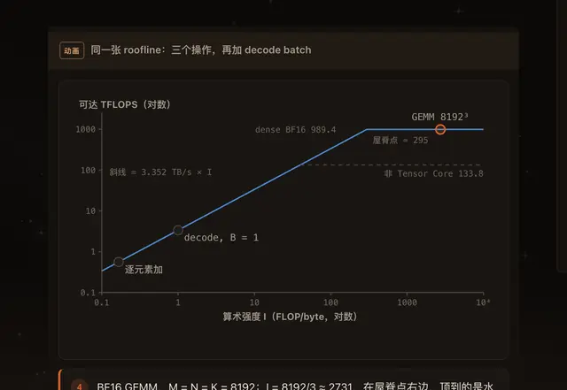
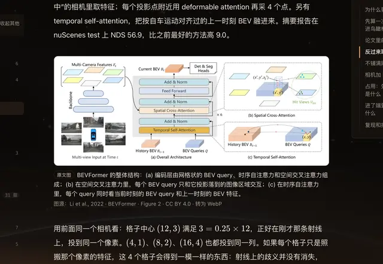
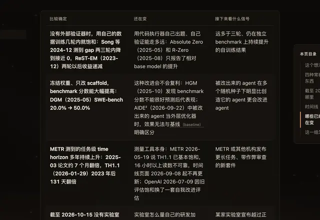

# SI 学习笔记

SI 是 **Super Intelligence（超级智能）** 的缩写。

**把零散的 ML / LLM 知识整理清楚，方便学习，也方便复习。**

<!-- repository-only -->

<p align="center"><a href="https://tianyi-zhang-02.github.io/cooking-agi/index.zh.html"></a></p>

<p align="center"><a href="https://tianyi-zhang-02.github.io/cooking-agi/index.zh.html"><b>在线阅读 →</b></a> &nbsp;·&nbsp; <a href="README.md">English</a> &nbsp;·&nbsp; <a href="#contributors">贡献者</a> &nbsp;·&nbsp; <a href="CONTRIBUTING.md">加入我们</a></p>

<p align="center"><a href="https://github.com/tianyi-zhang-02/cooking-agi/actions/workflows/site.yml"></a> <a href="LICENSE.md"></a> <a href="LICENSE.md"></a></p>

<table>
  <tr>
    <td align="center" width="33%">
      <picture><source media="(prefers-color-scheme: light)" srcset=".github/media/tour/zh-figure-light.webp"></picture>
      <br><b>分步图解</b><br>跟着文中的例子看计算过程，可以随时暂停、回看。
    </td>
    <td align="center" width="33%">
      <picture><source media="(prefers-color-scheme: light)" srcset=".github/media/tour/zh-paper-light.webp"></picture>
      <br><b>论文原图</b><br>把架构图放在相关讲解旁，附上出处和许可。
    </td>
    <td align="center" width="33%">
      <picture><source media="(prefers-color-scheme: light)" srcset=".github/media/tour/zh-frontier-light.webp"></picture>
      <br><b>前沿观察</b><br>新方法做到了什么、还有哪些问题，结合有日期和出处的资料来看。
    </td>
  </tr>
</table>

<!-- /repository-only -->

刚开始准备找工时，我的资料散在课程、论文、文档和一堆收藏里。找一份讲得清楚的材料要花时间，看完之后该接着学什么，也经常没头绪。这个站，就是从整理这些资料开始的。

这里整理了中英文的 ML / LLM 笔记、图解、代码练习和项目拆解，**免费开放，也会一直免费。** 刚入门，可以从基础学起；面试临近，可以集中复习；想了解别的方向，也能挑感兴趣的看。希望即使没有相关背景，你也能找到一个读得下去的起点。

**中文或 English 都可以。** 文章顶部的切换按钮会打开同一篇的另一种语言，中文里保留常用英文术语。网站首次打开默认英文，之后会记住你的选择；直接打开中文链接，就是中文版。

## 从哪里开始

| 你现在想做什么 | 可以从这里开始 |
| --- | --- |
| 刚接触 ML，想补基础 | [起步路线](interview/speedrun-start.md)：从一次预测、loss 和参数更新学起，也有补 Python 的入口。 |
| 想安排一段时间学习 | [按计划学习](interview/study-plan.md)：选一条路线，把阅读和练习排进自己的时间里。 |
| 快面试了，想集中复习 | [快速复习](interview/speedrun.md)：按岗位和可用时间，先补最需要的部分。 |
| 有基础，想看看哪里不熟 | [代码练习](interview/coding-checks.md) · [岗位指南](interview/ai-roles-prep.md)：先自己写、自己讲，卡住了再回看。 |
| 只是对某个方向好奇 | [专题入口](learn/choose-your-path.md#topics) · [编年史](learn/technology-timeline.md)：选一个问题读，或看看这个方向是怎么发展过来的。 |

按你对这个主题的熟悉程度选就好。做了多年系统，第一次接触 RL，也可以从入门讲解看起。

### 怎么用这些笔记

1. **先选一个想弄懂的问题。** 可以跟上面的路线，也可以从[专题目录](learn/choose-your-path.md)找，不需要从头读完整个站。
2. **跟着例子走一遍，再试着自己做。** 算一次、跑一下代码；想继续弄懂原因，再看推导和不同做法的取舍。有些章节还没讲到这么顺，我们会继续改。
3. **收藏想回来读的文章。** 点标题下的「收藏本页」，之后在右上角「我的阅读」里就能找到；再打开时会回到上次读到的位置。不用注册或 fork；记录存在当前浏览器，可以[导出一份 JSON 备份](interview/study-plan.md#backups)，换设备也能带走。

路线里的小时数指实际投入学习的时间，不是每天必须完成的任务。可以拆开学，不需要连续打卡。

### 各个板块放什么

- **[基础与原理](learn/README.md)**：模型怎么工作、怎么训练、怎么评估。刚接触语言模型，可以先看[学习导读](00-foundations/study-guide.md)。
- **[面试准备](interview/README.md)**：复习 ML / LLM，练 ML Coding、Python 和常见算法方法。
- **[工程实践](practice/README.md)**：拆解推荐、RAG 和后训练系统，看数据、训练、服务与评估怎么配合。
- **[编年史](learn/technology-timeline.md)**：电力、芯片、网络、软件与 AI 的发展，以及相关原始资料。
- **[求职记录](career/README.md)**：实习和 new-grad 求职中试过的做法，以及回头看想做的调整。

图解直接展示主要过程；想换个条件、比较结果时，再试试交互部分，不需要每个按钮都点一遍。

<span id="interview-coach"></span>

### 在 AI 助手里练面试（Interview coach skill）

把这个 skill 装进 Claude Code、Codex 这类 AI 助手，就可以对照笔记练习：一次问一道题，答完后给反馈、继续追问，并记下下次需要复习的地方。笔记和题目来自网站的只读数据接口，随网站更新；练习记录保存在自己电脑上，脚本不会把它们上传到本站。你在 AI 助手里输入的回答，仍按该助手及模型服务的设置处理，不代表整个对话只在本地运行。

```bash
npx skills add https://github.com/tianyi-zhang-02/cooking-agi --skill cooking-agi-interview
```

装好后直接说「按 LLM 推理工程师岗位模拟面试，5 道题」或「我哪里比较弱？就考那里」。用法见 [skills/README.md](skills/README.md)。这个 skill 由读者 [@Juggernaut0825](https://github.com/Juggernaut0825) 贡献。

## 内容一览

<!-- repository-only -->

<a href="https://tianyi-zhang-02.github.io/cooking-agi/learn/coverage.html"><picture><source media="(prefers-color-scheme: dark)" srcset="https://tianyi-zhang-02.github.io/cooking-agi/static/readme-topics-zh-dark.svg"></picture></a>

<!-- /repository-only -->

想现在就读一篇，可以从这几组里挑：

- **模型怎么工作**：[Transformer 交互图解](https://tianyi-zhang-02.github.io/cooking-agi/00-foundations/transformer-lab.html) · [BERT](00-foundations/core/bert.md) · [CLIP 与多模态](03-multimodal-learning/clip.md)。
- **模型怎么学**：[训练基础](learn/pretraining/README.md) · [Deep RL](05-post-training/deep-rl/README.md) · [Post-training](05-post-training/README.md) · [LLM-as-a-Judge](07-evaluation/llm-as-a-judge/README.md)。
- **模型怎么用起来**：[推理](learn/inference/README.md) · [搜索与检索](04-search/README.md) · [Agents 与工具](10-agents/README.md)。
- **正在变化的方向**：[前沿观察](11-frontier/README.md)（世界模型、递归自我改进（RSI）、测试时计算）· [AI 基础设施](12-infra/README.md)和[感知、机器人与自动驾驶](13-embodied/README.md)。

想动手练习，可以直接去 [ML Coding](learn/ml-exercises/README.md)、[Python](interview/python.md)、[算法方法](interview/leetcode.md)或[系统设计](learn/system-design/README.md)。

部分内容仍在补充和核对，进度见[内容覆盖与待办](learn/coverage.md)。“已写”不等于“已审核”；文中的小实验也不等于完整模型或 benchmark 的复现。

## 路线图

<!-- repository-only -->

<picture><source media="(prefers-color-scheme: dark)" srcset="https://tianyi-zhang-02.github.io/cooking-agi/static/readme-roadmap-zh-dark.svg"></picture>

<!-- /repository-only -->

### 现在在做

最近主要在回头修改已有笔记：核对一手资料、更新过时的数字，把重复解释合并，也补上缺少的算例。中英文都已做过一轮通读，10 月 21 日的更新又做了逐篇复核，并移除了几组已审阅内容的草稿标记。

审过的文章也可能有遗漏。哪里读着别扭、没讲明白，或者你发现了错误，欢迎[直接告诉我们](https://github.com/tianyi-zhang-02/cooking-agi/issues/new?template=note-feedback.yml)；每篇末尾都有反馈入口。

**接下来：** 让人更快找到答案：先把搜索和页面速度做好，再做 MCP 服务，让 Claude、ChatGPT、Cursor 直接查笔记、出题，和[面试练习 skill](#interview-coach) 读同一份数据。Jetson、物理仿真，以及视觉、驾驶、机器人这几组的审稿，想请做过的朋友一起来。完整计划见[后续计划](community/roadmap.md)；待发布的 v1.0 面试准备，范围见[版本进展](community/updates.md)。

### 主题覆盖

每个主题有多少篇笔记，这一轮复核读到了哪里。数字随网站每次部署更新。

<!-- repository-only -->

<details>
<summary>展开每个主题的复核进度</summary>

<a href="https://tianyi-zhang-02.github.io/cooking-agi/learn/coverage.html"><picture><source media="(prefers-color-scheme: dark)" srcset="https://tianyi-zhang-02.github.io/cooking-agi/static/topic-coverage-zh-dark.svg"></picture></a>

</details>

<!-- /repository-only -->

<!-- widget:topic-coverage -->

### 走到现在

<details markdown="1">
<summary>按时间看：2026 年 8 月至今</summary>

| 时间 | 做了什么 |
| --- | --- |
| 2026 年 8 月上旬 | 开始整理：中文笔记和系统学习地图；第一版网站和 Transformer 基础章节 |
| 8 月下旬 | 后训练系列，从 PPO 讲到之后的算法；面试基础题和白板手撕清单 |
| 9 月下旬 | 网站重做，按求职路线和知识板块组织；RLHF、MoE、Looped Transformer 和 Agents 加入可交互的图 |
| 9 月底到 10 月初 | 全站中英双语；学习路线和章节自测，CLIP 与多模态、LLM-as-a-Judge、Deep RL 交互实验 |
| 10 月 9 日到 11 日 | 双语路线整理成体系，例子逐个核对；补上训练、推理和 ML 系统指南 |
| 10 月 13 日 | 编年史世界树（143 个有来源的节点）、阅读记录、每页反馈和安全加固 |
| 10 月 14 日 | LeetCode 笔记加上分步动画；收藏和阅读记录合并到「我的阅读」；四个章节加上分步图解；全部笔记的中英文通读完第一遍 |
| 10 月 15 日到 16 日 | 前沿观察、AI 基础设施和具身智能三块（配论文原图和 26 张分步动画）；全部笔记逐篇审查错误、过时事实和重复；Scaling、扩散语言模型和量化三组草稿 |

</details>

每次合并的细节，见页面最下方的[更新记录](README.zh.md#changelog)。

<span id="contributors"></span>

## 贡献者与审稿人（Contributors / Reviewers）

<!-- repository-only -->

<picture><source media="(prefers-color-scheme: dark)" srcset="https://tianyi-zhang-02.github.io/cooking-agi/static/readme-people-zh-dark.svg"></picture>

<!-- /repository-only -->

这里列出参与提交和共同署名的贡献者、各板块审稿人，以及读者自愿分享的下一站。卡片在部署时及每小时根据 git 记录、GitHub 和 `site/collaboration.toml` 更新。提交数量不能代表贡献的全部，提问、审阅和纠错同样重要。

如果想为审阅或纠错补充署名，或分享自己的下一站，可以提 issue：[补充署名](https://github.com/tianyi-zhang-02/cooking-agi/issues/new?template=add-me-to-the-crew.yml) · [分享下一站](https://github.com/tianyi-zhang-02/cooking-agi/issues/new?template=next-stop.yml)。只填你愿意公开的内容就好。

## 加入我们！

哪里没讲明白、哪条信息过时了，或者你想看一个还没有的主题，都可以告诉我们。不用先找到答案，才能提问题。

- **提反馈**：开一个 [issue](https://github.com/tianyi-zhang-02/cooking-agi/issues/new?template=note-feedback.yml)，附上相关段落。内容纠错、信息过时、解释不清、想加主题、网站问题，都有对应选项。
- **一起改**：小改动直接提 PR 就好；想写新文章或调整目录，先开[内容提案](https://github.com/tianyi-zhang-02/cooking-agi/issues/new?template=proposal.yml)，方便大家商量，避免重复做。
- **分享给朋友**：如果这里的笔记帮到了你，欢迎把链接发给同学，或正在找工、转方向的朋友。不用公开公司或求职结果。参与整理的朋友列在[贡献者与审稿人](#contributors)里。

这些是我们一边学、一边改的笔记，不是官方课程。选题受自身经验影响，目前更偏 ML / LLM 和 MLE / research 方向，也难免有遗漏和过时的地方。我们分享公开知识和准备方法，不收录针对某家公司的面试信息或题库，也没办法预测题目、保证 offer。

<details markdown="1">
<summary>修改、审核与隐私说明</summary>

具体流程见[贡献指南](CONTRIBUTING.md)、[写作规范](EDITORIAL.md)和[板块审核人](community/README.md)。社区贡献的 PR 需要非作者的相关 CODEOWNER 审核，并通过自动检查。请使用公开资料，用自己的话解释。AI 辅助起草或初审需要说明用法、人工核对，不能代替正式批准或事实验证。

Issue 是公开的，请不要附私人进度备份、公司资料或未脱敏的日志。指出信息变化时，有公开来源或版本号更好；只是想问清楚一段讲解，不需要先准备这些。

</details>

**免费阅读，也欢迎按许可使用和改编。** 不设付费章节或付费备考路线。原创代码采用 MIT，原创笔记采用 CC BY 4.0；请保留署名、来源和许可说明，并标注修改。第三方素材仍遵循原许可。我们不为他人修改、转载的版本背书，保证与责任范围以[许可条款](LICENSE.md)为准。

## 本地阅读与检查

这个仓库包含笔记、例子和静态站点源码，不需要数据库。在仓库根目录运行，建议使用 Python 3.12：

```bash
python3 -m pip install markdown pygments numpy
python3 site/build.py --serve
```

打开 <http://localhost:8000>。只想构建、不启动预览，可以运行 `python3 site/build.py`，结果在 `_site/`。

<details markdown="1">
<summary>提交前的检查</summary>

```bash
python3 site/collaboration.py
python3 -m unittest discover -s site/tests
python3 site/leakcheck.py
python3 site/paritycheck.py --strict
python3 site/build.py
```

部分实验还需要 PyTorch，依赖写在对应章节；没有安装时，相关测试会明确跳过。个人收藏清单、最近阅读和阅读位置保存在这个浏览器里。公开计数默认关闭；另行开启后，只提交后续阅读和手动收藏操作，不上传已有记录或备份。

</details>

## 为什么整理这些

从学术研究转向企业里的 ML 工作时，我常遇到一种情况：论文里看着眼熟的东西，真要自己讲、自己写，又不太会了。整理笔记帮我发现了这些缺口，公开出来，也能让别人帮忙看看哪里还没想清楚。

我希望，开始学一个方向，不必先有相关背景，也不必刚好认识能给你一份资料清单的人。这些笔记代替不了学习和练习，但可以让起步容易一点。别人讲得好的，我们就推荐；自己不熟悉的，也欢迎做这个方向的朋友来补充。不同领域的人一起整理，说不定还能看到以前没注意过的联系。

能少花一点东翻西找的时间，学完还有空做点自己喜欢的事，我就觉得这个站值得继续做下去。

<span id="changelog"></span>

## 更新记录

每次合并进主分支的改动，按日期分成大更新和小更新，链接是对应的 PR。

| 日期 | 大更新 | 小更新 |
| --- | --- | --- |
| 2026-10-17 | 面试练习 skill：在 Claude Code、Codex 里对照笔记模拟面试，笔记和题目来自网站新开的只读数据接口（[#103](https://github.com/tianyi-zhang-02/cooking-agi/pull/103)，读者 @Juggernaut0825 贡献）· README 改版：首页动图，内容一览、路线图和贡献者卡片随网站更新（[#104](https://github.com/tianyi-zhang-02/cooking-agi/pull/104) [#105](https://github.com/tianyi-zhang-02/cooking-agi/pull/105)） | 贡献者页面从网站移到 GitHub 首页（[#104](https://github.com/tianyi-zhang-02/cooking-agi/pull/104)）· 卡片图标与折叠（[#106](https://github.com/tianyi-zhang-02/cooking-agi/pull/106)） |
| 2026-10-16 | 全部笔记逐篇审查：改正错误，面试页不再写具体公司的招聘流程（[#99](https://github.com/tianyi-zhang-02/cooking-agi/pull/99)）；事实更新到 2026 年 10 月（[#100](https://github.com/tianyi-zhang-02/cooking-agi/pull/100)）；重复的解释合到一处，补上到新板块的链接（[#101](https://github.com/tianyi-zhang-02/cooking-agi/pull/101)）· Scaling、扩散语言模型和量化三组草稿（[#102](https://github.com/tianyi-zhang-02/cooking-agi/pull/102)） | 删除未发布的 quant 笔记（[#98](https://github.com/tianyi-zhang-02/cooking-agi/pull/98)） |
| 2026-10-15 | 前沿观察、AI 基础设施和具身智能三块，配论文原图和 26 张分步动画（[#97](https://github.com/tianyi-zhang-02/cooking-agi/pull/97)） | — |
| 2026-10-14 | LeetCode 笔记加上分步动画讲解（[#78](https://github.com/tianyi-zhang-02/cooking-agi/pull/78)）· 四个章节加上分步图解和论文原图（[#83](https://github.com/tianyi-zhang-02/cooking-agi/pull/83)）· 全部笔记的中英文通读一遍，逐句核对事实、算例和表达（[#84](https://github.com/tianyi-zhang-02/cooking-agi/pull/84) [#85](https://github.com/tianyi-zhang-02/cooking-agi/pull/85) [#87](https://github.com/tianyi-zhang-02/cooking-agi/pull/87) [#88](https://github.com/tianyi-zhang-02/cooking-agi/pull/88) [#89](https://github.com/tianyi-zhang-02/cooking-agi/pull/89) [#90](https://github.com/tianyi-zhang-02/cooking-agi/pull/90)）· 训练与系统的 16 篇笔记加上分步图解（[#94](https://github.com/tianyi-zhang-02/cooking-agi/pull/94)） | 收藏、阅读记录和备份合并到「我的阅读」，去掉学习台，练习移到「按计划学习」（[#81](https://github.com/tianyi-zhang-02/cooking-agi/pull/81)）· README 宣传动图换成新版（[#79](https://github.com/tianyi-zhang-02/cooking-agi/pull/79)）· README 加上路线图、主题覆盖和更新记录（[#82](https://github.com/tianyi-zhang-02/cooking-agi/pull/82)）· 中文段落里的换行不再显示成空格（[#86](https://github.com/tianyi-zhang-02/cooking-agi/pull/86)）· 复核清单与更新记录（[#91](https://github.com/tianyi-zhang-02/cooking-agi/pull/91)）· 面试准备首页改成普通目录（[#93](https://github.com/tianyi-zhang-02/cooking-agi/pull/93)）· 私有仓库归档后，泄漏检查成为唯一一道闸门（[#92](https://github.com/tianyi-zhang-02/cooking-agi/pull/92)）· 门控注意力的例子改用不相加为 1 的门（[#95](https://github.com/tianyi-zhang-02/cooking-agi/pull/95)） |
| 2026-10-13 | 编年史：技术世界树，143 个有来源的节点，之后改成竖向年表（[#65](https://github.com/tianyi-zhang-02/cooking-agi/pull/65) [#71](https://github.com/tianyi-zhang-02/cooking-agi/pull/71)）· 学习台与阅读记录（[#64](https://github.com/tianyi-zhang-02/cooking-agi/pull/64) [#67](https://github.com/tianyi-zhang-02/cooking-agi/pull/67)） | 阅读面板：今天、本周、累计（[#66](https://github.com/tianyi-zhang-02/cooking-agi/pull/66) [#70](https://github.com/tianyi-zhang-02/cooking-agi/pull/70)）· 每页一键反馈（[#72](https://github.com/tianyi-zhang-02/cooking-agi/pull/72)）· 安全加固（[#73](https://github.com/tianyi-zhang-02/cooking-agi/pull/73)）· 学习小伙伴（[#74](https://github.com/tianyi-zhang-02/cooking-agi/pull/74)）· 匿名计数（[#75](https://github.com/tianyi-zhang-02/cooking-agi/pull/75) [#76](https://github.com/tianyi-zhang-02/cooking-agi/pull/76)）· vLLM / SGLang 对照（[#68](https://github.com/tianyi-zhang-02/cooking-agi/pull/68)）· README 动图（[#69](https://github.com/tianyi-zhang-02/cooking-agi/pull/69)） |
| 2026-10-11 | 双语入口、README 与学习路线；工程练习和更多算例（[#61](https://github.com/tianyi-zhang-02/cooking-agi/pull/61) [#62](https://github.com/tianyi-zhang-02/cooking-agi/pull/62)） | 训练、推理、SigLIP 与 ML 系统指南（[#63](https://github.com/tianyi-zhang-02/cooking-agi/pull/63)） |
| 2026-10-09 | 双语学习路线全面整理，例子逐个核对（[#60](https://github.com/tianyi-zhang-02/cooking-agi/pull/60)） | — |
| 2026-10-05 | Deep RL 双语课程与交互实验（[#58](https://github.com/tianyi-zhang-02/cooking-agi/pull/58)） | 求职笔记改得更自然（[#59](https://github.com/tianyi-zhang-02/cooking-agi/pull/59)） |
| 2026-10-03 | 数学与 Quant 复习：证明和算例（[#56](https://github.com/tianyi-zhang-02/cooking-agi/pull/56)，后来下架） | 讨论区下线，回到学习笔记（[#57](https://github.com/tianyi-zhang-02/cooking-agi/pull/57)） |
| 2026-10-02 | LLM-as-a-Judge 双语课程与交互评估（[#55](https://github.com/tianyi-zhang-02/cooking-agi/pull/55)） | — |
| 2026-10-01 | 导航、阅读工具与社区页（[#45](https://github.com/tianyi-zhang-02/cooking-agi/pull/45)） | 讨论区上线与排版（[#53](https://github.com/tianyi-zhang-02/cooking-agi/pull/53) [#54](https://github.com/tianyi-zhang-02/cooking-agi/pull/54)） |
| 2026-09-30 | 双语学习路线与章节自测（[#42](https://github.com/tianyi-zhang-02/cooking-agi/pull/42)） | CLIP / VLM 笔记与双语 README（[#44](https://github.com/tianyi-zhang-02/cooking-agi/pull/44)）· 刷题常用的 Python（[#40](https://github.com/tianyi-zhang-02/cooking-agi/pull/40)） |
| 2026-09-25 | — | 移除 AI Infra 板块；补改跳过的笔记，增加协作审稿人（[#37](https://github.com/tianyi-zhang-02/cooking-agi/pull/37) [#38](https://github.com/tianyi-zhang-02/cooking-agi/pull/38)） |
| 2026-09-24 | Quant 专区：概率系列（[#36](https://github.com/tianyi-zhang-02/cooking-agi/pull/36)，后来下架） | — |
| 2026-09-23 | 精读、Agents、模型选择、求职与 AI Infra（[#33](https://github.com/tianyi-zhang-02/cooking-agi/pull/33) [#34](https://github.com/tianyi-zhang-02/cooking-agi/pull/34)） | 贡献者页与致谢（[#30](https://github.com/tianyi-zhang-02/cooking-agi/pull/30) [#31](https://github.com/tianyi-zhang-02/cooking-agi/pull/31) [#32](https://github.com/tianyi-zhang-02/cooking-agi/pull/32)）· ML Systems 推荐阅读（[#35](https://github.com/tianyi-zhang-02/cooking-agi/pull/35)） |
| 2026-09-22 | RLHF 九篇系列；MoE、Looped Transformer 与 Agents 板块，七个交互图（[#24](https://github.com/tianyi-zhang-02/cooking-agi/pull/24) [#25](https://github.com/tianyi-zhang-02/cooking-agi/pull/25)） | 每页只用一种语言（[#18](https://github.com/tianyi-zhang-02/cooking-agi/pull/18)）· 夜空设计与首页（[#19](https://github.com/tianyi-zhang-02/cooking-agi/pull/19) [#20](https://github.com/tianyi-zhang-02/cooking-agi/pull/20) [#21](https://github.com/tianyi-zhang-02/cooking-agi/pull/21) [#22](https://github.com/tianyi-zhang-02/cooking-agi/pull/22)）· 评估长文拆短（[#23](https://github.com/tianyi-zhang-02/cooking-agi/pull/23)）· 求职笔记（[#26](https://github.com/tianyi-zhang-02/cooking-agi/pull/26) [#27](https://github.com/tianyi-zhang-02/cooking-agi/pull/27) [#28](https://github.com/tianyi-zhang-02/cooking-agi/pull/28) [#29](https://github.com/tianyi-zhang-02/cooking-agi/pull/29)） |
| 2026-09-21 | 网站重做：求职路线、知识板块与快速复习（[#17](https://github.com/tianyi-zhang-02/cooking-agi/pull/17)） | — |
| 2026-08-27 | — | 面试基础题、白板手撕清单和参考实现（[#15](https://github.com/tianyi-zhang-02/cooking-agi/pull/15) [#16](https://github.com/tianyi-zhang-02/cooking-agi/pull/16)） |
| 2026-08-26 | 后训练系列：四段递进，从 PPO 讲到之后的算法（[#11](https://github.com/tianyi-zhang-02/cooking-agi/pull/11) [#13](https://github.com/tianyi-zhang-02/cooking-agi/pull/13) [#14](https://github.com/tianyi-zhang-02/cooking-agi/pull/14)） | 补一条中文导读（[#10](https://github.com/tianyi-zhang-02/cooking-agi/pull/10)） |
| 2026-08-24 | — | 补回解码与 RLHF 流程（[#8](https://github.com/tianyi-zhang-02/cooking-agi/pull/8)） |
| 2026-08-14 | — | 多头注意力、归一化与残差连接（[#7](https://github.com/tianyi-zhang-02/cooking-agi/pull/7)） |
| 2026-08-12 | 基础章节、阅读顺序和第一版网站（[#3](https://github.com/tianyi-zhang-02/cooking-agi/pull/3)） | 中文润色、侧栏分组（[#4](https://github.com/tianyi-zhang-02/cooking-agi/pull/4)）· 架构图与入门 / 进阶分层（[#6](https://github.com/tianyi-zhang-02/cooking-agi/pull/6)） |
| 2026-08-10 | 第一版 AI 基础设施学习指南（[#1](https://github.com/tianyi-zhang-02/cooking-agi/pull/1)） | 重画图解（[#2](https://github.com/tianyi-zhang-02/cooking-agi/pull/2)） |
