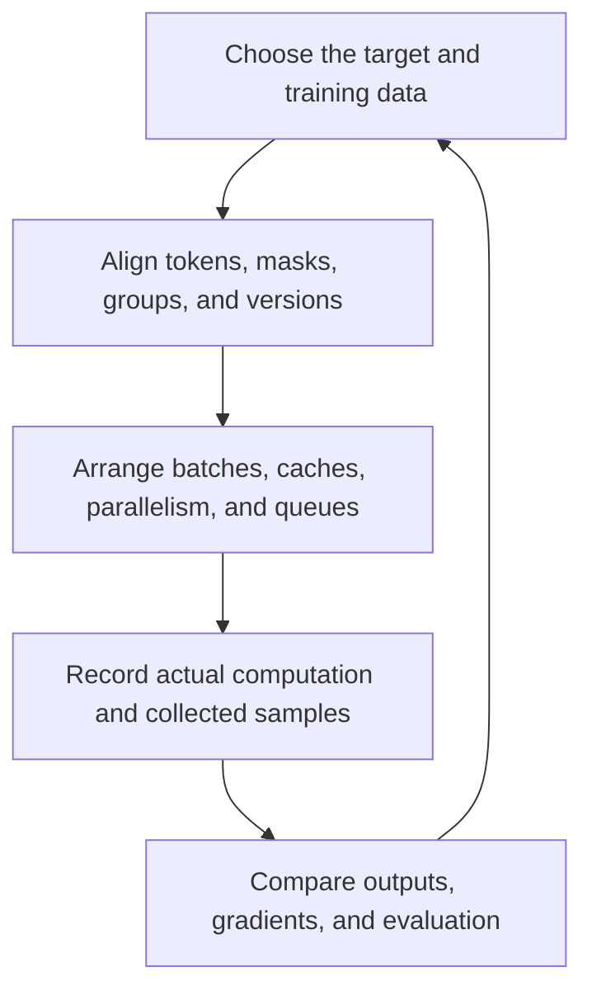

# From algorithms to source: generation, training, and stability

[中文](README.md) · **English**

A model receives four tokens and produces three more. How many forward passes does that take? When does its cache grow? If we train on those outputs, which positions contribute to the loss?

We start with these small questions. Follow a request through vLLM/SGLang, a group of answers through NeMo RL, and then the places where executable code can still train the wrong objective. Each note follows **example → explanation → source → checks**. Source links are pinned, so you can follow the functions relevant to your question without reading an entire repository first.

## Start with your question {#start}

| What do you want to understand? | Where to start | Example in the note |
| --- | --- | --- |
| How do prefill, decode, and KV caching fit together? | [One generation, from model computation to engine scheduling](prefill-decode.en.md) | Input A B C D, output E F G: trace the inputs, cache, and samples at each step |
| How do answers become a parameter update? | [Follow a training run through NeMo RL](nemo-rl.en.md) | Two questions, four answers each: follow rewards, probabilities, and weight versions |
| Why does loss stall, become NaN, or improve while evaluation gets worse? | [Training stability: from samples to an update](training-stability.en.md) | Two microbatches have 100 and 10 tokens: why does averaging their means give 2 instead of the token mean, 1.182? |

If forward and backward are unfamiliar, work through the [matrix-gradient example](../../00-foundations/deep-dives/matrix-gradients-to-systems.en.md), then read about [gradient accumulation and multiple GPUs](../../06-systems/megatron-basics.en.md). For processes, devices, and ranks, read [execution and resource boundaries](../../06-systems/execution-boundaries.en.md). Source should make those concepts concrete, not introduce another vocabulary to memorize.

## One question at a time: matrices to RL systems {#small-steps}

For shorter sessions, choose from the sequence below. Spend roughly 15–25 minutes on one mechanism and one checkable example; this is a guide to selecting material, not a deadline. Split a longer article across sessions. Matrices and gradients will reappear in caching, distributed execution, and RL.

[Matrix gradients and training systems](../../00-foundations/deep-dives/matrix-gradients-to-systems.en.md) follows a linear layer through an update, then explains why training stores activations and combines gradients. The later steps move into models and systems. If you already know the basics, skip to the topic you need.

| A question for one session | Read | A concrete check |
| --- | --- | --- |
| 1. What does each number in a matrix multiply mean? | [Matrix gradients and training systems](../../00-foundations/deep-dives/matrix-gradients-to-systems.en.md) | Write the shapes of X, W, and Z; calculate one output |
| 2. Why are more linear layers insufficient? | [Linear models to neural networks](../../00-foundations/from-linear-to-neural.en.md) | Compose two linear maps, then use XOR to examine nonlinearity |
| 3. How does attention connect tokens? | [The complete Transformer](../../00-foundations/transformer.en.md) | Identify the rows and columns of QKᵀ and what the causal mask blocks |
| 4. How do logits become a loss? | [Cross-entropy](../../00-foundations/pytorch/cross-entropy.en.md) | Select target-token log-probabilities; check shifting, masks, and denominators |
| 5. How does a gradient reach earlier layers? | [Autograd](../../00-foundations/pytorch/autograd.en.md) | Compare manual and automatic derivatives; distinguish propagation from `.grad` storage |
| 6. How does a gradient change a parameter? | [SGD to AdamW](../../00-foundations/deep-dives/optimizers.en.md) | Compare an SGD step with the extra state for momentum and second moments |
| 7. Why does training use memory? | [Precision and memory](../../00-foundations/deep-dives/precision-and-memory.en.md) | Account separately for parameters, gradients, optimizer state, and activations |
| 8. How can batches and GPUs preserve the objective? | [Training stability](training-stability.en.md#normalization) → [Tensor parallelism](../../06-systems/tensor-parallel.en.md) | Recalculate the 100/10-token denominators, then label each GPU's matrix shards |
| 9. Why can a busy GPU still be slow? | [Performance: roofline and MFU](../../12-infra/performance.en.md) | Fix batch size, sequence length, and precision; distinguish compute and data movement |
| 10. Why do prefill and decode differ? | [One generation](prefill-decode.en.md) | Track input tokens and KV growth for A B C D → E F G |
| 11. Tokens are discrete; where does the RL gradient come from? | [Policy gradients](../../05-post-training/deep-rl/policy-gradients.en.md) → [NeMo RL](nemo-rl.en.md) | Distinguish rewards and log-probabilities; follow an answer group into training |
| 12. Why does async execution create stale samples? | [Async RL](../../06-systems/async-rl.en.md) | Label generation and training with weight versions; locate queues and stale data |

From here, you can explore LoRA's low-rank updates, MoE routing and all-to-all, FlashAttention's data movement, or top-k logit representation costs. Keep asking concrete questions: what computation or storage does a method save, and what communication or approximation does it add? Test performance claims with the version and workload you actually use.

## How can a batch change become an objective change? {#connection}

Consider two changes separately. Keeping KV for the same prefix avoids repeated computation. Averaging two microbatch losses can change the weight assigned to each token. For the first, check that cached and uncached results agree. For the second, first decide which objective you actually intend to optimize.



An autoregressive model conditions each output on the available prefix. A system can batch different users or reuse valid prefix KV, but filling a GPU does not make future tokens known. Speculative decoding introduces drafting and verification; it does not remove that conditional relationship.

Training has similar constraints. If the objective averages over valid tokens, dividing long and short examples into different microbatches must preserve that denominator. A change described as “just batching” can otherwise change each example's contribution to the gradient.

| Systems choice | Intended benefit | What to check after the change |
| --- | --- | --- |
| Chunked prefill and continuous batching | Better resource use with mixed request lengths | Positions, causal masks, cache writes, and stopping rules |
| Prefix caching | Avoid repeated prefix computation | Compatible tokens, weights, adapters, positions, and modality inputs |
| Packing, gradient accumulation, distributed reduction | Less padding and a larger effective batch | Sequence boundaries, loss weights, and valid-token denominators |
| Asynchronous rollouts and completion-order sampling | Less waiting for the learner | Behavior-policy versions, complete groups, and timeout bias |
| Mixed precision and fused kernels | Lower memory and compute costs | Finite values, numerical error, gradients, and necessary higher-precision reductions |

Some changes should preserve the computation within an appropriate numerical tolerance. Others deliberately change sampling or optimization. Decide which you are making before choosing the test.

## Find the source that answers your question {#libraries}

The call paths use these source snapshots, checked on 2026-10-30. They are independent project snapshots, **not a tested installation or compatibility matrix**.

| Project | Scope of this walkthrough | Pinned source |
| --- | --- | --- |
| vLLM | EngineCore, token budgets, KV allocation, and the V2 model-runner handoff | [`913fccd`](https://github.com/vllm-project/vllm/tree/913fccd11847f5b4d4769e3a69c8925f955bc29e) |
| SGLang | Normal and overlap scheduling entries, ScheduleBatch, model worker, and radix prefix lookup | [`dde1ef2`](https://github.com/sgl-project/sglang/tree/dde1ef21a03da18fe226308fb27043013297e38e) |
| NeMo RL | GRPO path selection, policy interfaces, the data plane, weight synchronization, and recovery boundaries | [`1c40201`](https://github.com/NVIDIA-NeMo/RL/tree/1c4020163a5523be4365de7fdeaa411770ecc589) |

When you reach training execution, use [multi-GPU training](../../06-systems/megatron-basics.en.md) to understand Megatron/FSDP state partitioning. For worker placement, turn to Ray in [cluster scheduling](../../06-systems/execution-boundaries.en.md#scheduling). To compare RL runtimes, continue with [verl and AReaL responsibilities](../../06-systems/rl-systems.en.md#frameworks) and [asynchronous RL](../../06-systems/async-rl.en.md). Those notes compare concepts and mechanisms; the table above defines this series' source-reading scope.

## What can you check yourself? {#practice}

1. **Trace one execution.** Label each stage's inputs, outputs, and retained state. When is E sampled, and when is its KV computed?
2. **Compare one change.** With a smaller prefill chunk, do active streams wait less, and does the long prompt itself take longer? Keep the original setup as a control.
3. **Introduce an error deliberately.** Remove the causal mask, substitute the wrong logprob denominator, or change valid-token counts. Does your check identify the difference, or merely report successful execution?

The accompanying [plain-Python experiment](code/runtime_checks.py) compares full causal attention with incremental cached computation, then checks normalization across unequal microbatches. It uses single-head attention and Python loops, without positional encoding, an MLP, or autograd. It is not a complete Transformer and cannot predict GPU performance. The small setup lets you check each calculation before studying how a framework executes it in parallel.

```bash
python3 practice/runtime-reading/code/runtime_checks.py
```

Source tracing is static analysis. Speed, memory use, and learning gains require separate controlled experiments. Establish the small checks before increasing model size, concurrency, or machine count.
