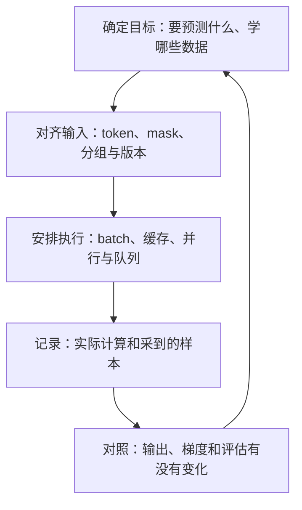

# 从算法到源码：生成、训练与稳定性

**中文** · [English](README.en.md)

模型收到四个 token，接着输出三个。这中间做了几次前向计算？缓存什么时候增加？如果把这段回答拿去训练，又该对哪些位置计算损失（loss）？

这组笔记就从这些问题开始。先看一条请求在 vLLM / SGLang 中如何生成回答，再看 NeMo RL 怎样用一组回答更新模型，最后排查那些“代码能跑，但学得不对”的问题。每篇都先算一个小例子，再解释原理、找到对应源码，最后动手验证。源码链接固定到具体版本，可以挑自己关心的函数读，不必从仓库首页一路翻到底。

## 从你现在的问题开始 {#start}

| 想弄清什么 | 读哪篇 | 文中的例子 |
| --- | --- | --- |
| Prefill、decode 和 KV cache 怎么配合？ | [一次生成，从模型计算到引擎调度](prefill-decode.md) | 输入 A B C D，输出 E F G：逐轮看输入、缓存和采样 |
| 回答怎样变成一次参数更新？ | [沿 NeMo RL 读一次训练](nemo-rl.md) | 两道题各采四个回答，跟踪奖励、概率与权重版本 |
| 损失不降、出现 NaN，或奖励涨了但效果更差？ | [训练稳定性：从样本到一次更新](training-stability.md) | 两个微批次分别有 100 和 10 个 token，为什么先各自平均再合并，会把平均损失从 1.182 算成 2？ |

如果前向、反向和梯度累积还不熟，先读[一次更新与 Megatron](../../06-systems/megatron-basics.md)。如果还分不清一个进程、一张卡和一个 rank，先读[执行与资源边界](../../06-systems/execution-boundaries.md)。源码是用来印证这些概念的，不是另一套要背的术语。

## 为什么只改分批方式，也会影响训练？ {#connection}

先看两种不同的改动。把同一段前缀的 KV 留下来，是为了少做重复计算；把两个微批次的平均损失直接相加再除以二，却可能改变每个 token 的权重。前一种要核对使用缓存后结果是否一致，后一种要先确认自己究竟想优化哪个目标。



例如自回归模型要求第 t 个输出依赖已经得到的前缀。系统可以把不同用户的请求放进同一批，也可以复用有效的前缀 KV；但不能为了填满 GPU，就假装后面尚未生成的 token 已经知道了。推测解码另有草稿与验证机制，不是取消这个条件概率关系。

训练也一样：如果目标是对一整批有效 token 求平均，把长短样本拆成微批次后，仍要按这一整批的有效 token 总数归一化，而不是让每个微批次各算各的均值。否则，看似只改了分批方式，也会改变每条样本对梯度的贡献。

| 系统上的选择 | 通常想解决什么 | 改完要检查什么 |
| --- | --- | --- |
| 分块预填充、连续批处理 | 长短请求共存时更好地使用资源 | 位置与因果 mask、缓存写入顺序、停止条件 |
| 前缀缓存 | 避免重复计算相同前缀 | token、权重、adapter、位置和模态输入是否兼容 |
| Packing、梯度累积、多卡归约 | 减少 padding，容纳更大的有效 batch | 序列边界、loss 权重、有效 token 分母 |
| 异步 rollout、按完成顺序取样 | 减少训练端等待 | 行为策略版本、组完整性、超时样本偏差 |
| 混合精度、算子融合 | 降低存储与计算开销 | 有限值、误差、梯度和必要的高精度归约 |

其中有些变化应在允许的浮点误差内保持计算含义；有些会有意改变采样或优化方式。要先区分这两类，才能决定测试该比较什么。

## 带着问题找源码 {#libraries}

本组的调用链固定到下面的源码快照，核对日期为 2026-10-30。它们是不同项目的独立快照，**不是一份已验证兼容的安装组合**。

| 项目 | 本组阅读范围 | 固定版本 |
| --- | --- | --- |
| vLLM | EngineCore、token 预算、KV 分配、V2 model runner 的交接 | [`913fccd`](https://github.com/vllm-project/vllm/tree/913fccd11847f5b4d4769e3a69c8925f955bc29e) |
| SGLang | 普通与 overlap 调度入口、ScheduleBatch、模型 worker、radix 前缀查找 | [`dde1ef2`](https://github.com/sgl-project/sglang/tree/dde1ef21a03da18fe226308fb27043013297e38e) |
| NeMo RL | GRPO 路径选择、策略接口、样本传输、权重同步与恢复条件 | [`1c40201`](https://github.com/NVIDIA-NeMo/RL/tree/1c4020163a5523be4365de7fdeaa411770ecc589) |

读到训练执行，可以配合[多卡训练](../../06-systems/megatron-basics.md)理解 Megatron / FSDP 怎样切分状态；想知道工作进程（worker）被安排到哪张卡上，再看[集群调度](../../06-systems/execution-boundaries.md#scheduling)里的 Ray。想比较不同 RL 框架，可以接着看 [verl / AReaL 的职责对照](../../06-systems/rl-systems.md#frameworks)与[异步 RL](../../06-systems/async-rl.md)。这些延伸笔记侧重概念和机制，逐函数的源码阅读范围以上表为准。

## 看懂以后，可以动手检查什么？ {#practice}

1. **画一张流程图。** 跟着一条请求或一次训练更新，把每一步的输入、输出和留下的状态写在箭头旁。E 是什么时候生成的，它的 KV 又是什么时候算的？
2. **比较一个改动。** 比如减小预填充的分块大小：正在输出的请求是否少等了，长输入本身是否多花了时间？用原设置作对照。
3. **故意制造一个错误。** 去掉因果 mask、换错 logprob 分母，或改变有效 token 数。看看你的检查能不能指出哪里变了，而不只是打印“运行成功”。

这组附了一个[纯 Python 小实验](code/runtime_checks.py)：比较完整因果 attention 与逐 token 缓存计算，再检查长短微批次的归一化。它只保留单头 attention，用 Python 循环计算，没有位置编码、MLP 或自动求导，不是完整的 Transformer，也不能预测 GPU 性能。这样可以先把每一步算清楚，再去看框架怎样并行执行。

```bash
python3 practice/runtime-reading/code/runtime_checks.py
```

源码定位属于静态阅读；速度、显存与训练收益需要另外做受控实验。先把小检查做对，再增加模型大小、并发和机器数。
