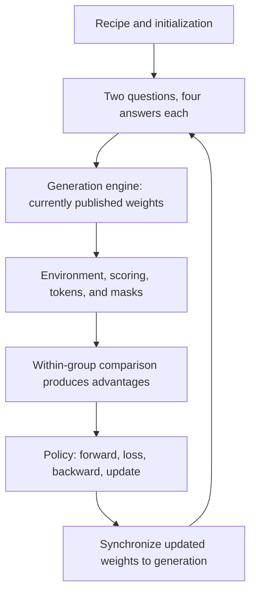

# Follow a training run through NeMo RL

[中文](nemo-rl.md) · **English**

Once you have a group of model answers, how do you train on them? Score them, assemble samples with masks and probabilities, compute the loss, run backward, and update parameters. One easily missed step follows: generation must receive the new weights before the next answers can come from the updated model.

NeMo RL provides algorithm orchestration and distributed integration for this work. This walkthrough pins [main at `1c40201`](https://github.com/NVIDIA-NeMo/RL/tree/1c4020163a5523be4365de7fdeaa411770ecc589), checked on 2026-10-30. We follow standard GRPO before comparing three other paths. This is source analysis, not a training run or framework benchmark.

## Follow one standard GRPO cycle {#one-update}

Take two questions with four answers each, labeled `q1/a1` through `q2/a4`, all generated by v10. These labels are illustrative, not required framework field names.

The first cycle uses v10; after successful synchronization, the next cycle uses v11. The handoffs below include probability computation and state that the diagram omits.

### Step one: turn a recipe into objects

[`run_grpo.py`](https://github.com/NVIDIA-NeMo/RL/blob/1c4020163a5523be4365de7fdeaa411770ecc589/examples/run_grpo.py) loads configuration, initializes Ray, tokenization, and data, then calls setup to create the policy, generation, loss, and checkpoint components.

Record the training backend, generation backend, colocation, data-plane setting, and asynchronous path. These determine which limitations apply. Single Controller options do not describe legacy asynchronous GRPO.

### Step two: turn answers into training records

Text becomes token IDs; the generation engine performs forwards and sampling, and a rollout may include tool calls and environment responses. Training needs more than the final answer: it needs action positions versus tool observations, generation probabilities, and termination state.

If `q1` receives rewards `[1, 0, 1, 0]`, subtracting the mean gives `[0.5, -0.5, 0.5, -0.5]`. A complete algorithm must also specify normalization, KL, and token aggregation. If `q1/a4` is unfinished, the other three are not automatically a complete group of four.

The comparison is between **answers to the same question**. Suppose `q2` is easier and all four answers receive reward 1. Subtracting their own group mean gives four zeros. Averaging all eight answers together would change that result and the intended comparison. Keep group IDs with the samples, not just a list of eight rewards.

Multi-turn records must also become training sequences. A tool observation can be context without being an action sampled by the policy. Matching lengths is only a first check; the mask must carry the right meaning.

### Step three: turn the objective into gradients

The [standard loop](https://github.com/NVIDIA-NeMo/RL/blob/1c4020163a5523be4365de7fdeaa411770ecc589/nemo_rl/algorithms/grpo.py#L3466) arranges the required policy/reference logprobs and advantages, then enters `prepare_for_training` and `policy.train`.

[`Policy.train`](https://github.com/NVIDIA-NeMo/RL/blob/1c4020163a5523be4365de7fdeaa411770ecc589/nemo_rl/models/policy/lm_policy.py#L1005) distributes data to workers. The selected backend executes the forward, prepares inputs to the loss, and runs backward and the optimizer. Follow [`prepare_loss_input`](https://github.com/NVIDIA-NeMo/RL/blob/1c4020163a5523be4365de7fdeaa411770ecc589/nemo_rl/algorithms/loss/loss_input.py#L199) for token shifting, masks, and probability alignment; follow the [Automodel worker](https://github.com/NVIDIA-NeMo/RL/blob/1c4020163a5523be4365de7fdeaa411770ecc589/nemo_rl/models/policy/workers/automodel_policy_worker.py) for microbatches, gradient processing, and optimization.

Learning evaluates **the current probability of actions already sampled**; it need not randomly regenerate the answer. Generation-time behavior logprobs, update-start old-policy logprobs, current-policy logprobs, and a reference distribution for KL serve different purposes. Being probabilities from related models does not make them interchangeable.

Follow `q1/a1` a little further. Its recorded text need not change during training, but the probabilities used in the loss can:

| Stage | Record kept | What is computed or changed |
| --- | --- | --- |
| v10 generates the answer | Tokens, generation-time probabilities, generation version | Environment results and reward |
| Prepare the training group | The same answer, assigned to q1 | Within-group advantage, action mask, other probabilities required by the objective |
| Update training parameters | The answer and behavior record stay unchanged | Recompute those actions' logprobs under current parameters and obtain gradients |
| Complete the update and synchronization | Historical samples still identify v10 | The next generation cycle uses v11 |

Changing old samples' version labels to v11 would erase their provenance. Those labels describe how samples were produced, not which model is now serving.

### Step four: publish weights, not just a version number

After an update, generation can still hold v10. Synchronization must account for tensor layouts, partitioning, transfer completion, and caches. With training TP=4 and generation TP=2, the first training rank's shard is not simply everything the first generation rank needs.

Start at the [`WeightSynchronizer` factory](https://github.com/NVIDIA-NeMo/RL/blob/1c4020163a5523be4365de7fdeaa411770ecc589/nemo_rl/weight_sync/factory.py#L79), then follow the selected transport. Receiving all weights does not make old KV valid. The selected runtime must define how in-flight requests cross a version boundary.

## Which components handle the update? {#flows}

| Responsibility | Reading entry | Distinction to preserve |
| --- | --- | --- |
| Configuration and launch | `examples/run_*.py`, validation, setup | A setting's existence does not mean every launcher consumes it |
| Algorithm orchestration | `grpo.py`, `grpo_sync.py`, `single_controller.py` | The objective and its execution schedule are different layers |
| Training execution | `Policy`, Automodel/Megatron workers | Computing gradients is not completing an optimizer step |
| Generation and environment | Generation, rollout, environment modules | Policy actions differ from environment observations |
| Communication and resources | Ray, data plane, weight sync | Placement, sample movement, and parameter movement are separate tasks |
| State management | Checkpoint, replay recovery, monitoring | Live processes do not establish correct training recovery |

**Control flow** decides when to invoke components. **Sample flow** brings tokens, rewards, masks, and versions to the learner. **Weight flow** returns the updated model to generation. Large tensors need not pass through the coordinating driver; data-plane metadata is not the payload itself.

Automodel, Megatron, vLLM, and SGLang are backends with different responsibilities, not interchangeable complete RL trainers. A Ray actor is a stateful process object; an actor policy is the policy model. Keep those uses separate too.

## Back at the launcher: choose the execution path {#paths}

The example above follows the standard synchronous path. A real recipe may select another runtime; finding a function named `train` does not establish that your configuration reaches it.

| Runtime | Entry | How samples reach training |
| --- | --- | --- |
| Standard synchronous GRPO | `run_grpo.py` → `grpo_train` | Legacy batch distribution using `BatchedDataDict` |
| Synchronous GRPO with TQ | `run_grpo.py` → `select_sync_trainer` → `grpo_train_sync` | Payloads live in the data plane; training uses metadata and references |
| Legacy asynchronous GRPO | `run_grpo.py` → `async_grpo_train` | Background trajectory collection and a ReplayBuffer with version-related admission rules |
| Single Controller | `run_grpo_single_controller.py` → `SingleControllerActor` | Rollout pump, TQ replay, sampler, and train pump |

Check the first three against the [launcher branch](https://github.com/NVIDIA-NeMo/RL/blob/1c4020163a5523be4365de7fdeaa411770ecc589/examples/run_grpo.py#L193) and [synchronous trainer selection](https://github.com/NVIDIA-NeMo/RL/blob/1c4020163a5523be4365de7fdeaa411770ecc589/nemo_rl/data_plane/factory.py#L37). The [Single Controller guide](https://github.com/NVIDIA-NeMo/RL/blob/1c4020163a5523be4365de7fdeaa411770ecc589/docs/guides/single-controller.md) explicitly labels that path beta in this snapshot.

TQ means TransferQueue; here it transports and manages training samples. **Using TQ does not make training asynchronous, and an async generation API does not establish overlap between sampling and learning.** That depends on the runtime's stage scheduling and policy-lag rules.

## Check backend combinations on the selected path {#compatibility}

These are boundaries in the pinned snapshot, not promises about later versions or a complete support matrix.

| Intended configuration | Constraint in this snapshot | Source |
| --- | --- | --- |
| Training backend selection | Policy enables one of Automodel and Megatron | [Policy initialization](https://github.com/NVIDIA-NeMo/RL/blob/1c4020163a5523be4365de7fdeaa411770ecc589/nemo_rl/models/policy/lm_policy.py#L162) |
| Disaggregated SGLang refit | The factory requires a Megatron policy | [Weight-sync branch](https://github.com/NVIDIA-NeMo/RL/blob/1c4020163a5523be4365de7fdeaa411770ecc589/nemo_rl/weight_sync/factory.py#L190) |
| Checkpoint-engine refit | This branch supports non-colocated vLLM only | [Transport validation](https://github.com/NVIDIA-NeMo/RL/blob/1c4020163a5523be4365de7fdeaa411770ecc589/nemo_rl/weight_sync/factory.py#L145) |
| Single Controller colocated generation | Colocation is limited to Megatron generation; other backends face disaggregated-path constraints | [SC validation](https://github.com/NVIDIA-NeMo/RL/blob/1c4020163a5523be4365de7fdeaa411770ecc589/nemo_rl/algorithms/single_controller_utils/config.py#L1292) |

Checkpoint-engine here is a runtime weight-transfer mechanism, not a synonym for a durable training checkpoint. Loading a model in a backend does not establish compatibility with every asynchronous runtime, precision setting, and recovery feature.

## Concurrent samples have a lifecycle {#lifecycle}

Single Controller is more than two coroutines. Read [`_train_pump`](https://github.com/NVIDIA-NeMo/RL/blob/1c4020163a5523be4365de7fdeaa411770ecc589/nemo_rl/algorithms/single_controller.py#L2965) while tracing each group's state:

| Transition | Why it matters | Failure question |
| --- | --- | --- |
| Reserve capacity for an in-flight group | Producers cannot grow the queue indefinitely | Can abandoned reservations permanently fill the buffer? |
| Publish complete data for selection | An incomplete payload is not a trainable complete group | Do recovered payloads match their indexes? |
| Select a group and train microbatches | A logical update can span several computations | Which groups contributed gradients, and were they marked consumed too early? |
| Finish the optimizer update and release consumed state | Parameters and consumption position must agree | Can recovery repeat or skip an update? |

This table identifies state boundaries to read, not a complete recovery protocol. Cancellation, capacity release, checkpoint barriers, and failure propagation still matter. “Commit” can mean publishing a sample or finishing a parameter update; identify the object involved.

For example, restoring v11 parameters with an earlier consumption cursor can repeat already-used groups. Restoring old parameters with an advanced cursor can skip an update. Weights alone are insufficient. See the [SC guide](https://github.com/NVIDIA-NeMo/RL/blob/1c4020163a5523be4365de7fdeaa411770ecc589/docs/guides/single-controller.md) for implementation-specific recovery state and [training stability](training-stability.en.md#recovery) for a general check.

## Make the reading testable {#exercise}

Choose the standard synchronous path and trace `q1/a1` through an event table: prompt ID, generation version, valid action positions, reward, training admission, optimizer step, and next usable generation version. Change one condition: the fourth answer times out, a worker fails refit, or checkpointing is interrupted.

Before proposing “add a retry,” specify what repeats. Could it train a sample twice? Is the group still complete? Are the old weights and KV usable? Then locate the object responsible in the source.

This gives you concrete questions for comparing [verl and AReaL](../../06-systems/rl-systems.en.md#frameworks), rather than comparing project introductions. Continue with [asynchronous RL probabilities and versions](../../06-systems/async-rl.en.md) and [training stability](training-stability.en.md).
