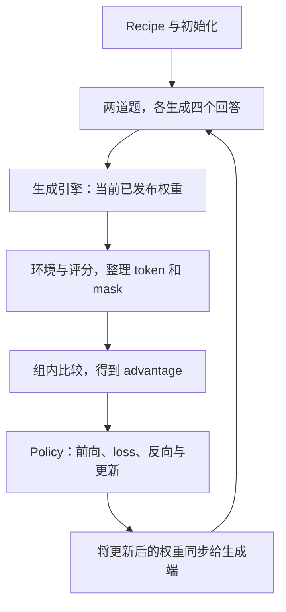

# 沿 NeMo RL 读一次训练

**中文** · [English](nemo-rl.en.md)

拿到一组模型回答以后，接下来怎么训练？先给它们评分，记录生成时的概率，并用掩码（mask）标出参与训练的位置，再计算损失（loss）、反向传播、更新参数。之后还有一步很容易漏掉：生成端要拿到新权重，下一批回答才会来自更新后的模型。

NeMo RL 把这些步骤组织起来，并让不同机器上的组件配合执行。下面阅读的是 [main 的 `1c40201` 快照](https://github.com/NVIDIA-NeMo/RL/tree/1c4020163a5523be4365de7fdeaa411770ecc589)（2026-10-30），先看标准 GRPO，再比较另外三条运行路径。这里是源码分析，没有运行训练或测量框架性能。

## 先沿标准 GRPO 跑一圈 {#one-update}

假设两道题，每道生成四个回答。为便于追踪，给它们编号 `q1/a1` 到 `q2/a4`，全部由 v10 生成。下面这些编号是教学示例，不是框架规定的字段名。

第一轮使用 v10；同步成功以后，下一轮由 v11 继续。下面逐步看各组件交接了什么，尤其是图中没有展开的对数概率（logprob）和运行状态。

### 第一步：把 recipe 变成实际对象

这里的 recipe 是组织一次实验的配置。[`run_grpo.py`](https://github.com/NVIDIA-NeMo/RL/blob/1c4020163a5523be4365de7fdeaa411770ecc589/examples/run_grpo.py)加载配置，初始化 Ray、分词器与数据，再调用 setup 创建策略、生成、损失计算和检查点等组件。

先记下训练后端（backend）、生成后端、是否同卡部署、数据面开关，以及选择了哪条异步路径。以后读到某项限制，就能判断它是否适用于自己的配置。例如 Single Controller 和旧版 async GRPO 走的是不同路径，不能用前者的选项解释后者。

### 第二步：把回答变成可训练的数据

文本先被转成 token ID，生成引擎再执行前向计算与采样。这段采样过程（rollout）还可能包含工具调用和环境返回。训练需要的不只是最终答案：还要知道哪些 token 是模型动作、哪些是工具输出，生成时的概率是多少，以及回答是否完整结束。

例如 `q1` 的四个奖励（reward）是 `[1, 0, 1, 0]`。只减去均值时得到 `[0.5, -0.5, 0.5, -0.5]`；完整算法还需指定标准化、KL 与 token 聚合方式。如果 `q1/a4` 尚未完成，就不能把先到的三个回答当成原本要收集的完整四个回答来归一化。

这里比较的是**同一道题的回答**。假设 `q2` 比较简单，四个回答全对，奖励都是 1，减去自己的组均值后都为 0。把两道题的八个回答一起算均值会改变这个结果，也改变了原本的比较对象。所以每条样本都要保留所属组的编号（group ID），不能只保存八个奖励数字。

多轮交互记录还要转换成训练序列。工具返回（tool observation）可以进入上下文，但通常不应被当作策略采样的动作，计入策略损失。序列长度对得上还不够，掩码也必须选中正确的位置。

### 第三步：把目标变成梯度

[标准主循环](https://github.com/NVIDIA-NeMo/RL/blob/1c4020163a5523be4365de7fdeaa411770ecc589/nemo_rl/algorithms/grpo.py#L3466)安排目标所需的对数概率、参考策略（reference）与优势（advantage）计算，再进入 `prepare_for_training` 和 `policy.train`。

[`Policy.train`](https://github.com/NVIDIA-NeMo/RL/blob/1c4020163a5523be4365de7fdeaa411770ecc589/nemo_rl/models/policy/lm_policy.py#L1005)把数据分发给工作进程（worker）。训练后端执行模型前向计算，将输出整理成损失函数所需的输入，再反向传播、更新参数。沿 [`prepare_loss_input`](https://github.com/NVIDIA-NeMo/RL/blob/1c4020163a5523be4365de7fdeaa411770ecc589/nemo_rl/algorithms/loss/loss_input.py#L199)可以检查预测与目标如何错开一位、掩码选中了哪里、概率是否与动作对齐；沿 [Automodel worker](https://github.com/NVIDIA-NeMo/RL/blob/1c4020163a5523be4365de7fdeaa411770ecc589/nemo_rl/models/policy/workers/automodel_policy_worker.py)可以继续看微批次、梯度处理和优化器。

训练端算的是**已经采样出的动作在当前模型下有多大概率**，不需要把答案再随机生成一遍。生成时记录的概率（behavior）、更新起点的概率（old）、当前参数下重新算出的概率（current），以及用于 KL 基准的参考策略，作用不同。即使它们来自同一模型的不同版本，也不能随意互换。

继续看 `q1/a1`：训练时回答文本不必变化，但用于计算损失的概率可能变化。

| 时刻 | 保留哪些记录 | 还要计算或更新什么 |
| --- | --- | --- |
| v10 生成回答 | token、生成时的概率、生成版本 | 环境执行结果与奖励 |
| 准备这组训练样本 | 同一份回答，归属 q1 | 组内优势、有效动作掩码、目标所需的其他概率 |
| 训练参数正在更新 | 回答和生成时的记录仍不变 | 用当前参数重新算这些动作的对数概率，并求梯度 |
| 更新并同步成功 | 历史样本仍注明来自 v10 | 下一轮生成使用 v11 |

这也是为什么不能在训练完成后，把旧样本上的版本号一并改成 v11：它记录的是样本怎么来的，不是当前服务的是哪个模型。

### 第四步：发布权重，不是只改一个版本号

参数更新成功以后，生成端仍可能持有 v10。同步权重时，要处理张量布局、分片、传输完成条件和缓存。若训练采用四路张量并行（TP=4），生成采用两路（TP=2），两边的分片方式不同；训练端 rank 0 持有的权重块，并不就是生成端 rank 0 所需的全部内容。

先看 [`WeightSynchronizer` 工厂](https://github.com/NVIDIA-NeMo/RL/blob/1c4020163a5523be4365de7fdeaa411770ecc589/nemo_rl/weight_sync/factory.py#L79)，再读它选择的具体传输实现。新权重到齐后，旧 KV 不一定还能用；尚未完成的请求怎样跨版本继续，要看这条运行路径的处理约定。

## 一次更新经过哪些组件？ {#flows}

| 职责 | 阅读入口 | 读源码时留意什么 |
| --- | --- | --- |
| 配置与入口 | `examples/run_*.py`、配置校验、setup | 配置项存在，不表示每个入口都会读取它 |
| 算法编排 | `grpo.py`、`grpo_sync.py`、`single_controller.py` | 算法目标与运行顺序不是同一层 |
| 训练执行 | `Policy`、Automodel / Megatron workers | 算出梯度，不等于优化器已经更新参数 |
| 生成与环境 | generation、rollout、environment | 区分模型采样的动作和环境返回的观察结果 |
| 通信与资源 | Ray、data plane、weight sync | 资源放置、传样本、传参数是三件事 |
| 状态管理 | checkpoint、replay recovery、监控 | 进程重新启动，不等于训练状态已经正确恢复 |

**控制流**决定何时调用哪个组件。**样本流**把 token、奖励、掩码和版本交给训练端。**参数流**把更新后的模型交回生成端。发出指令的主控进程（driver）不一定亲自中转大张量：它可能只传递元数据（metadata）和引用，而样本数据本体（payload）走另一条传输路径。

这里 Automodel、Megatron、vLLM 和 SGLang 承担不同的后端职责，不是四个可以随意互换的完整 RL 训练器。另一个容易混淆的词是 actor：在 Ray 中，它指有状态的进程对象；在 actor–critic 语境中，它指策略。

## 回到源码入口：先选对运行路径 {#paths}

前面的例子按标准同步路径理解。实际实验配置可能选择另一条路；只搜到一个叫 `train` 的函数，还不能说明当前配置会执行它。

| 运行方式 | 从哪里进入 | 样本怎样交给训练端 |
| --- | --- | --- |
| 标准同步 GRPO | `run_grpo.py` → `grpo_train` | 通过 legacy batch 路径分发 `BatchedDataDict` |
| 使用 TQ 的同步 GRPO | `run_grpo.py` → `select_sync_trainer` → `grpo_train_sync` | 数据面保存样本本体，训练侧通过元数据与引用访问 |
| 旧版 async GRPO | `run_grpo.py` → `async_grpo_train` | 后台收集轨迹，ReplayBuffer 按版本等条件向训练端提供样本 |
| Single Controller | `run_grpo_single_controller.py` → `SingleControllerActor` | rollout pump、TQ replay、sampler 与 train pump 协作 |

可以从[入口的分支](https://github.com/NVIDIA-NeMo/RL/blob/1c4020163a5523be4365de7fdeaa411770ecc589/examples/run_grpo.py#L193)和[同步 trainer 的选择](https://github.com/NVIDIA-NeMo/RL/blob/1c4020163a5523be4365de7fdeaa411770ecc589/nemo_rl/data_plane/factory.py#L37)核对前面三条；[Single Controller 文档](https://github.com/NVIDIA-NeMo/RL/blob/1c4020163a5523be4365de7fdeaa411770ecc589/docs/guides/single-controller.md)在这个版本明确标为 beta。

TQ 指 TransferQueue，这里的作用是搬运和管理训练样本。**用了 TQ 不等于训练异步；生成接口是 async，也不等于训练和采样已经重叠。** 后者要看运行时是否允许不同阶段同时推进，以及怎样处理策略滞后。

## 训练和生成后端，可以怎样组合？ {#compatibility}

下面列出所读快照中的几项限制，不代表所有受支持的组合，后续版本也可能变化。这里的 refit 指把更新后的权重装入生成后端。

| 想配置什么 | 该快照中的约束 | 源码依据 |
| --- | --- | --- |
| 选择训练后端 | `Policy` 要在 Automodel 与 Megatron 中启用一个 | [Policy 初始化](https://github.com/NVIDIA-NeMo/RL/blob/1c4020163a5523be4365de7fdeaa411770ecc589/nemo_rl/models/policy/lm_policy.py#L162) |
| 分离部署的 SGLang refit | 工厂分支要求训练侧使用 Megatron | [weight-sync 分支](https://github.com/NVIDIA-NeMo/RL/blob/1c4020163a5523be4365de7fdeaa411770ecc589/nemo_rl/weight_sync/factory.py#L190) |
| checkpoint-engine refit | 该分支只接通分离部署的 vLLM | [transport 校验](https://github.com/NVIDIA-NeMo/RL/blob/1c4020163a5523be4365de7fdeaa411770ecc589/nemo_rl/weight_sync/factory.py#L145) |
| Single Controller 同卡生成 | 同卡部署（colocated）只允许 Megatron；其他后端需要满足分离部署的约束 | [SC 配置校验](https://github.com/NVIDIA-NeMo/RL/blob/1c4020163a5523be4365de7fdeaa411770ecc589/nemo_rl/algorithms/single_controller_utils/config.py#L1292) |

这里的 checkpoint-engine 用于运行时权重传输，不等于把训练状态持久化保存为检查点。某个后端能加载模型，也不代表它与特定异步路径、精度和恢复功能已经全部兼容。

## 一组样本，什么时候才算用完了？ {#lifecycle}

Single Controller 的复杂之处不只在“开两个协程”。阅读 [`_train_pump`](https://github.com/NVIDIA-NeMo/RL/blob/1c4020163a5523be4365de7fdeaa411770ecc589/nemo_rl/algorithms/single_controller.py#L2965)时，带着下面的问题追每组数据：

| 状态变化 | 为什么需要这个边界 | 如果进程在这里失败 |
| --- | --- | --- |
| 为还在生成的组预留容量 | 上游不能无限生产 | 失败请求遗留的预留空间不能一直占着缓冲区 |
| 完整数据提交，可供选择 | 未完成的数据不能当完整组训练 | 恢复时要让样本数据与索引对应起来 |
| 采样器选中组，训练若干微批次 | 一次逻辑更新可以分多次计算 | 要知道梯度对应哪些组，不能提前记成已消费 |
| 优化器更新完成，释放消费状态 | 参数和消费位置应对得上 | 避免重复消费或跳过尚未更新的样本 |

这张表帮助读源码时分清各阶段，不能直接当作完整的恢复方案。实际还要看任务取消、容量释放、保存检查点时的同步屏障，以及失败如何通知其他组件。源码中的 `commit` 有时指样本已经可见，有时指参数更新完成，要看它提交的究竟是什么。

举个反例：模型已更新到 v11，但恢复时把消费位置退回 v10 之前，可能重复训练已经用过的组；反过来，消费位置已经前进，模型却恢复到旧参数，就可能漏掉一次更新。仅保存权重不够。具体恢复项见 [SC guide](https://github.com/NVIDIA-NeMo/RL/blob/1c4020163a5523be4365de7fdeaa411770ecc589/docs/guides/single-controller.md)，一般检查方法见[训练稳定性](training-stability.md#recovery)。

## 动手跟踪一条样本 {#exercise}

先选标准同步路径，用事件表跟踪 `q1/a1`：问题编号、生成版本、有效动作位置、奖励、进入训练的时刻、优化器更新步数、下一次生成可用的版本。然后只改变一个条件：第四个回答超时、一个工作进程未完成权重更新，或者一次检查点保存被中断。

不要急着给出“加个 retry”的答案。先回答：重试哪个阶段？会不会重复消费？是否仍有完整组？旧权重和 KV 还能不能使用？最后再去源码中找负责这件事的对象。

如果能把这条链说清楚，再比较 [verl / AReaL](../../06-systems/rl-systems.md#frameworks)就有了具体问题，而不只是比较项目介绍。进一步读[异步 RL 的概率与版本](../../06-systems/async-rl.md)和[训练稳定性](training-stability.md)。
