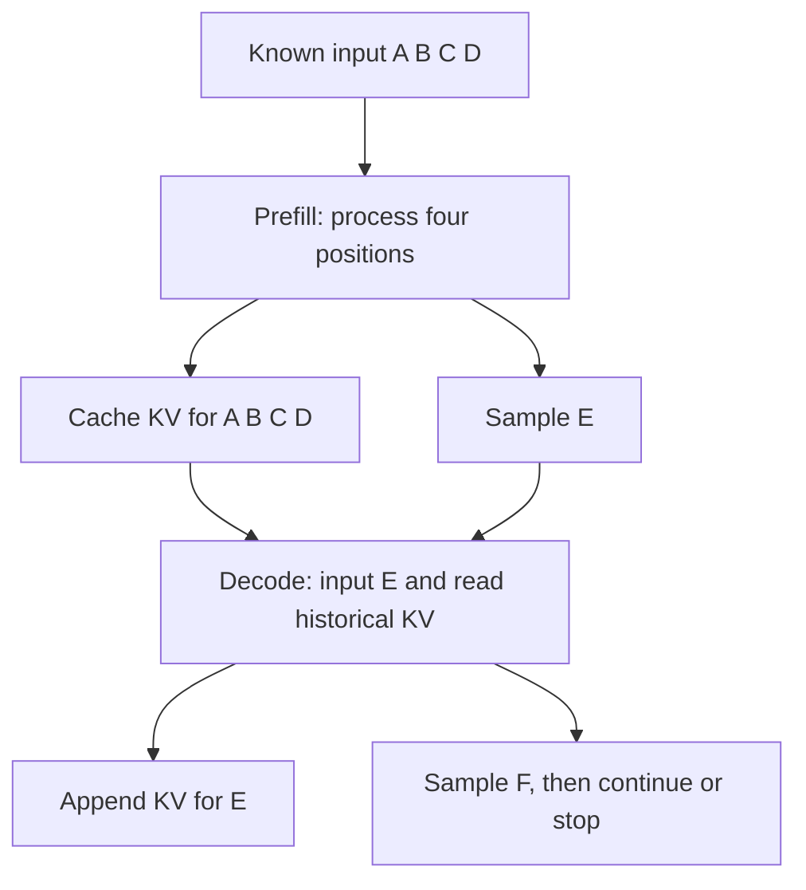

# One generation: from prefill and decode to engine scheduling

[中文](prefill-decode.md) · **English**

Why can a model process a long input together but still generate a short answer one token at a time? The input is already known; later outputs depend on earlier results. Following a very short request makes prefill, decode, and caching easier to distinguish.

Start with an ordinary causal Transformer: fixed weights, no speculative decoding, no early stopping, and no multimodal encoder. Once that path is clear, we can locate its state in vLLM and SGLang.

## Four inputs and three outputs: how many forwards? {#token-trace}

Let the prompt contain four tokens, `A B C D`, and let the model generate `E F G`.

| Phase | Input this step | Cached positions | New output |
| --- | --- | --- | --- |
| Prefill | A B C D | KV for A B C D | E |
| First decode | E | KV for A B C D E | F |
| Second decode | F | KV for A B C D E F | G |

Each new output is sampled from the last position's logits in that forward. KV means the keys and values retained by attention layers. The table lists their token positions rather than expanding every layer's tensors.

If the request ends after G, G needs no further forward. **Sampling E and computing E's KV happen at different times.** The output at D produces E's token ID; feeding E into the next forward creates E's own keys and values.

This example therefore takes one prefill and two decode forwards, not three decode forwards simply because there are three output tokens. These are not kernel counts: each forward contains many operations, and prefill can itself be chunked.

Now put the same request on a clock. Suppose queueing takes 40 ms, prefill takes 60 ms, and each subsequent decode takes 20 ms. Ignore tokenization, transport, and other overheads for this calculation:

| Time since submission | Work just completed | What the user sees |
| --- | --- | --- |
| 40 ms | Queueing ends; computation starts | No output yet |
| 100 ms | Prefill finishes; E is sampled | First token |
| 120 ms | E is processed; F is sampled | Second token |
| 140 ms | F is processed; G is sampled; request ends | Third token |

Time to first token (TTFT) is 100 ms, both subsequent output intervals are 20 ms, and end-to-end latency is 140 ms. Shorter queueing can make E appear sooner without shortening the wait between F and G. These hypothetical timings distinguish metrics; they are not engine measurements.

## Why is parallel prefill not looking into the future? {#causality}

All four input tokens are already given. Each layer can compute their projections together while a causal mask restricts attention: A cannot attend to B, and B cannot attend to C. Parallel computation over known positions does not grant access to future positions.

For one attention head, prefill has query length 4 and key/value length 4, with lower-triangular attention. At E, query length is 1 while key/value cover the four previous positions and E: five positions in total.

$$
o_t=\operatorname{softmax}\!\left(\frac{q_tK_{\leq t}^{\mathsf T}}{\sqrt{d}}\right)V_{\leq t}.
$$

Historical keys and values need not be projected again, but the new query still attends to the relevant historical keys and combines their values. KV caching **avoids recomputation; it does not eliminate long-context attention reads**. Sliding windows, sparse attention, and compressed states change which history is accessed and need separate analysis.

In training, the recorded answer is usually known too. A causal mask allows predictions at several answer positions in one forward, followed by label shifting and loss masking. This computes probabilities given prefixes; it is not free-running generation in a single forward. See the [KV cache derivation](../../00-foundations/deep-dives/kv-cache-and-inference.en.md) for more detail.

## Why can the bottleneck change on the same GPUs? {#cost}

Prefill processes many positions together, often producing larger matrix multiplications in linear layers. Small-batch decode advances only a few tokens per request while potentially reading substantial weights and historical KV. Prefill is therefore often better able to use compute capacity; decode can be limited by memory bandwidth or small-operation launch overhead.

That is a starting hypothesis, not a rule. Long-context attention, communication, MoE routing, a large decode batch, and CPU scheduling can change the bottleneck. Use this lower-bound intuition to ask what a step waits for, then profile it:

$$
T_{\mathrm{step}}\gtrsim\max\!\left(\frac{F}{P_{\mathrm{eff}}},\frac{M}{B_{\mathrm{eff}}}\right).
$$

F is the operation count, M the bytes moved, and the denominators are effective compute and bandwidth. Communication, launches, dependencies, and queues add costs. Substituting advertised hardware peaks does not produce a measured latency.

For a KV-only capacity example, take 32 layers, 8 KV heads, head dimension 128, and 2 bytes per element. Across all layers, one token requires:

$$
2\times32\times8\times128\times2=131072\ \text{bytes}=128\ \text{KiB}.
$$

Caching 4096 tokens requires 512 MiB; 16 requests of that cached length require 8 GiB. This excludes weights, block waste, and workspace, and assumes no cross-request sharing or device sharding. It is whole-model logical KV, not necessarily a per-GPU allocation. Layer types and implementation also matter. Changing the KV-head count changes this capacity: **an architectural choice such as GQA directly affects serving concurrency**.

## The scheduler sees unfinished work, not just sentences {#scheduling}

Suppose a step can compute 8 new token positions. Request A has just arrived with a 12-token prompt; B is already generating and needs one position advanced. One legal plan assigns B one position and A seven prefill positions. A then has five prompt positions left, while B can continue generating next round.

A cannot start answering after those seven positions: its full prompt has not been processed. It retains intermediate KV and continues with the remaining input next round. B already has its full prefix, so it can sample a new output now. **Sharing a batch does not mean doing the same kind of work.**

This is an illustrative schedule, not a policy any framework promises to use. Three constraints matter together:

- **Compute budget:** how many new positions fit, not merely how many requests.
- **Cache budget:** where those positions can be written; admitting more work without space may require preemption or waiting.
- **Latency goals:** a large uninterrupted prefill can stall ongoing output, while very small chunks add scheduling and execution overhead.

Continuous batching lets finished requests leave and new requests join. Chunked prefill splits a long input across iterations. They are related, not identical switches. P–D disaggregation is another choice: separate resource pools add KV transfer and two queues. See [inference deployment layouts](../../06-systems/inference-frameworks.en.md#deployment-map).

## Locate the work in vLLM and SGLang {#source-paths}

These links pin snapshots from 2026-10-30. The table follows ordinary generation; VLMs, speculative decoding, and specialized hardware backends add branches.

| Action to trace | vLLM | SGLang |
| --- | --- | --- |
| Collect state and advance an iteration | [EngineCore.step](https://github.com/vllm-project/vllm/blob/913fccd11847f5b4d4769e3a69c8925f955bc29e/vllm/v1/engine/core.py#L674) | [event_loop_normal](https://github.com/sgl-project/sglang/blob/dde1ef21a03da18fe226308fb27043013297e38e/python/sglang/srt/managers/scheduler.py#L2049), with a separate overlap path |
| Assign work to requests | [Scheduler.schedule](https://github.com/vllm-project/vllm/blob/913fccd11847f5b4d4769e3a69c8925f955bc29e/vllm/v1/core/sched/scheduler.py#L698) | [get_next_batch_to_run](https://github.com/sgl-project/sglang/blob/dde1ef21a03da18fe226308fb27043013297e38e/python/sglang/srt/managers/scheduler.py#L4014) |
| Turn the plan into model execution | [V2 execute_model](https://github.com/vllm-project/vllm/blob/913fccd11847f5b4d4769e3a69c8925f955bc29e/vllm/v1/worker/gpu/model_runner.py#L1790) | [Worker conversion from ScheduleBatch to ForwardBatch](https://github.com/sgl-project/sglang/blob/dde1ef21a03da18fe226308fb27043013297e38e/python/sglang/srt/managers/tp_worker.py#L626) |
| Find reusable prefixes | [KVCacheManager.get_computed_blocks](https://github.com/vllm-project/vllm/blob/913fccd11847f5b4d4769e3a69c8925f955bc29e/vllm/v1/core/kv_cache_manager.py#L266) | [RadixCache.match_prefix](https://github.com/sgl-project/sglang/blob/dde1ef21a03da18fe226308fb27043013297e38e/python/sglang/srt/mem_cache/radix_cache.py#L369) |

vLLM's scheduler tracks computed tokens and work still to advance; it does not require two entirely separate prefill and decode scheduling loops. EngineCore passes a plan to the executor, and the runner manages device-side state. The plan is not already the full collection of GPU input tensors.

SGLang's normal loop receives requests, chooses a batch, executes it, and processes results. `ScheduleBatch` has extend/decode preparation paths; the worker constructs `ForwardBatch` and calls the model runner. Overlap mode changes CPU/GPU overlap, so the normal-loop sequence is not a literal timing diagram for every configuration.

Cache lookup also has boundaries. This vLLM snapshot retains the need to recompute the final position for next-token logits; block alignment can enlarge that recomputation. SGLang's radix lookup considers an `extra_key` namespace as well as token IDs. **Identical text is not sufficient evidence of reusable state**, and radix trees are not its only cache backend. The original [PagedAttention](https://arxiv.org/abs/2309.06180) and [SGLang papers](https://arxiv.org/abs/2312.07104) explain the early designs; pinned source governs the behavior discussed here.

## Which optimizations can affect learning? {#learning}

A serving endpoint cares about answer quality, time to first token, and output intervals. An RL generation backend must also deliver samples whose training meaning is recoverable.

| Change | First serving-side effect | Additional training check |
| --- | --- | --- |
| Larger batches | Potentially higher throughput, potentially more waiting | Policy age and whether faster-finishing samples are preferentially consumed |
| Lower output limits | Requests finish sooner | Truncation rates, length distribution, and changed rewards |
| Different temperature or top-p | Different diversity and success rates | Which sampling distribution the logprob represents, and whether the objective matches it |
| Refreshed generation weights | A new model begins answering | Invalidated KV, in-flight requests, and version boundaries |

“The algorithm is unchanged” is not a substitute for verification. Even when the intended computation is equivalent, floating-point ordering can change samples near a decision boundary. Compare logits or logprobs on fixed inputs first, then generation statistics and downstream evaluation, rather than requiring every random answer to match exactly.

For example, reducing an output limit from 256 to 64 may reduce mean completion time. But an answer that needed token 65 is now truncated. If that becomes a low-reward training rollout, the feedback has changed too. Separate “generated less content” from “generated the same content faster.”

## Verify a small instance {#exercise}

Run the [small experiment](code/runtime_checks.py): it compares full causal attention with incremental KV computation, then deliberately allows future attention to demonstrate a mismatch. It also checks chunked execution over the same positions and the KV capacity arithmetic.

For a real engine, fix weights, tokenizer, input tokens, positions, precision, and sampling settings. Record cold/warm cache state, queue time, time to first token, output intervals, and complete request latency. Equal request counts do not imply equal token work; preserve the input/output length distribution when comparing schedules.

Next, connect generation to learning: [follow an update through NeMo RL](nemo-rl.en.md).
