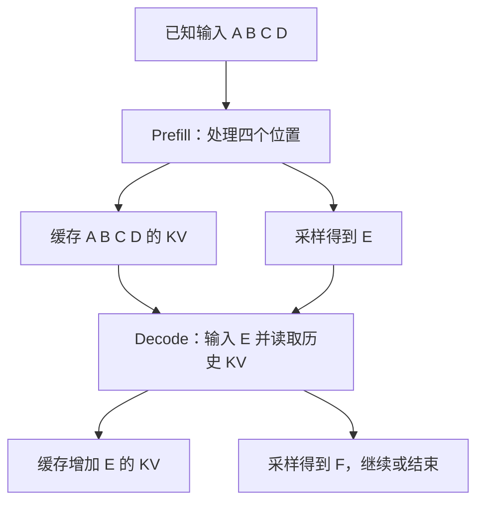

# 一次生成：从 prefill、decode 到引擎调度

**中文** · [English](prefill-decode.en.md)

输入很长，模型却能一起处理；回答明明很短，为什么还要一个 token 接一个 token 地生成？区别在于：输入已经给定，后面的输出还得等前面的结果。处理已知输入叫预填充（prefill），随后逐步生成叫解码（decode）。先跟一条很短的请求走一遍，就容易看清这两个阶段怎样配合缓存工作。

下面先看普通的因果 Transformer：不启用推测解码，不提前结束，权重固定，省略多模态编码。弄清这条路径，再到 vLLM 和 SGLang 的源码里找相应状态。

## 四个输入、三个输出，究竟算了几次？ {#token-trace}

把输入提示（prompt）记成四个 token：`A B C D`。模型接下来生成 `E F G`。

| 阶段 | 本轮输入 | 累计缓存 | 新输出 |
| --- | --- | --- | --- |
| 预填充 | A B C D | A B C D 的 KV | E |
| 第一次 decode | E | A B C D E 的 KV | F |
| 第二次 decode | F | A B C D E F 的 KV | G |

“新输出”这一列，每次都由本轮最后一个位置的 logits 采样得到。Logits 是模型给词表中各个 token 的未归一化分数。这里 KV 指各层注意力保存的键（key）和值（value）；表里只写它们对应哪些 token，不展开每层的张量。

得到 G 后如果请求结束，就不必再为 G 执行一次前向。**采样出 E，与计算 E 的 KV，是两个时刻。** 模型先根据 D 位置的输出选出 E；下一次把 E 输入模型，才会算出 E 自己的 KV。

所以这个例子是一次 prefill 加两次 decode，不是“生成三个 token 就必定做三次 decode”。这里数的是模型前向次数，不是 GPU 核函数（kernel）的执行次数：一次前向包含很多算子，prefill 本身也可能分块执行。

把时间也放进来会更直观。假设排队 40 ms，prefill 用 60 ms，后面两次 decode 各用 20 ms；为方便手算，忽略分词、传输和其他开销：

| 从提交请求开始 | 刚完成的事 | 用户能看到什么 |
| --- | --- | --- |
| 40 ms | 排队结束，开始计算 | 还没有输出 |
| 100 ms | Prefill 完成，采样 E | 第一个 token |
| 120 ms | 输入 E，采样 F | 第二个 token |
| 140 ms | 输入 F，采样 G，请求结束 | 第三个 token |

这时首 token 延迟（TTFT）是 100 ms，后续两次输出间隔都是 20 ms，整条请求耗时 140 ms。减少排队能让用户更早看到 E，却不一定缩短 F 和 G 之间的等待。这些是假设时间，用来区分指标，不代表任何引擎的速度。

## Prefill 能并行，为什么不算偷看答案？ {#causality}

输入四个 token 已经全部给定，每层可以一起计算它们的投影，再用因果掩码（causal mask）限制注意力范围：A 不能看 B，B 不能看 C。并行的是这些已知位置的计算，不是允许每个位置使用未来信息。

以单个注意力头为例，prefill 的查询（query）长度为 4，KV 长度也为 4；注意力矩阵只有下三角部分可用。轮到输入 E 时，查询长度为 1，KV 则覆盖已有四个位置和 E，共 5 个位置。

$$
o_t=\operatorname{softmax}\!\left(\frac{q_tK_{\leq t}^{\mathsf T}}{\sqrt{d}}\right)V_{\leq t}.
$$

历史 KV 不用反复做投影，但新的查询仍然要与它能看到的历史键计算注意力，再对相应的值加权求和。KV 缓存**省掉了重复投影，却没有省掉读取长上下文的开销**。滑动窗口、稀疏注意力或压缩状态会改变这里的访问范围，要另外分析。

训练时，数据中的回答通常也是已知的，所以可以在因果掩码下同时预测多个回答位置。计算损失时，要把预测与下一个 token 对齐（label shift），并通过损失掩码（loss mask）选出参与训练的位置。这里算的是给定前缀后的概率，不是在一次前向里自由生成完整回答。更详细的缓存推导见 [KV cache](../../00-foundations/deep-dives/kv-cache-and-inference.md)。

## 同一组 GPU，为什么两个阶段的瓶颈不同？ {#cost}

Prefill 同时处理多个位置，线性层通常能组成更大的矩阵乘法；小批量 decode 中，每条请求只推进少数 token，却可能需要读取大量权重和历史 KV。因此前者往往更容易用满算力，后者常受显存带宽或小算子启动开销限制。

这是排查时的初步判断，不是定律。长上下文注意力、多卡通信、MoE 路由、更大的解码批次和 CPU 调度都可能改变瓶颈。可以先估算：光是计算或搬运这些数据，至少需要多久？再用性能分析工具（profiler）验证：

$$
T_{\mathrm{step}}\gtrsim\max\!\left(\frac{F}{P_{\mathrm{eff}}},\frac{M}{B_{\mathrm{eff}}}\right).
$$

这里 F 是运算量，M 是需搬运的字节，另外两项是有效算力和有效带宽。真实时间还包含通信、启动、依赖与排队，不能直接代入硬件宣传的峰值就当实测。

举个只算 KV 容量的例子：32 层、8 个 KV 头、每个头的维度为 128、每个元素 2 字节。一个 token 在所有层的 KV 共占：

$$
2\times32\times8\times128\times2=131072\ \text{bytes}=128\ \text{KiB}.
$$

缓存 4096 个 token 就是 512 MiB；16 条请求都缓存这么长，合计 8 GiB。这里没有计入权重、缓存块内未用满的空间和计算临时空间，也未考虑跨请求共享或跨卡分片；算出的是整个模型所需的逻辑 KV 容量，不一定等于单卡分配量。实际容量还要看层类型与实现。改变 KV 头的数量会改变缓存量，说明 **GQA 这样的架构选择会直接影响系统并发能力**。

## 长输入和正在生成的回答，怎样一起调度？ {#scheduling}

假设本轮预算是 8 个待计算 token：请求 A 刚来，有 12 个 prompt token；B 已经在生成，只需推进 1 个 token。一种合法安排是给 B 1 个位置，给 A 的 prefill 7 个位置。下一轮 A 还剩 5 个 prompt 位置，B 则可以继续生成。

注意，A 算完前 7 个输入位置，还不能开始回答：它的完整问题尚未读完。这一轮留下的是中间 KV，下一轮从剩余输入继续。B 的前缀已经齐了，所以同一轮就能采样新的输出。**放进同一批处理，不代表两条请求都在做同一种工作。**

这只是教学调度，不是某框架保证采用的策略。它说明三个限制要一起满足：

- **计算预算**：一轮能处理多少新位置，而不只是能塞多少条请求。
- **缓存预算**：这些位置需要写到哪里；没有空间时，继续接请求可能需要抢占或等待。
- **延迟目标**：整块处理长输入，可能让正在输出的用户等太久；切得太碎又会增加调度和执行开销。

连续批处理允许已结束请求离开、新请求加入；分块预填充则允许长输入分几轮完成。二者相关但不是一个开关。P–D 分离又是另一件事：prefill 和 decode 放到不同资源池，还要支付 KV 转移和两个队列的成本，见[推理部署方式](../../06-systems/inference-frameworks.md#deployment-map)。

## 回到 vLLM 与 SGLang 的源码 {#source-paths}

以下链接固定到 2026-10-30 的快照。表里只跟普通生成路径，VLM、推测解码和专门硬件后端有额外分支。

| 想追的动作 | vLLM | SGLang |
| --- | --- | --- |
| 收集状态并推进一轮 | [EngineCore.step](https://github.com/vllm-project/vllm/blob/913fccd11847f5b4d4769e3a69c8925f955bc29e/vllm/v1/engine/core.py#L674) | [event_loop_normal](https://github.com/sgl-project/sglang/blob/dde1ef21a03da18fe226308fb27043013297e38e/python/sglang/srt/managers/scheduler.py#L2049)；另有 overlap 路径 |
| 给请求分配本轮工作 | [Scheduler.schedule](https://github.com/vllm-project/vllm/blob/913fccd11847f5b4d4769e3a69c8925f955bc29e/vllm/v1/core/sched/scheduler.py#L698) | [get_next_batch_to_run](https://github.com/sgl-project/sglang/blob/dde1ef21a03da18fe226308fb27043013297e38e/python/sglang/srt/managers/scheduler.py#L4014) |
| 把计划变成模型执行 | [V2 execute_model](https://github.com/vllm-project/vllm/blob/913fccd11847f5b4d4769e3a69c8925f955bc29e/vllm/v1/worker/gpu/model_runner.py#L1790) | [worker 将 ScheduleBatch 转为 ForwardBatch](https://github.com/sgl-project/sglang/blob/dde1ef21a03da18fe226308fb27043013297e38e/python/sglang/srt/managers/tp_worker.py#L626) |
| 查找可复用前缀 | [KVCacheManager.get_computed_blocks](https://github.com/vllm-project/vllm/blob/913fccd11847f5b4d4769e3a69c8925f955bc29e/vllm/v1/core/kv_cache_manager.py#L266) | [RadixCache.match_prefix](https://github.com/sgl-project/sglang/blob/dde1ef21a03da18fe226308fb27043013297e38e/python/sglang/srt/mem_cache/radix_cache.py#L369) |

vLLM 的 scheduler 用“已计算多少 token、还有多少需要推进”统一安排工作，并不要求把 prefill 和 decode 写成两个完全独立的调度循环。EngineCore 把计划交给 executor，runner 再处理设备侧状态；不要把计划结构误读成已经拼好的全部 GPU 输入。

SGLang 的普通循环先接收请求，再选 batch、执行和处理结果。`ScheduleBatch` 有 extend/decode 准备路径；worker 再构造 `ForwardBatch`，调用 model runner。Overlap 模式会调整 CPU/GPU 工作的重叠，不能把普通循环的顺序图直接当所有配置的逐时执行图。

缓存也有细节：这个 vLLM 快照的命中检查会为取得下一 token 的 logits 留出重算末位置的需要，块对齐还可能扩大重算范围。SGLang 的 radix 查找除了 token 序列，还考虑 `extra_key` 命名空间。**文本相同，不足以证明缓存可复用**；也不要把 radix 树理解成唯一的缓存后端。早期设计分别可看 [PagedAttention](https://arxiv.org/abs/2309.06180) 与 [SGLang 论文](https://arxiv.org/abs/2312.07104)，当前执行行为以固定源码为准。

## 哪些优化会进一步影响学习？ {#learning}

在线服务更关注回答质量、首 token 延迟和输出间隔；RL 的生成端还要留下足够的记录，让训练端知道每条回答是怎样采样出来的。

| 改动 | 服务侧首先看到 | 训练侧还要检查 |
| --- | --- | --- |
| 增大 batch | 吞吐可能提升，也可能多排队 | rollout 版本会不会更旧；是否只消费了更快完成的样本 |
| 减小输出上限 | 单请求更快结束 | 截断率、长度分布、奖励是否被改变 |
| 调整温度 / top-p | 输出多样性与成功率变化 | 记录的是哪个采样分布的对数概率（logprob），目标是否与之匹配 |
| 刷新生成权重 | 新模型开始提供回答 | 旧 KV 是否失效；在途请求和版本如何处理 |

不能因为只改了调度或缓存，就认定算法结果一定不变。即使数学上的计算相同，浮点运算的顺序也可能影响接近决策边界的采样。先比较固定输入的 logits 或对数概率，再比较生成统计和下游评估，比要求每条随机回答逐字相同更有用。

例如把输出上限从 256 降到 64，平均完成时间可能更短。但原本需要第 65 个 token 才给出答案的样本，现在会被截断。如果它们随后被当作低分 rollout 训练，模型收到的反馈已经变了。讨论这次改动时，需要把“少生成了多少内容”和“同样的内容生成得快了多少”分开。

## 自己验证一次 {#exercise}

运行[小实验](code/runtime_checks.py)，它会比较完整因果 attention 和逐 token KV 计算；再故意允许看未来，结果就不再一致。它还会检查同一批位置的分块计算，以及 KV 容量手算。

回到真实引擎，先固定权重、tokenizer、输入 token、位置、精度和采样参数。记录冷/热缓存、排队时间、首 token 延迟、输出间隔和完整请求耗时。等量的请求数不代表等量的 token 工作；比较两种调度时，要保留相同的输入输出长度分布。

下一篇把这条生成路径接到训练：[沿 NeMo RL 读一次更新](nemo-rl.md)。
